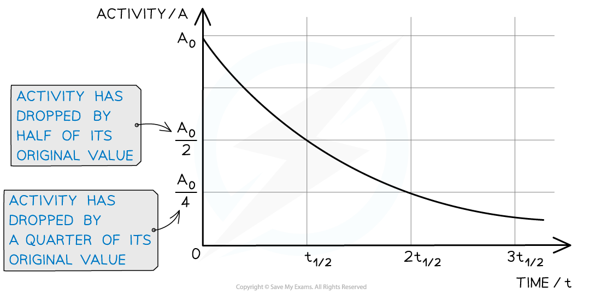

# Half-Life

## Half-Life Definition

> **Spec point** — `spcpt_Fg8kY3KqhdkzxgdT`

## Half-life definition

- Half-life is defined as:

**The time taken for the initial number of nuclei to reduce by half**

- This means that when a time equal to the half-life has passed, the activity of the sample will also halve
- This is because the activity is proportional to the number of undecayed nuclei, A ∝ N

#### Determining half-life from a graph

***When a time equal to the half-life passes, the activity falls by half, when two half-lives pass, the activity falls by another half (which is a quarter of the initial value)***

## Calculating Half-Life

> **Spec point** — `spcpt_MMQ7dKcFQVdnZW2W`

## Calculating half-life

- The half-life of a radioactive sample can be calculated using the equation:

$t_{1/2}=\frac{\mathrm{ln}2}{λ}$

- Where:

  - *t*½ = half-life of the sample (s)
  - *λ* = decay constant of the sample (s-1)

- This equation shows that:

  - the half-life and the decay constant of a sample are inversely proportional
  - the shorter the half-life, the larger the decay constant and the **faster** the rate of decay

### Derivation of the half-life equation

- To find an expression for half-life, start with the equation for *exponential decay*:

***N *****= *****N*****0****e****–*****λt***

- Where:

  - *N* = number of nuclei remaining in a sample
  - *N*0 = the initial number of undecayed nuclei (when t = 0)
  - *λ* = decay constant (s-1)
  - *t* = time interval (s)

- When time *t* is equal to the half-life t½, the activity *N* of the sample will be half of its original value, so *N* = ½ *N*0

$\frac{1}{2}N_{0}=N_{0}e^{-λt_{1/2}}$

- First, divide both sides by N0:

$\frac{1}{2}=e^{-λt_{1/2}}$

- Then, take the natural log of both sides:

$\ln ( 1 \frac{1}{2} ) = - \\lambda t_{1 \div 2}$

- Finally, apply the properties of logarithms:

$λt_{1/2}=\mathrm{ln}2$

- Therefore, half-life t½ can be calculated using the equation:

$t_{1 \div 2} = \frac{\ln 2}{\\lambda } \text{asymptotically} \text{equal} \text{to} \frac{0.693}{\\lambda }$

> **Worked Example**
> Strontium-90 is a radioactive isotope with a half-life of 28.0 years. A sample of strontium-90 has an activity of 6.4 × 109 Bq.
> 
> Calculate the decay constant λ, in s–1, of strontium-90.
> 
> **Answer: **
> 
> **Step 1: Convert the half-life into seconds**
> 
> 28 years = 28 × 365 × 24 × 60 × 60 = 8.83 × 108 s
> 
> **Step 2: Write the equation for half-life**
> 
> $t_{\frac{1}{2}}=\frac{\mathrm{ln}2}{λ}$
> 
> **Step 3: Rearrange for λ and calculate**
> 
> $λ=\frac{\mathrm{ln}2}{t_{\frac{1}{2}}}=\frac{\mathrm{ln}2}{8.83\times10^{8}}=7.85\times10^{-10}s^{-1}$
