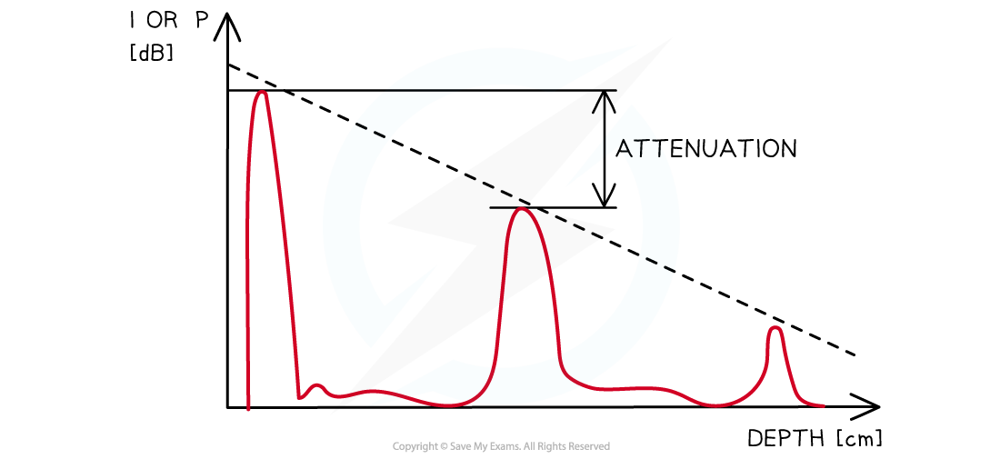

# Attenuation of Ultrasound in Matter

## Attenuation of Ultrasound in Matter

> **Spec point** — `spcpt_fPvD3TNRRrtVc666`

## Attenuation of ultrasound in matter

- Attenuation of ultrasound is defined as: **The reduction of energy due to the absorption of ultrasound as it travels through a material**
- The attenuation coefficient of the ultrasound is expressed in **decibels per centimetre** lost for every incremental increase in megahertz frequency

  - Generally, 0.5 dB cm–1 is lost for every 1 MHz

- The intensity I of the ultrasound decreases with distance *x*, according to the equation:

$I=I_{0}e^{-μx}$

- Where:

  - *I**0* = the intensity of the incident beam (W m-2)
  - *I* = the intensity of the reflected beam (W m-2)
  - *μ* = the absorption coefficient (m-1)
  - *x* = distance travelled through the material (m)

- The absorption coefficient *μ*, will vary from material to material
- Attenuation is not a major problem in ultrasound scanning as the scan relies on the **reflection **of the ultrasounds at the boundaries of materials

#### Intensity-depth graph showing attenuation

***When the intensity is expressed in decibels, the amplitudes of the echoes can be seen to decrease linearly***

> **Worked Example**
> The thickness *x* of the layer of fat on an animal, as shown in the diagram, is to be investigated using ultrasound.
> 
> 
> 
> The intensity of the parallel ultrasound beam entering the surface S of the layer of fat is $I$.
> 
> The beam is reflected from the boundary between fat and muscle.
> 
> The intensity of the reflected ultrasound detected at the surface S of the fat is $0.012I$.
> 
> | **Medium** | **Z / kg m****–2**** s****–1** | ***μ***** / m****–1** |
> |---|---|---|
> | Fat | 1.3 × 106 | 48 |
> | Muscle | 1.7 × 106 | 23 |
> 
> Using the information in the table, calculate:
> 
> (a) The intensity reflection coefficient at the boundary between the fat and the muscle.
> 
> (b) The thickness $x$ of the layer of fat.
> 
> **Answer:**
> 
> **Part (a)**
> 
> **Step 1: Write down the equation for intensity reflection coefficient *****α***
> 
> $\\alpha = \frac{( Z_{2} - Z_{1} )^{2} }{( Z_{2} + Z_{1} )^{2}}$
> 
> **Step 2: Calculate the intensity reflection coefficient**
> 
> $\\alpha = \frac{( 1.7 \times 10^{6} - 1.3 \times 10^{6} )^{2} }{( 1.7 \times 10^{6} + 1.3 \times 10^{6} )^{2}} = \frac{( 0.4 )^{2} }{( 3 )^{2}} = 0.018$
> 
> - This means that 0.018 of the intensity is reflected at the interface between fat and muscle
> - This reflected intensity will move back through the fat towards surface S
> 
> **Part (b)**
> 
> **Step 1: Write out the known quantities**
> 
> - The intensity of the ultrasound pulse is affected 3 times:
> 
>   - Attenuation from the surface S to the fat-muscle boundary
>   - Reflection at the boundary
>   - Attenuation from the boundary back to the surface S
> - After being transmitted in the fat, the intensity at surface S is given to be $0.012I$.
> - Therefore, the intensity is $0.018I$ at the fat-muscle boundary, and as the ultrasound moves through the fat, it gets attenuated and the new intensity at the surface S is now $0.012I$
> 
> incident intensity = intensity of the reflected pulse
> 
> $I_{0}=0.018Ie^{-μx}$
> 
> - Transmitted intensity = $0.012I$
> - Absorption coefficient, $μ$ = 48 m-1
> - Thickness of fat = $x$
> 
> **Step 2: Write out the equation for attenuation**
> 
> $I=I_{0}e^{-μx}$
> 
> **Step 3: Substitute in values for intensity and simplify**
> 
> $0.012 I = ( 0.018 I \times e^{- \\mu x} ) \times e^{- \\mu x}$
> 
> $0.012=0.018e^{-2μx}$
> 
> **Step 4: Rearrange and take the natural log of both sides**
> 
> $\frac{0.012}{0.018}=e^{-2μx}$
> 
> $\ln ( \frac{0.012}{0.018} ) = - 2 \\mu x$
> 
> **Step 5: Rearrange and calculate the thickness***** x***
> 
> $x = \frac{\ln ( \frac{0.012}{0.018} ) }{- 2 \\mu } = \frac{\ln ( \frac{0.012}{0.018} ) }{- 2 \times 48} = 4.22 \times 10^{- 3} \mathrm{m} = 0.42 \text{cm}$

> **Exam Hint**
> The intensity equation will not be provided for you on your exam datasheet, so make sure you remember this!
