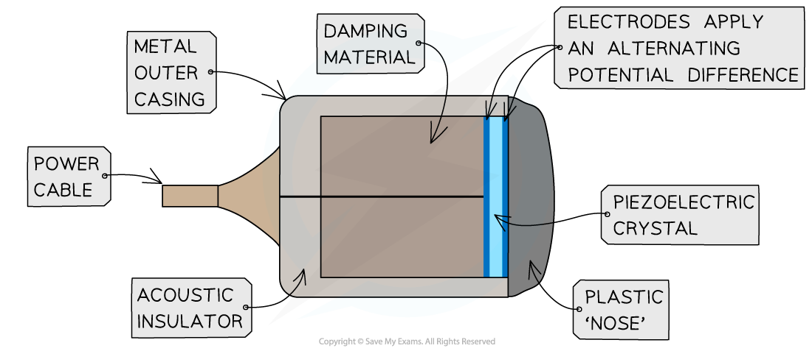
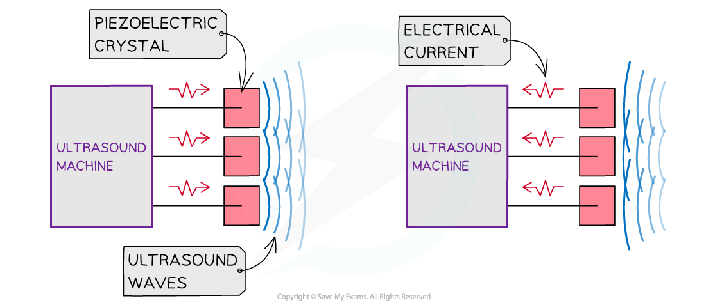
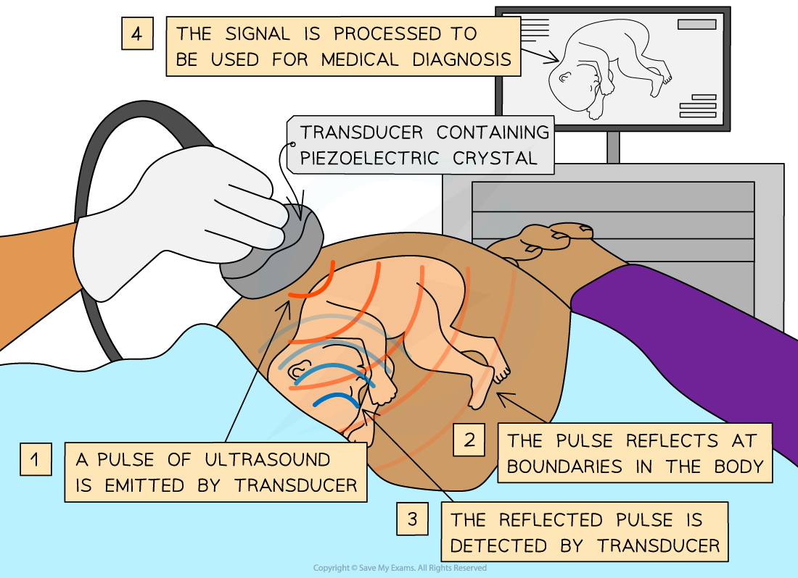

# Generating & Using Ultrasound

## Generating Ultrasound

> **Spec point** — `spcpt_qrvQfxjsTMZFd2VS`

## Generating ultrasound

- An ultrasound is defined as: **A high frequency sound above the range of human hearing**
- This is above 20 kHz, although in medical applications the frequencies can be up to the MHz range
- An ultrasound transducer is made up of a piezoelectric crystal and electrodes which produce an alternating p.d.
- The crystal is heavily *damped*, usually with epoxy resin, to stop the crystal from vibrating too much

  - This produces short pulses and increases the *resolution* of the ultrasound device

#### An ultrasound transducer

***The structure of an ultrasound transducer***

- A piezoelectric crystal can act as both a receiver or transmitter of ultrasound

  - When it is **receiving** ultrasound, it converts the sound waves into an alternating p.d.
  - When it is **transmitting** ultrasound, it converts an alternating p.d. into sound waves

#### An ultrasound machine with a piezoelectric crystal

***A piezoelectric crystal can act as both a receiver or transmitter of ultrasound***

> **Worked Example**
> Explain the principles of the generation and detection of ultrasound waves.
> 
> **Answer:**
> 
> **Step 1: Explain the principles of the generation of ultrasound**
> 
> - An alternating p.d. is applied across a piezo-electric crystal, causing it to change shape
> - The alternating p.d. causes the crystal to vibrate and produce ultrasound waves
> - The crystal vibrates at the frequency of the alternating p.d., so, the crystal must be cut to a specific size in order to produce resonance
> 
> **Step 2: Explain the principles of detection of ultrasound**
> 
> - When the ultrasound wave returns, the crystal vibrates which produces an alternating p.d. across the crystal
> - This received signal can then be processed and used for medical diagnosis

## Using Ultrasound in Medical Imaging

> **Spec point** — `spcpt_JBVNMgYsD25PTPsX`

## Using ultrasound in medical imaging

- In an ultrasound scanner, the transducer sends out a beam of sound waves into the body
- The sound waves are reflected back to the transducer by boundaries between tissues in the path of the beam

  - For example, the boundary between fluid and soft tissue or tissue and bone

- When these echoes hit the transducer, the transducer **vibrates**, which generates electrical signals that are sent to the ultrasound scanner

  - Using the speed of sound and the time of each echo’s return, the scanner calculates the distance from the transducer to the tissue boundary
  - These distances can be used to generate two-dimensional images of tissues and organs

- The ultrasound gives two main pieces of information about the boundary:

  - **Depth**: the time between transmission and receipt of the pulse (the time delay)
  - **Nature**: the amount of transmitted intensity received (will vary depending on the type of tissue)

- The frequency of the ultrasound is important because:

  - The higher the **frequency **of the ultrasound, the higher the resolution
  - The higher the **resolution**, the smaller the details of structures that can be distinguished

#### Ultrasound scan

***Using ultrasound to obtain information about an unborn child***

> **Worked Example**
> Explain the main principles behind the use of ultrasound to obtain diagnostic information about internal body structures.
> 
> **Answer:**
> 
> **Step 1: Describe the journey of an ultrasound pulse**
> 
> - A pulse of ultrasound is emitted by the piezo-electric crystal in the transducer
> - The pulse is reflected by the boundary between two media
> - The reflected pulse is detected by the ultrasound transmitter
> 
> **Step 2: Explain how the reflected ultrasound pulse is used**
> 
> - The signal is then processed and displayed on the screen for the healthcare worker to analyse and use for medical diagnosis
> - The **intensity of the reflection** gives information about the nature of the boundary
> - The time between transmission and receipt of the pulse (**the time delay**) gives information about the depth of the boundary

> **Exam Hint**
> 6 mark exam questions about this topic are very common, make sure you practice writing about using and detecting ultrasounds in full, coherent sentences with correct spelling and grammar. Writing short or vague answers could lose you marks, as well as misspelling words!
