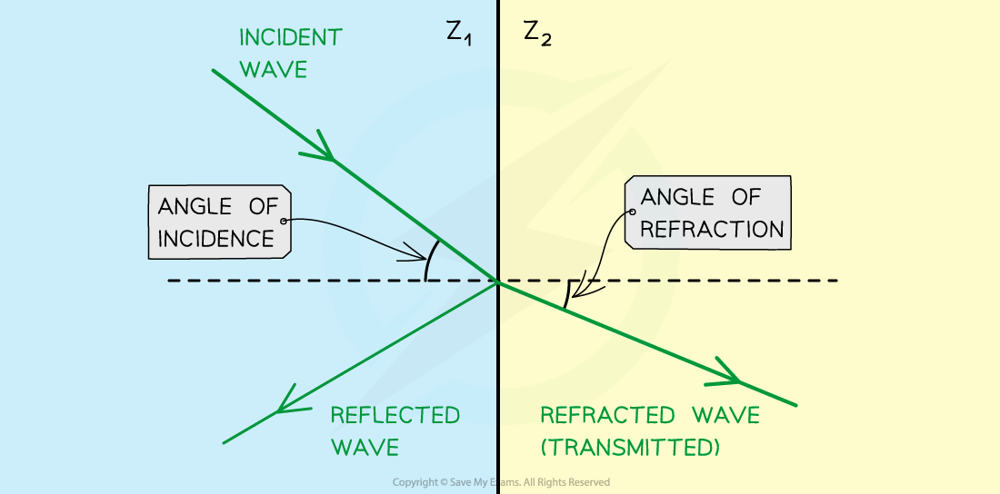

# Specific Acoustic Impedance

## Specific Acoustic Impedance

> **Spec point** — `spcpt_nY7wjsTq6vGyGnnN`

## Specific acoustic impedance

- The **acoustic impedance**, Z, of a medium is defined as: **The product of the speed of the ultrasound in the medium and the density of the medium**
- This quantity describes how much resistance an ultrasound beam encounters as it passes through a tissue
- Acoustic impedance can be calculated using the equation:

$Z=ρc$

- Where:

  - *Z *= acoustic impedance (kg m-2 s-1)
  - *ρ *= the density of the material (kg m-3)
  - *c* = the speed of sound in the material (m s-1)

- This equation tells us:

  - The **higher** the density of a tissue, the **greater** the acoustic impedance
  - The **faster** the ultrasound travels through the material, the **greater** the acoustic impedance also

- This is because sound travels faster in **denser** materials

  - Sound is **fastest** in solids and **slowest** in gases
  - This is because the **closer** the particles in the material, the faster the vibrations can move through the material

- At the boundary between media of different acoustic impedances, some of the wave energy is **reflected** and some is **transmitted**
- The greater the **difference** in acoustic impedance between the two media, the greater the reflection and the smaller the transmission

  - Two materials with the same acoustic impedance would give no reflection
  - Two materials with a large difference in values would give much larger reflections

- Air has an acoustic impedance of* Z*air = 400 kg m-2 s-1
- Skin has an acoustic impedance of* Z*skin = 1.7 × 106 kg m-2 s-1

  - The large difference means ultrasound would be significantly reflected, hence a coupling gel is necessary
  - The coupling gel used has a similar Z value to the skin, meaning that very little ultrasound is reflected

#### Light travelling through two materials with different acoustic impedance

***Refraction and reflection of ultrasound waves at a boundary between two materials with different acoustic impedances (in this case, Z******1****** < Z******2 ******)***

> **Worked Example**
> The table shows the speed of sound acoustic impedance in four different materials.
> 
> | **medium** | **speed of ultrasound / m s****–1** | **acoustic impedance / kg m****–2**** s****–1** |
> |---|---|---|
> | air | 330 | 4.3 × 102 |
> | gel | 1500 | 1.5 × 106 |
> | soft tisuse | 1600 | 1.6 × 106 |
> | bone | 4100 | 7.0 × 106 |
> 
> Use this information to calculate the value for the density of bone.
> 
> **Answer:**
> 
> **Step 1:** **Write down known quantities**
> 
> - Acoustic impedance of bone, *Z* = 7.0 × 106 kg m-2 s-1
> - Speed of ultrasound in bone, *c* = 4100 m s-1
> 
> **Step 2: Write out the equation for acoustic impedance**
> 
> $Z=ρc$
> 
> **Step 3: Rearrange for density and calculate**
> 
> $ρ=\frac{Z}{c}=\frac{7.0\times10}{4100}=1700\mathrm{kg}m^{-3}$

> **Exam Hint**
> A common mistake is to confuse the *c* in the acoustic impedance equation for the speed of light - don’t do this!
