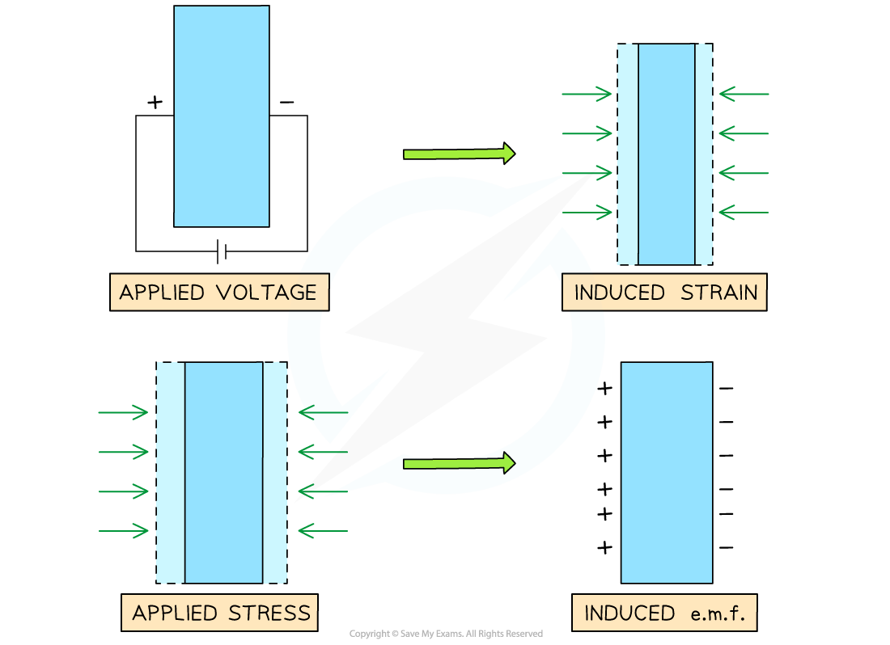
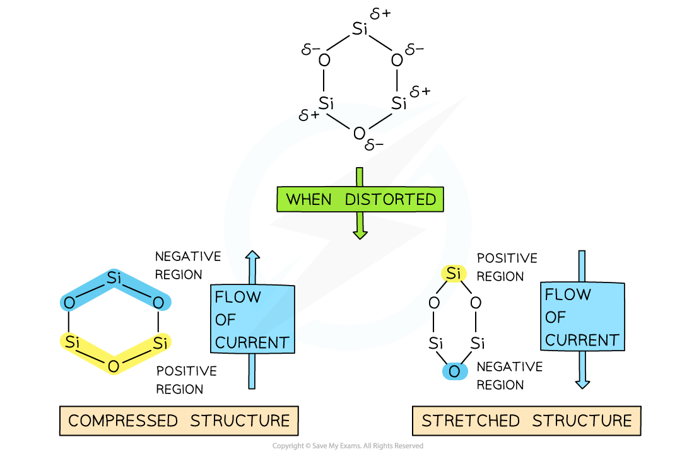

# The Piezoelectric Transducer

## The Piezoelectric Transducer

> **Spec point** — `spcpt_233K2JrxmqtKBSRg`

## The piezoelectric transducer

- The piezoelectric effect is defined as: **The ability of particular materials to generate a potential difference (p.d.) by transferring mechanical energy to electrical energy**
- A **transducer** is any device that converts energy from one form to another

#### The piezoelectric effect

***In the piezoelectric effect, an applied voltage causes a piezo-crystal to contract or expand, and vice versa***

### Piezoelectric Crystals

- At the heart of a piezoelectric transducer is a **piezoelectric crystal**
- Piezoelectric crystals are materials which produce an *e.m.f* when they are deformed

  - This deformation can be by compression or stretching

- If a p.d. is applied to a piezoelectric crystal, then it deforms, and if the p.d. is reversed, then it expands

  - If this is an alternating p.d. then the crystal will vibrate at the same frequency as the alternating voltage
  - Crystals must be cut to a certain size in order to induce *resonance*

- One of the most common piezoelectric crystals is **quartz**, which is made from a lattice of silicon dioxide atoms

  - When the lattice is distorted, the structure becomes charged creating an electric field and, as a result, an electric current
  - If an electric current is applied to the crystal, then this causes the shape of the lattice to alternate which produces a sound wave
  - Due to the conventional direction of electric current, it will flow from the positive to the negative region of the crystal

#### A molecule in a quartz crystal

***When the compression and stretching alternates, an alternating e.m.f. is induced***

### Applications of the Piezoelectric Transducer

- **Microphone**

  - A piezoelectric microphone detects pressure variations in sound waves
  - These can then be converted to an electrical signal for processing
- **Ultrasound**

  - In a piezoelectric transducer, an alternating p.d. is applied to produce ultrasound waves and sent into the patient’s body
  - The returning ultrasound waves induce a p.d. in the transducer for analysis by a healthcare professional
