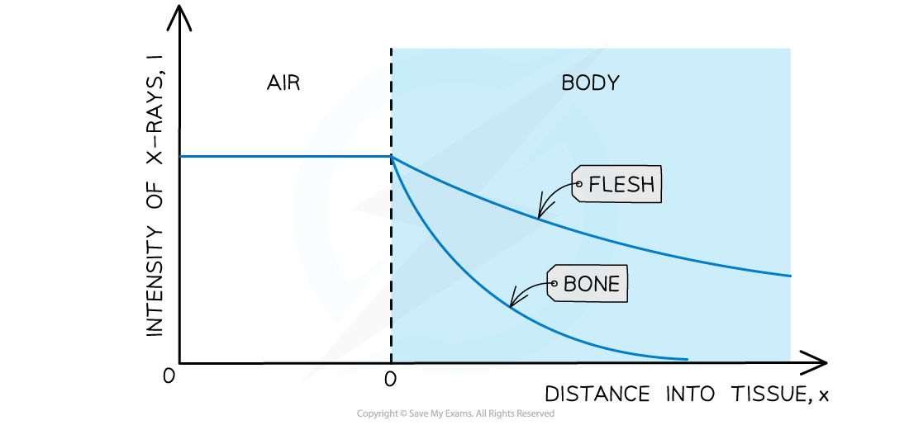

# Attenuation of X-rays in Matter

## Attenuation of X-rays in Matter

> **Spec point** — `spcpt_nbftvYdVbW9jS2Sq`

## Attenuation of X-rays in matter

- Bones **absorb** X-ray radiation

  - This is why they appear white on the X-ray photograph

- When the collimated beam of X-rays passes through the patient’s body, some of the photons are **absorbed** and **scattered**
- The attenuation of X-rays can be calculated using the equation:

$I=I_{0}e^{-μx}$

- Where:

  - *I**0* = the intensity of the incident beam (W m-2)
  - *I* = the intensity of the emergent beam (W m-2)
  - *μ* = the linear absorption coefficient (m-1)
  - *x* = distance travelled through the material (m)

- The attenuation coefficient also depends on the energy of the X-ray photons
- The intensity of the X-ray *decays exponentially*
- The thickness of the material that will reduce the X-ray beam or a particular frequency to half its original value is known as the **half thickness**

#### Intensity-distance graph of X-rays for air and body

***Absorption of X-rays by different materials***

> **Worked Example**
> A student investigates the absorption of X-ray radiation in a model arm. A cross-section of the model arm is shown in the diagram.
> 
> 
> 
> Parallel X-ray beams are directed along the line MM and along the line BB. The linear absorption coefficients of the muscle and the bone are 0.20 cm-1 and 12 cm-1 respectively.
> 
> Calculate the ratio:
> 
> $\frac{\mathrm{intensity} \mathrm{of} \mathrm{emergent}x-\mathrm{ray} \mathrm{beam} \mathrm{from} \mathrm{model}}{\mathrm{intensity} \mathrm{of} \mathrm{incident}x-\mathrm{ray} \mathrm{beam} \mathrm{on} \mathrm{model}}$
> 
> for a parallel X-ray beam directed along the line
> 
> (a) MM
> 
> (b) BB
> 
> and state whether the X-ray images are sharp, or have good contrast.
> 
> **Answer:**
> 
> **Part (a)**
> 
> **Step 1: **Write out the known quantities
> 
> - Linear absorption coefficient for muscle, μ = 0.20 cm-1
> - Distance travelled through the muscle, x = 8.0 cm
> 
> **Step 2: Write out the equation for attenuation and rearrange**
> 
> $I=I_{0}e^{-μx}$
> 
> $\frac{\mathrm{intensity} \mathrm{of} \mathrm{emergent}x-\mathrm{ray} \mathrm{beam} \mathrm{from} \mathrm{model}}{\mathrm{intensity} \mathrm{of} \mathrm{incident}x-\mathrm{ray} \mathrm{beam} \mathrm{on} \mathrm{model}}=\frac{I}{I_{0}}=e^{-μx}$
> 
> **Step 3: Substitute in values and calculate the ratio**
> 
> `I over I subscript 0 space equals space e to the power of negative open parentheses 0.20 space cross times space 8 close parentheses end exponent space equals space 0.2`
> 
> **Part (b)**
> 
> **Step 1: Write out the known quantities**
> 
> - Linear absorption coefficient for muscle, *μ*m = 0.20 cm-1
> - Linear absorption coefficient for bone, *μ*b = 12 cm-1
> - Distance travelled through the muscle, *x*m = 4.0 cm
> - Distance travelled through the bone, *x*b = 4.0 cm
> 
> **Step 2:** **Write out the equation for attenuation for two media and rearrange**
> 
> $\frac{I}{I_{0}}=e^{-μ_{m}x_{m}}\timese^{-μ_{b}x_{b}}$
> 
> **Step 3:** **Substitute in values and calculate the ratio**
> 
> `I over I subscript 0 space equals space e to the power of negative open parentheses 0.20 space cross times space 4 close parentheses end exponent space cross times space e to the power of negative open parentheses 12 space cross times space 4 close parentheses end exponent space equals space 6.4 space cross times space 10 to the power of negative 22 end exponent space almost equal to space 0`
> 
> **Step 4: Write a concluding statement**
> 
> - Each ratio gives a measure of the amount of transmission of the beam
> - A** good contrast** is when:
> - there is a large difference between the intensities
> 
>   - the ratio is much less than 1.0
> 
> - Therefore, both images have a good contrast
