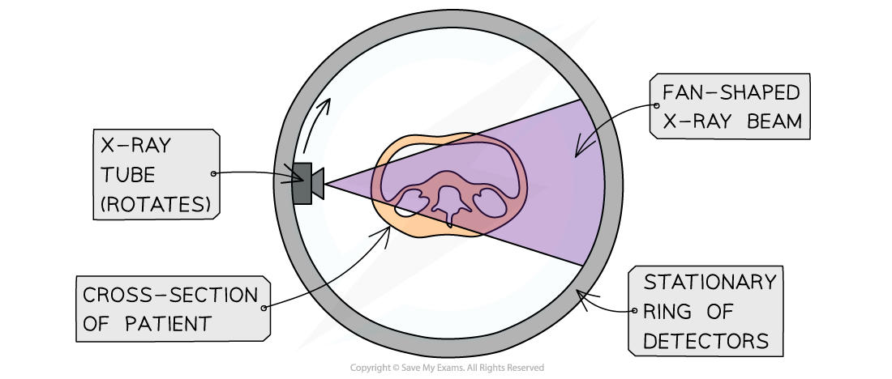

# Computed Tomography Scanning

## Computed Tomography Scanning

> **Spec point** — `spcpt_sqh4YFgRyS7hz75Q`

## Computed tomography scanning

- A simple X-ray image can provide useful, but limited, information about internal structures in a 2D image
- When a more comprehensive image is needed, a **computerised axial tomography** (CAT or CT) scan is used
- The main features of the operation of a CT scan are as follows:

  - An X-ray tube rotates around the stationary patient
  - A CT scanner takes X-ray images of the **same slice**, at many different angles
  - This process is **repeated**, then images of successive slices are combined together
  - A computer pieces the images together to build a **3D image**
  - This 3D image can be **rotated** and viewed from different angles

#### CAT scan diagram

***CAT scans take 2D images from multiple positions to create a 3D image***

### Advantages & Disadvantages of CAT Scans

- **Advantages **of CAT scanners:

  - They produce images of much higher resolution (compared to a single X-ray image)
  - They can distinguish between tissues with similar attenuation coefficients
  - They produce a 3D image of the body by combining the images taken in each direction

- **Disadvantages** of CAT scanners:

  - The patient receives a much higher radiation dose than a normal X-ray
  - There are possible side effects from the contrast media

> **Worked Example**
> An X-ray image is taken of the skull of a patient. Another patient has a CT scan of his head.
> 
> By reference to the formation of the image in each case, suggest why the exposure to radiation differs between the two imaging techniques.
> 
> **Answer:**
> 
> **Step 1: Describe how an image is formed from a simple X-ray scan**
> 
> - The simple X-ray image involves taking a single exposure
> - This produces a single 2D image
> 
> **Step 2: Describe how an image is formed from a CT scan**
> 
> - The CT scan requires taking several exposures of a slice from many different angles
> - This is then repeated for different slices before being combined together to build a 3D image
> 
> **Step 3: Suggest why the exposure to radiation differs**
> 
> - The resolution provided by a CT scan means the exposure to the patient is much greater than if they had a simple X-ray scan
