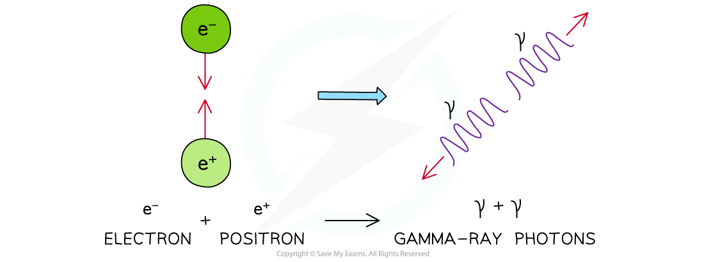
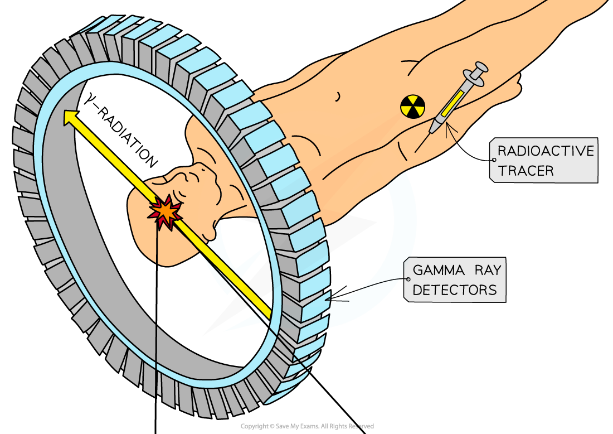
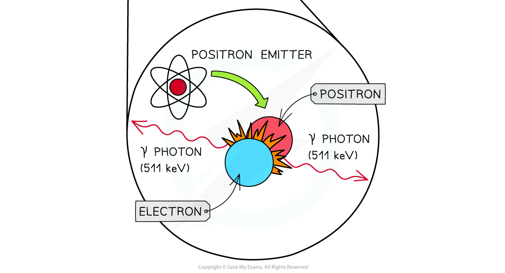

# Annihilation in PET Scanning

## The Process of Annihilation

> **Spec point** — `spcpt_c8KJgbBwWSnzYMK8`

## The process of annihilation

- When a positron is emitted from a tracer in the body, it travels less than a millimetre before it collides with an electron
- The positron and the electron will **annihilate**, which means

  - their mass is converted into energy
  - two gamma rays are produced and move apart in opposite directions

- Annihilation doesn’t just happen with electrons and positrons, it can occur between any particle and its **antimatter **counterpart
- Annihilation is defined as: **When a particle meets its equivalent antiparticle they are both destroyed and their mass is converted into energy**
- As with any collision, mass, energy and momentum are always **conserved**

#### Annihilation between an electron and positron

***When a positron and electron annihilate, their mass is converted into two gamma-ray photons***

## Positron Emission Tomography (PET) Scanning

> **Spec point** — `spcpt_c4c5ZMhqc3ppJnbY`

## Positron emission tomography (PET) scanning

- Once the tracer is introduced to the body it has a **short *****half-life***, so, it begins emitting positrons (*β**+*) immediately

  - This allows for a short exposure time to the radiation
  - A short half-life does mean the patient needs to be scanned quickly and not all hospitals have access to expensive PET scanners

- In PET scanning:

  - Positrons are emitted by the decay of the tracer
  - They travel a small distance and annihilate when they interact with electrons in the tissue
  - This *annihilation* produces a pair of gamma-ray photons which travel in opposite directions

#### PET scan

***Annihilation of a positron and an electron is the basis of PET Scanning***
