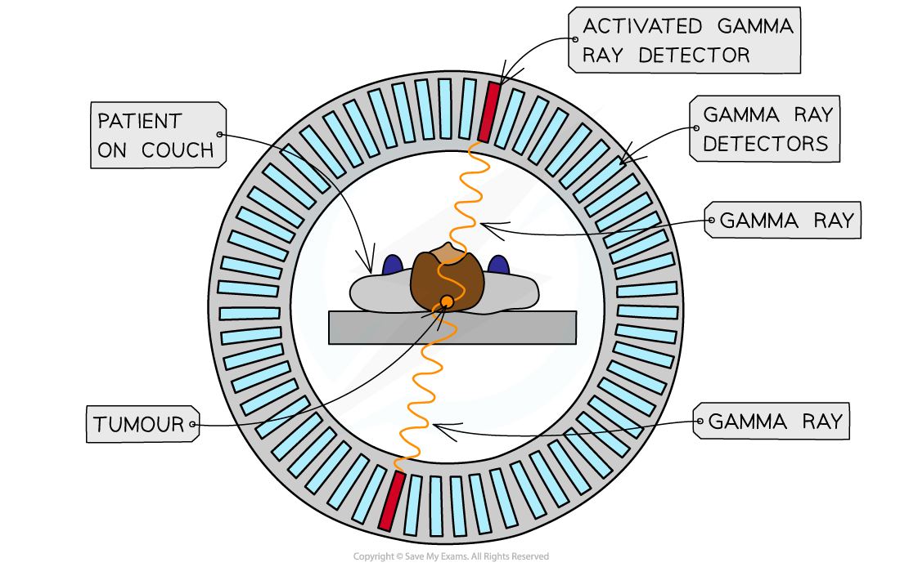

# Detecting Gamma-Rays from PET Scanning

## Calculating Energy of Gamma-Ray Photons

> **Spec point** — `spcpt_Tnmbf6Bxd329pYn8`

## Calculating energy of gamma-ray photons

- In the *annihilation* process, mass, energy and momentum are conserved
- The gamma-ray photons have an energy and frequency that is determined solely by the mass-energy of the positron-electron pair
- The energy of a photon is given by:

$E=hf=m_{e}c^{2}$

- The momentum of a photon is given by

$p=\frac{E}{c}$

- Where:

  - *m*e = *mass of the electron* or positron (kg)
  - *h* = *Planck's constant* (J s)
  - *f* = frequency of the photon (Hz)
  - *c* = the *speed of light* in a vacuum (m s**–**1)

> **Worked Example**
> Fluorine-18 decays by β+ emission. The positron emitted collides with an electron and annihilates producing two γ-rays.
> 
> (a) Calculate the energy released when a positron and an electron annihilate.
> 
> (b) Calculate the frequency of the γ-rays emitted.
> 
> (c) Calculate the momentum of one of the γ-rays.
> 
> **Answer:**
> 
> **Part (a)**
> 
> **Step 1: Write down the known quantities**
> 
> - Mass of an electron = mass of a positron, *m**e* = 9.11 × 10–31 kg
> - Total mass is equal to the mass of the electron and positron = 2*m**e*
> 
> **Step 2: Write out the equation for mass-energy equivalence**
> 
> $E=m_{e}c^{2}$
> 
> **Step 3: Substitute in values and calculate energy**
> 
> `E space equals space 2 space cross times space open parentheses 9.11 space cross times space 10 to the power of negative 31 end exponent close parentheses space cross times space open parentheses 3.0 space cross times space 10 to the power of 8 close parentheses squared space equals space 1.6 space cross times space 10 to the power of negative 13 end exponent space straight J`
> 
> **Part (b)**
> 
> **Step 1: Determine the energy of one photon**
> 
> - Planck's constant, *h* = 6.63 × 10−34 J s
> - Two photons are produced, so, the energy of one photon is equal to half of the total energy from part (a):
> 
> $E=\frac{1.6\times10^{-13}}{2}=0.8\times10^{-13}J$
> 
> **Step 2: Write out the equation for the energy of a photon**
> 
> $E=hf$
> 
> **Step 3: Rearrange for frequency and calculate**
> 
> $f=\frac{E}{h}=\frac{0.8\times10^{-13}}{6.63\times10^{-34}}=1.2\times10^{20}\mathrm{Hz}$
> 
> **Part (c)**
> 
> **Step 1: Write out the equation for the momentum of a photon**
> 
> $p=\frac{E}{c}$
> 
> **Step 2: Substitute in values and calculate momentum**
> 
> $p=\frac{E}{c}=\frac{0.8\times10^{-13}}{3.0\times10^{8}}=2.7\times10^{-22}Ns$

## Detecting Gamma-Rays from PET Scanning

> **Spec point** — `spcpt_SpNwbzVdVm94RBGr`

## Detecting gamma-rays from PET scanning

- The patient lays stationary in a tube surrounded by a ring of detectors
- Images of slices of the body can be taken to show the position of the **radioactive tracers**
- The detector consists of two parts:

  - A crystal *scintillator*
  - A *photomultiplier*

### Crystal scintillator

- When the gamma-ray (*γ*-ray) photon is incident on a crystal, an electron in the crystal is excited to a higher energy state
- As the excited electron travels through the crystal, it excites more electrons
- When the excited electrons move back down to their original state, the lost energy is transmitted as visible light photons

### Photomultiplier

- The photons produced by the scintillator are very faint
- Therefore, they need to be amplified and converted to an electrical signal by a photomultiplier tube

#### PET scanner

***Detecting gamma rays with a PET scanner***

### Creating an image from PET scanning

- The *γ* rays travel in straight lines in opposite directions when formed from a positron-electron *annihilation*

  - This is due to the **conservation of momentum**

- They hit the detectors in a line – known as the **line of response**
- The tracers will emit lots of *γ* rays simultaneously, and the computers will use this information to create an image
- The more photons formed at a particular point, the more tracer that is present in the tissue being studied, and this will appear as a bright point on the image
- An image of the **tracer concentration** in the tissue can be created by **processing the arrival times** of the gamma-ray photons
