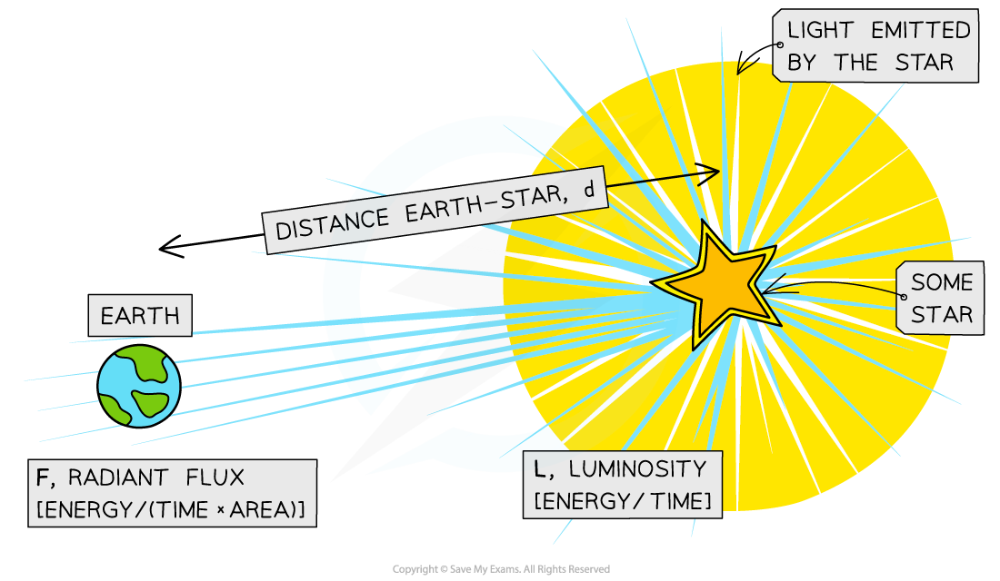
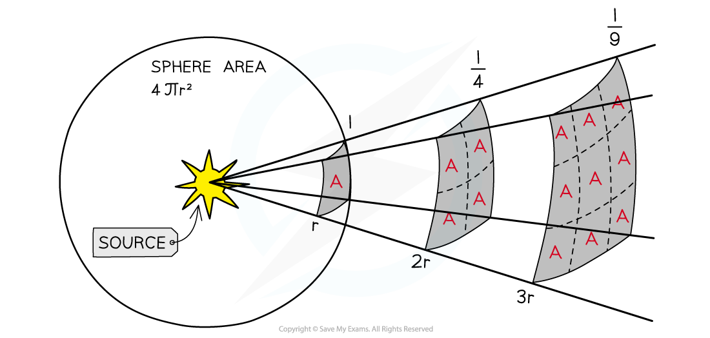

# Luminosity & Radiant Flux

## Defining Luminosity

> **Spec point** — `spcpt_y9PMcXG4Cx5jv2Vd`

## Defining luminosity

- Luminosity is defined as: **The total power output of radiation emitted by a star**
- It is measured in units of watts (W)
- Radiant flux intensity is defined as: **The observed amount of intensity, or the radiant power transmitted normally through a surface per unit of area, of radiation measured on Earth**
- The difference between luminosity and radiant flux is:

  - luminosity is the total radiation that **leaves** the star
  - radiant flux intensity is the amount of radiation **measured on Earth**
  - by the time the radiation reaches the Earth, it will have spread out a great deal, therefore, it will only be a fraction of the value of the luminosity

#### Luminosity and radiant flux of a star

***The luminosity is the total power output of the star, whereas the radiant flux is what is measured on Earth***

## Inverse Square Law of Flux

> **Spec point** — `spcpt_QFVt366tdYxp46tS`

## Inverse square law of flux

- Light sources which are further away appear fainter because the light it emits is spread out over a greater area
- The moment the light leaves the surface of the star, it begins to spread out uniformly through a spherical shell

  - The surface area of a sphere is equal to $4πr^{2}$

- The radius *r* of this sphere is equal to the distance *d* between the star and the Earth
- By the time the radiation reaches the Earth, it has been spread over an area of $4πd^{2}$
- The **inverse square law of flux** can therefore be calculated using:

$F=\frac{L}{4πd^{2}}$

- Where:

  - *F* = radiant flux intensity, or observed intensity on Earth (W m-2)
  - *L* = luminosity of the source (W)
  - *d* = distance between the star and the Earth (m)

- This equation assumes:

  - The power from the star radiates uniformly through space
  - No radiation is absorbed between the star and the Earth

- This equation tells us:

  - For a given star, the luminosity is constant
  - The radiant flux follows an inverse square law
  - The greater the radiant flux (larger *F*) measured, the closer the star is to the Earth (smaller *d*)

#### The inverse square law of flux

***Inverse square law; when the light is twice as far away, it has spread over four times the area, hence the intensity is four times smaller***

> **Worked Example**
> A star has a known luminosity of 9.7 × 1027 W. Observations of the star show that the radiant flux intensity of light received on Earth from the star is 114 nW m–2.
> 
> Determine the distance of the star from Earth.
> 
> **Answer:**
> 
> **Step 1: Write down the known quantities**
> 
> - Luminosity, *L* = 9.7 × 1027 W
> - Radiant flux intensity, *F* = 114 nW m–2 = 114 × 10–9 W m–2
> 
> **Step 2: Write down the inverse square law of flux**
> 
> $F=\frac{L}{4πd^{2}}$
> 
> **Step 3: Rearrange for distance *****d*****, and calculate**
> 
> $d = \sqrt{ \frac{L}{4 \mathrm{\pi } F} } = \sqrt{ \frac{9.7 \times 10^{27}{4 \mathrm{\pi } \times ( 114 \times 10^{-9} } )} }$
> 
> $d$* *= 8.2 × 1016 m
