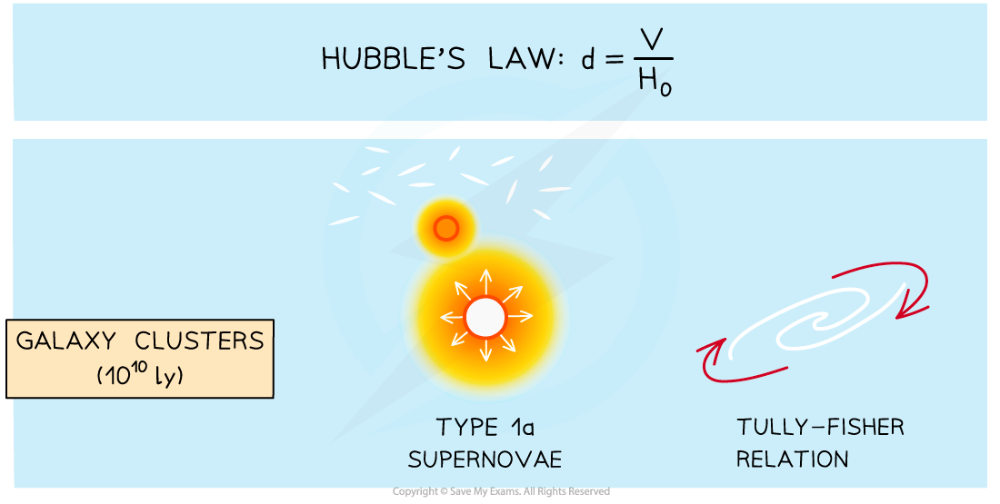
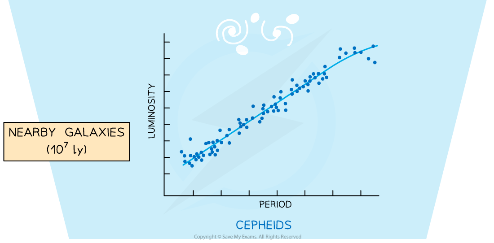
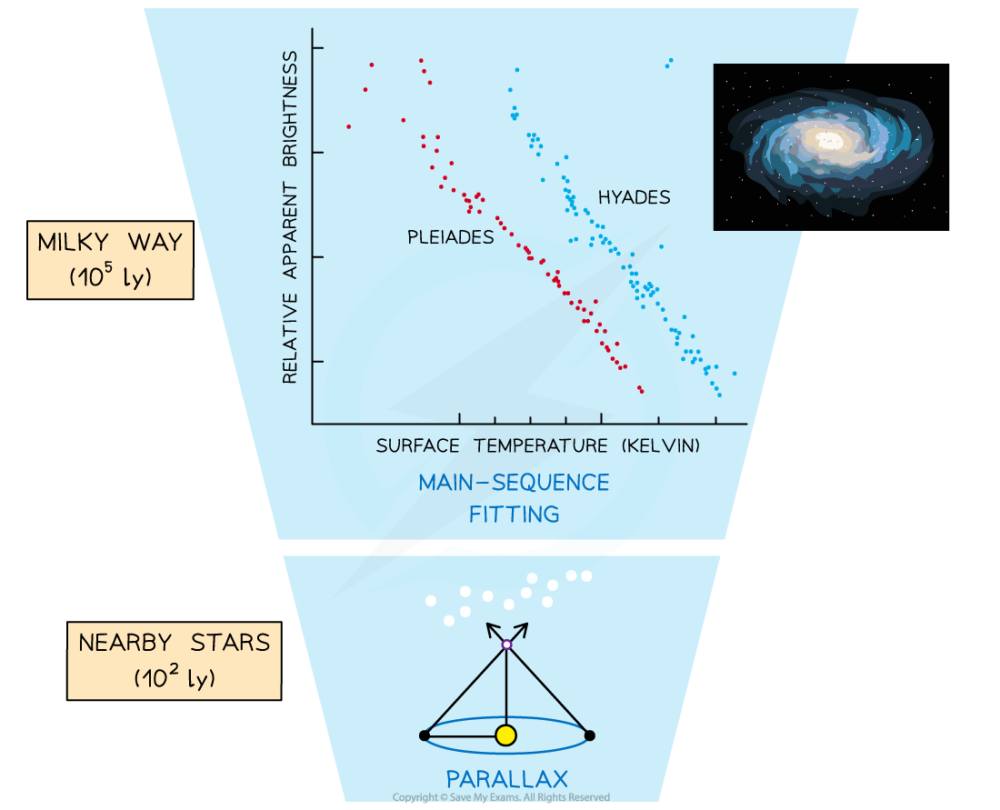
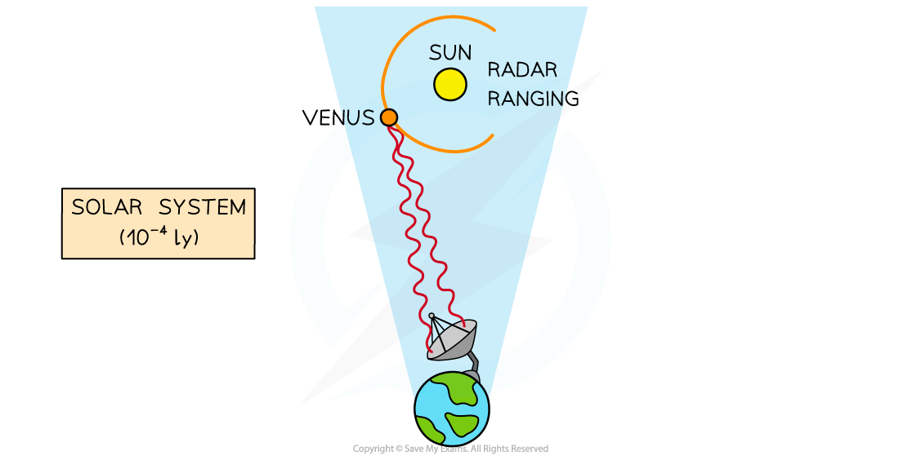

# Standard Candles & Stellar Distances

## Standard Candles

> **Spec point** — `spcpt_BhZGFTbw6Pv5bCsr`

## Standard candles

- A standard candle is defined as: **An astronomical object which has a known luminosity due to a characteristic quality possessed by that class of object**
- Examples of standard candles include:

  - **cepheid variable stars**
  - **type 1a supernovae**

### Cepheid variable stars

- A cepheid variable is a type of pulsating star which increases and decreases in brightness over a set time period
- This variation has a well-defined relationship to the luminosity

### Type 1a supernovae

- A type 1a *supernova* is an explosion involving a white dwarf
- The peak luminosity of the explosion is always the same

## Using Standard Candles as a Distance Indicator

> **Spec point** — `spcpt_9fCqBXrtwsqDJ4YK`

## Using standard candles as a distance indicator

- Measuring astronomical distances accurately is an extremely difficult task

  - A **direct **distance measurement, e.g. using parallax measurements, is only possible if the object is close enough to the Earth
  - For more distant objects, **indirect **methods must be used e.g. using standard candles

- If the *luminosity* of a source is known, then the distance can be estimated based on how bright it appears from Earth

  - Astronomers measure the *radiant flux intensity*, of the electromagnetic radiation arriving at the Earth
  - Since the luminosity is known (as the object is a standard candle), the distance can be calculated using the *inverse square law of flux*

- Each standard candle method can measure distances within a certain range
- Collating the data and measurements from each method allows astronomers to build up a larger picture of the scale of the universe

  - This is known as the **cosmic distance ladder**

#### Cosmic distance ladder

***A combination of methods involving standard candles allows astronomers to build up a cosmic distance ladder from nearby stars to distant galaxies***

> **Worked Example**
> Cepheid variable stars and type 1a supernovae are both used by astronomers as standard candles.
> 
> (a) Explain how standard candles are used to determine distances to galaxies.
> 
> (b) Suggest why type 1a supernovae are more suitable than Cepheid variable stars to determine distances to the most distant galaxies.
> 
> **Answer:**
> 
> **Part (a)**
> 
> **Step 1: State what is meant by a standard candle**
> 
> - A standard candle is an object of known luminosity
> 
> **Step 2: Identify the quantities required to calculate distance**
> 
> - The inverse square law of flux is:
> 
> $F=\frac{L}{4πd^{2}}$
> 
> - Where:
> 
>   - *F* = radiant flux intensity of an object in the galaxy
>   - *L* = luminosity of an object in the galaxy
>   - *d* = distance to the object in the galaxy
> 
> **Step 3: Explain how the distance to a galaxy is determined**
> 
> - A standard candle in the galaxy of interest is identified
> - The standard candle's radiant flux intensity (i.e. its observed brightness on Earth) is measured
> - Using this and its known luminosity, the distance to the standard candle (and, therefore, galaxy) is calculated using the inverse square law of flux
> 
> **Part (b)**
> 
> **Step 1: Identify how each object is used as a standard candle**
> 
> - A Cepheid variable star is an object whose radius varies periodically, and this period of variation is related to its luminosity
> - A type 1a supernova is an explosive outburst of a binary pair containing a white dwarf and another star. The peak luminosity of the explosion reaches the same value each time
> 
> **Step 2: Suggest why the type 1a supernova can be used to measure greater distances**
> 
> - A type 1a supernova has a much greater luminosity than a Cepheid variable star
> - As a result, the radiant flux intensity (observed brightness) of a type 1a supernova is much greater
> - Therefore, type 1a supernovae are more likely to be observed and measured in the most distant galaxies
