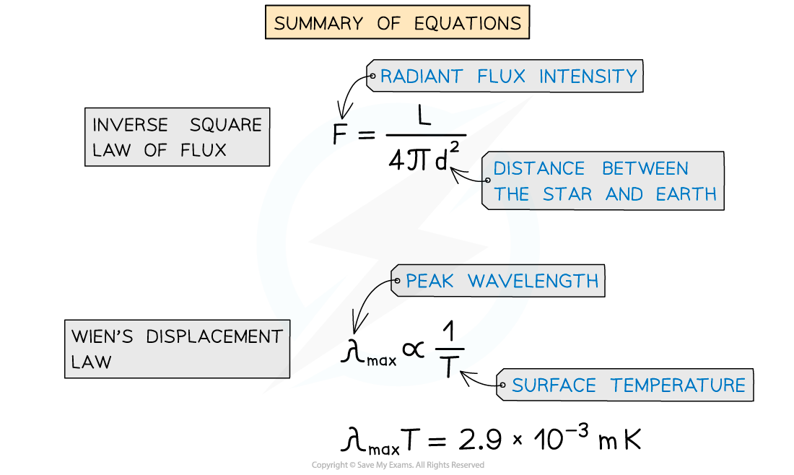
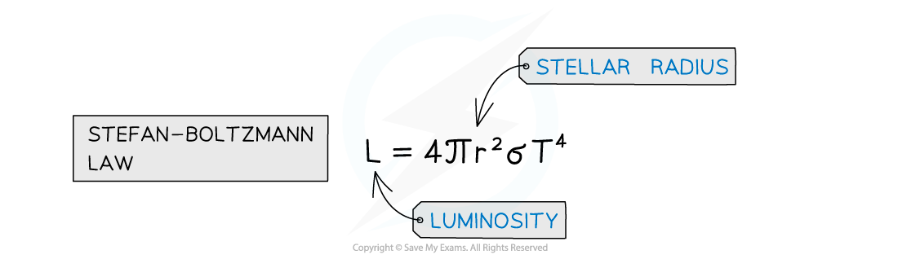

# Stefan-Boltzmann Law & Stellar Radii

## Stefan-Boltzmann Law

> **Spec point** — `spcpt_62gJHmjtHV4Y3hQS`

## Stefan-Boltzmann law

- A star’s **luminosity **depends on its:

  - surface temperature
  - radius

- The relationship between these is known as the **Stefan-Boltzmann law**, which states: **The total energy emitted by a black body per unit area per second is proportional to the fourth power of the absolute temperature of the body**
- It is equal to:

$L=4πr^{2}σT^{4}$

- Where:

  - *L* = *luminosity* of the star (W)
  - *r* = radius of the star (m)
  - σ = the *Stefan-Boltzmann constant*
  - *T* = surface temperature of the star (K)

## Estimating the Radius of Stars

> **Spec point** — `spcpt_PCPQp4QCCVYpdpPd`

## Estimating the radius of stars

- The radius of a star can be estimated by combining Wien’s displacement law and the Stefan–Boltzmann law
- The procedure for this is as follows:

  - Use Wien’s displacement law to find the surface temperature of the star
  - Use the *inverse square law of flux* equation to find the luminosity of the star (if given the radiant flux and stellar distance)
  - Then, use the Stefan-Boltzmann law to calculate the radius of the star

> **Worked Example**
> Betelgeuse is our nearest red giant star.
> 
> It has a luminosity of 4.49 × 1031 W and emits radiation with a peak wavelength of 850 nm.
> 
> Calculate the ratio of the radius of Betelgeuse *r**B* to the radius of the Sun *r**s*.
> 
> Radius of the sun *r*s = 6.95 × 108 m.
> 
> **Answer:**
> 
> **Step 1: Write down Wien’s displacement law**
> 
> $λ_{max}T=2.9\times10^{-3}mK$
> 
> **Step 2: Rearrange Wien’s displacement law to find the surface temperature of Betelgeuse**
> 
> $T=\frac{2.9\times10^{-3}}{λ_{max}}=\frac{2.9\times10^{-3}}{850\times10^{-9}}=3410K$
> 
> **Step 3: Write down the Stefan-Boltzmann law**
> 
> $L=4πr^{2}σT^{4}$
> 
> **Step 4: Rearrange for r and calculate the stellar radius of Betelgeuse**
> 
> $r_{B} = \sqrt{ \frac{L}{4 \mathrm{\pi } \\sigma T^{4} } = \sqrt{ \frac{4.49 \times 10^{31} }{4 \mathrm{\pi } \times ( 5.67 \times 10^{-8} } ) \times ( 3410 )^{4} } } = 6.83 \times 10^{11} \mathrm{m}$
> 
> **Step 5:** **Calculate the ratio** $\frac{r_{B}}{r_{s}}$
> 
> $\frac{r_{B}}{r_{s}}=\frac{6.83\times10^{11}}{6.95\times10^{8}}=983$
> 
> - Therefore, the radius of Betelgeuse is about 1000 times larger than the Sun’s radius
