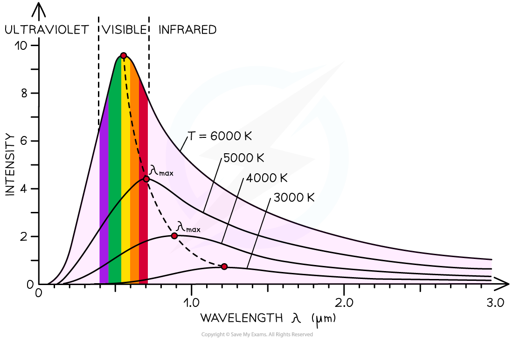

# Wien's Displacement Law

## Wien's Displacement Law

> **Spec point** — `spcpt_7SZzbW6ZrpXF4MrR`

## Wien's displacement law

- Wien’s displacement law relates the observed wavelength of light from a star to its surface temperature, it states: **The black body radiation curve for different temperatures peaks at a wavelength which is inversely proportional to the temperature**
- This relation can be written as:

$λ_{max}\propto\frac{1}{T}$

- Where

  - $λ_{max}$ = the maximum wavelength emitted by the star at the peak intensity (m)
  - $T$ = thermodynamic temperature at the surface of the star (K)

- A black body is an object which:

  - absorbs all the radiation that falls on it, and is also a good emitter
  - does not reflect or transmit any radiation
- A black-body is a theoretical object, however, stars are the best approximation there is
- The radiation emitted from a black-body has a characteristic spectrum that is determined by the temperature alone

***The intensity-wavelength graph shows how thermodynamic temperature links to the peak wavelength for four different stars***

- The constant of proportionality in Wien's law is given by

$λ_{max}T=2.9\times10^{-3}mK$

- This equation tells us the higher the temperature of a body:

  - the shorter the wavelength at the peak intensity
  - the greater the intensity of the radiation at each wavelength

- This means that **hotter** stars tend to be **white or blue** and **cooler** stars tend to be **red or yellow**

#### Table to compare surface temperature and star colour

| **Colour of star** | **Temperature / K** |
|---|---|
| blue | > 33 000 |
| blue-white | 10 000 – 30 000 |
| white | 7500 – 10 000 |
| yellow-white | 6000 – 7500 |
| yellow | 5000 – 6000 |
| orange | 3500 – 5000 |
| red | < 3500 |

> **Worked Example**
> The spectrum of the star Rigel in the constellation of Orion peaks at a wavelength of 263 nm, while the spectrum of the star Betelgeuse peaks at a wavelength of 828 nm.
> 
> Which of these two stars is cooler, Betelgeuse or Rigel?
> 
> **Answer:**
> 
> **Step 1:** **Write down Wien’s displacement law**
> 
> $λ_{max}T=2.9\times10^{-3}mK$
> 
> **Step 2: Rearrange for temperature *****T***
> 
> $T=\frac{2.9\times10^{-3}}{λ_{max}}$
> 
> **Step 3:** **Calculate the surface temperature of each star**
> 
> Rigel: $T=\frac{2.9\times10^{-3}}{λ_{max}}=\frac{2.9\times10^{-3}}{263\times10^{-9}}=11026=11000K$
> 
> Betelgeuse: $T=\frac{2.9\times10^{-3}}{λ_{max}}=\frac{2.9\times10^{-3}}{828\times10^{-9}}=3502=3500K$
> 
> **Step 4:** **Write a concluding sentence**
> 
> - Betelgeuse has a surface temperature of 3500 K, therefore, it is much cooler than Rigel
> 
> 
> 
> ***The Orion Constellation; cooler stars, such as Betelgeuse, appear red or yellow, while hotter stars, such as Rigel, appear white or blue***

> **Exam Hint**
> Note that the temperature used in Wien’s Law is in **Kelvin** (K). Remember to convert from oC if the temperature is given in degrees in the question before using the Wien’s Law equation.
