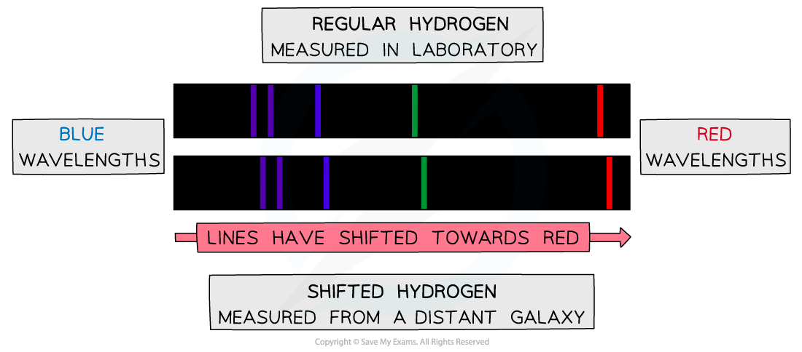

# Emission Spectra

## Emission Spectra

> **Spec point** — `spcpt_2yMS3Cb674dK5T73`

## Emission spectra

- Astronomers are very limited in how they can investigate objects in space
- All of the techniques used involve analysing the light emitted from the star, or galaxy
- One of these techniques involves analysing the** emission **and** absorption spectra** of stars

  - More details on this can be found in the revision note on [Line Spectra](https://www.savemyexams.com/a-level/physics/cie/25/revision-notes/22-quantum-physics/22-4-energy-levels-in-atoms-and-line-spectra/line-spectra/)

- Elements in the star, predominantly hydrogen and helium, absorb some of the emitted wavelengths
- Therefore, characteristic lines are present when the spectrum is analysed

#### Redshift on an emission spectrum

***The top emission spectrum shows spectral lines of hydrogen measured on Earth. The bottom emission spectrum show the shifted spectral lines of hydrogen measured from a distant galaxy***

- When astronomers observe light from distant galaxies, they observe differences in the spectral lines to the light from the Sun
- The lines have the same characteristic pattern, meaning the element can still be easily identified, they just appear to be shifted slightly

  - The lines in the spectra from distant galaxies show an **increase in wavelength**
  - The lines are moved, or shifted, towards the** red end of the spectrum**
