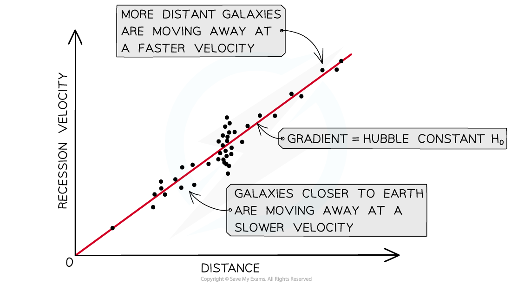

# Hubble's Law & the Big Bang Theory

## Hubble's Law & the Big Bang Theory

> **Spec point** — `spcpt_dVY3QqFb5fmpWQKs`

## Hubble's law & the Big Bang theory

- Edwin Hubble investigated the light spectra emitted from a large number of galaxies
- He used *redshift* data to determine the recession velocities of these galaxies, and *standard candles*  to determine the distances
- From these measurements, he formulated a relationship, now known as **Hubble’s law**, which states:

**The recession speed of galaxies moving away from Earth is proportional to their distance from the Earth**

- This can be calculated using:

$v=H_{0}d$

- Where:

  - *v* = the galaxy's recessional velocity (m s-1)
  - *d* = distance between the galaxy and Earth (m)
  - *H*0 = Hubble's constant, or the rate of expansion of the universe (s-1)

- This equation tells us:

  - The **further away **a galaxy is, the **faster** its recession velocity
  - The gradient of a graph of recession velocity against distance is equal to the **Hubble constant**

#### Hubble's law graph

***A key aspect of Hubble’s law is that the furthest galaxies appear to move away the fastest***

### Age of the universe

- If the galaxies are moving away from each other, then they must’ve started from the same point at some time in the past
- If this is true, the universe likely began in an extremely hot, dense singular point which subsequently began to expand very quickly

  - This idea is known as the **Big Bang Theory**

- The redshift of galaxies and the expansion of the universe are now some of the most prominent pieces of evidence to suggest this theory is true
- The data from Hubble’s law can be extrapolated back to the point that the universe started expanding i.e. the beginning of the Universe
- Therefore, the age of the universe T0 is equal to:

$T_{0}=\frac{1}{H_{0}}$

- Current estimates of the age of the universe range from **13 – 14 billion years**
- There is still some discussion about the exact age of the universe, therefore, obtaining accurate measurements for the Hubble constant is a top priority for cosmologists

#### Expansion of the universe

***Tracing the expansion of the universe back to the beginning of time leads to the idea the universe began with a “big bang”***

> **Worked Example**
> A galaxy is found to be moving away with a speed of 2.1 × 107 m s-1. The galaxy is at a distance of 9.5 × 1024 m from Earth.
> 
> Assuming the speed has remained constant, what is the age of the universe in years?
> 
> **Answer:**
> 
> **Step 1: Write down Hubble’s Law**
> 
> $v=H_{0}d$
> 
> **Step 2: Rearrange for the Hubble constant H****0****, and calculate**
> 
> $H_{0}=\frac{v}{d}=\frac{2.1\times10^{7}}{9.5\times10^{24}}=2.21\times10^{-18}s^{-1}$
> 
> **Step 3: Write the equation for the age of the universe T****0****, and calculate**
> 
> $T_{0}=\frac{1}{H_{0}}=\frac{1}{2.21\times10^{-18}}=4.52\times10^{17}s$
> 
> **Step 4: Convert from seconds into years**
> 
> $T_{0} = \frac{4.52 \times 10^{17} }{( 365 \times 24 \times 60 \times 60 )} = 1.43 \times 10^{10} \text{years}$
> 
> - Therefore, the age of the universe is estimated to be about **14.3 billion years**
