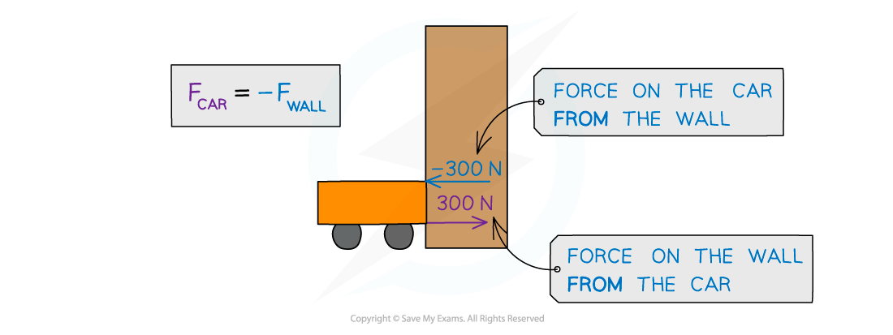

# Force & Momentum

## Force & Momentum

> **Spec point** — `spcpt_csp63TgCtqGHRZJq`

## Force & momentum

- **Force **is defined as the** rate of change of momentum**

$F=\frac{\Deltap}{\Deltat}$

- Where:

  - *F* = force in newtons (N)
  - *p* = momentum in kilogram metres per second (kg m s-1)
  - *t* = time in seconds (s)
  - Δ (the Greek letter delta) = change in

- Change in momentum, Δ*p*, can also be expressed as:

change in momentum = final momentum − initial momentum

$\Deltap=p_{final}-p_{inital}=p_{f}-p_{i}$

- ** Force **and **momentum **are **vector **quantities

  - They can have a **positive **or **negative **direction

> **Worked Example**
> A car of mass 1500 kg hits a wall at an initial velocity of 15 m s-1.
> 
> It then rebounds off the wall at 5 m s-1. The car is in contact with the wall for 0.3 s.
> 
> Calculate the average force experienced by the car.
> 
> **Answer:**
> 
> **Step 1: List the known quantities and assign direction:**
> 
> - Mass, $m$ = 1500 kg
> - Inital velocity, $v_{i}$ = 15 m s-1
> - Final velocity, $v_{f}$ = −5 m s-1
> - Duration of collision, $\Deltat$* *= 0.3 s
> 
> **Step 2: State the equation for force and momentum**
> 
> $F=\frac{\Deltap}{\Deltat}$
> 
> **Step 3: State the equation for change in momentum**
> 
> $\Deltap=p_{f}-p_{i}$
> 
> **Step 4: Calculate the initial momentum**
> 
> $p_{i}=m\timesv_{i}$
> 
> $p_{i}=1500\times15=22500\mathrm{kg}ms^{-1}$
> 
> **Step 5: Calculate the final momentum**
> 
> $p_{f}=m\timesv_{f}$
> 
> `p subscript f space equals space 1500 space cross times space open parentheses negative 5 close parentheses space equals space minus 7500 space kg space straight m space straight s to the power of negative 1 end exponent`
> 
> **Step 6: Calculate the change in momentum**
> 
> $\Deltap=p_{f}-p_{i}$
> 
> $\Deltap=-7500-22500=-30000\mathrm{kg}ms^{-1}$
> 
> **Step 7: Calculate the average force exerted on the car**
> 
> $F=\frac{\Deltap}{\Deltat}$
> 
> $F=\frac{-30000}{0.3}=-100000N$

### Direction of forces

- The force that is equal to the rate of change of momentum is still the **resultant force**
- The force on an object will be **negative **if the direction of the force **opposes **the direction of its **initial velocity**
- This means that a force is **exerted by** the object it has collided with

#### Forces acting between a car and a wall upon impact

***The force exerted by the wall on car will be equal in magnitude and opposite in direction to the force exerted by the car on the wall: F******car****** = –F******wall***

- A car collides with a wall, and the car exerts a force of 300 N on the wall
- The wall also exerts a force of −300 N on the car
- The force exerted **by the wall on the car** is **equal **in magnitude and **opposite **in direction to the force exerted **by the car on the wall**
- This is Newton’s third law of motion (see [Newton’s laws of motion](https://www.savemyexams.com/a-level/physics/cie/25/revision-notes/3-dynamics/3-1-momentum-and-newtons-laws-of-motion/newtons-laws-of-motion/))

### Time of impact

- The **force **exerted is also determined by the **time taken** for the impact to occur
- The **same **change in momentum, over a **longer **period of time will exert **less **force, and vice versa $F=\frac{\Deltap}{\Deltat}$

  - As Δ*t* increases, *F* decreases, when Δ*p* remains the same
  - As Δ*t* decreases, *F* increases, when Δ*p* remains the same

> **Worked Example**
> A tennis player strikes a ball with their racket twice. Each time, the change in momentum of the ball is 0.5 kg m s-1.
> 
> During the first strike, the ball is in contact with the racket for 0.2 s. During the second strike, the ball is in contact with the racket for 0.1 s.
> 
> Determine which strike the greatest force is exerted on the racket by the ball.
> 
> **Answer:**
> 
> **Step 1: List the known quantities**
> 
> - Change in momentum, Δ*p* = 0.5 kg m s-1
> - Contact time for the first strike, Δ*t*1 = 0.2 s
> - Contact time for the second strike, Δ*t*2 = 0.1 s
> 
> **Step 2: Determine the force exerted on the racket during the first strike**
> 
> $F_{1}=\frac{\Deltap}{\Deltat_{1}}$
> 
> $F_{1}=\frac{0.5}{0.2}=2.5N$
> 
> **Step 3: Determine the force exerted on the racket during the second strike**
> 
> $F_{2}=\frac{\Deltap}{\Deltat_{2}}$
> 
> $F_{2}=\frac{0.5}{0.1}=5.0N$
> 
> **Step 4: State which strike the greatest force is exerted on the racket**
> 
> - The ball exerts a greater force on the racket during the <u>second</u> strike
