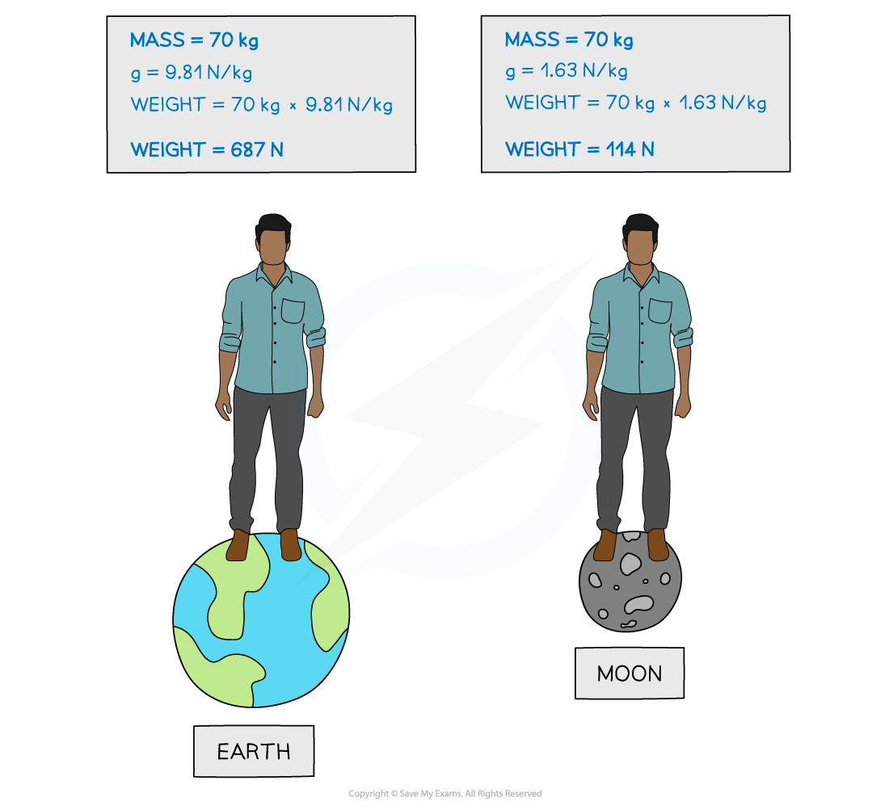
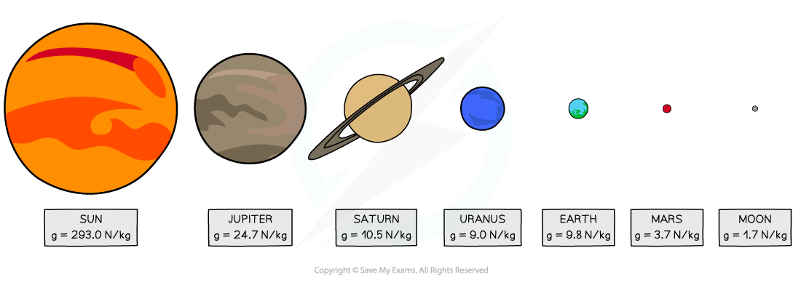

# Mass & Weight

## What is Mass?

> **Spec point** — `spcpt_vpGVPqRG3j7cRwgn`

## What is mass?

- **Mass **is a measure of the amount of **matter **in an object
- Consequently, this is the **property **of an object that resists change in motion
- The greater the mass of a body, the smaller the change produced by an applied force
- The SI unit for mass is the **kilogram** (kg)

> **Exam Hint**
> - Since mass is measured in **kilograms** in physics, if it is given in grams in a question, make sure you convert to kg by dividing the value by 1000

## Weight

> **Spec point** — `spcpt_jV2kHfbbq9DcCtyn`

## Weight

- **Weight **is the effect of a gravitational field on a **mass**
- Since it is a **force**, it is measured in **newtons** (N) and is a **vector **quantity
- The weight of a body is equal to the product of its **mass **and the **acceleration of free fall **

$W=mg$

- Where:

  - *W* = weight in newtons (N)
  - *m*= mass in kilograms (kg)
  - *g *= acceleration of freefall in metres per second (m s-2)
- The acceleration of freefall, *g*, on Earth, is 9.81 m s-2

> **Exam Hint**
> **Gravitational field strength** (in N kg-1) and **acceleration due to freefall** (in m s-2) are just two ways of describing the same thing.
> 
> They have the **same value **but have **different units **depending on the context.

### Free fall

- An object in **free fall** is falling **solely **under the influence of gravitational attraction
- In the **absence **of **air resistance**, all bodies near the Earth fall with the **same acceleration** regardless of their mass

### Mass v weight

- An object’s **mass **always remains the **same**, however, its **weight **will **differ **depending on the strength of the gravitational field at different locations within the Universe
- For example, the gravitational field strength on the Moon is **1.63 N kg****-1**, meaning an object’s weight will be about **6 times** less than on Earth

#### Comparison of a person's weight on Earth and on the Moon

***On the moon, your mass will stay the same but your weight will be much lower***

- Although you only need to memorise *g* on Earth, its value on other planets in our solar system is given in the diagram below. Notice how much this varies according to the size of the planet

#### Gravitational field strengths of bodies in the solar system

***More massive planets and objects have a greater gravitational field strength***

> **Worked Example**
> The acceleration due to gravity on the moon is 1/6 of that on Earth. If the weight of a space probe on the moon is 491 N, calculate its mass.
> 
> **Answer:**
> 
> **Step 1: State the equation for weight**
> 
> $W=mg$
> 
> **Step 2: Rearrange to make mass, *****m*****, the subject**
> 
> $m=\frac{W}{g}$
> 
> **Step 3: Find *****g***** for the moon**
> 
> $g=\frac{g_{Earth}}{6}=\frac{9.81}{6}=1.64N\mathrm{kg}^{-1}$
> 
> **Step 4: Substitute in the known values**
> 
> $m=\frac{491}{1.64}=300\mathrm{kg}$
