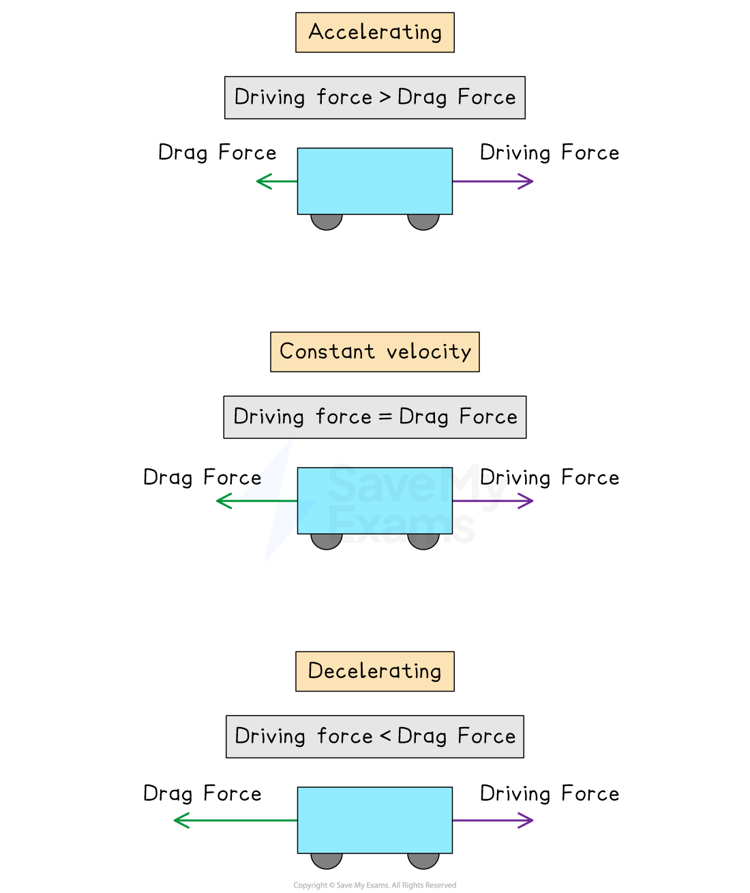
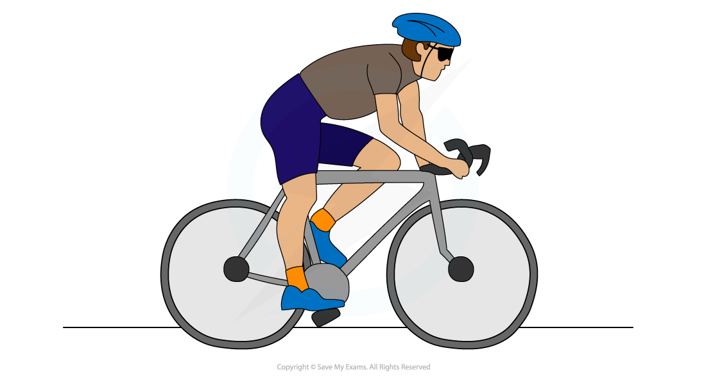

# Drag Force & Air Resistance

## Drag Forces

> **Spec point** — `spcpt_qyJ24syjS2WJqFvB`

## Drag forces

- Drag forces are forces acting in the** opposite** direction to an object moving through a **fluid **(either gas or liquid)
- Examples of drag forces are **fluid resistance **(viscous drag)** **and **air resistance**
- A key component of drag forces is that the magnitude of the drag force **increases **with the **speed **of the object

  - As an object **speeds up**, the drag force **increases**
  - As an object **slows down**, the drag force **decreases**
  - This will be explored further in [Terminal Velocity](https://www.savemyexams.com/a-level/physics/cie/25/revision-notes/3-dynamics/3-2-non-uniform-motion/terminal-velocity/)
- Therefore, drag forces have the greatest effect at high speeds

- Consider a car traveling **forward **on a **straight **road
- When the car is **accelerating**:

  - The driving force is **greater **than the frictional force
  - The **resultant force** is acting in the **same direction** as the direction of motion
  - Therefore, the car speeds up
- When the car is traveling at a constant velocity:

  - The driving force is **equal **to the frictional force
  - There is **no resultant force** acting on the car
  - Therefore, the motion of the car remains the same (continues traveling at a constant velocity)
- When the car is **decelerating**:

  - The driving force is **less **than the frictional force
  - The **resultant force** is acting in the direction that **opposes the motion** of the car
  - Therefore, the car slows down

#### Driving force and frictional force acting on a car at different accelerations

***For the car to accelerate, the driving force must be larger than the frictional force; for the car to travel at a constant velocity, the driving force and frictional force must be balanced; for the car to decelerate, the driving force must be less than the frictional force***

> **Worked Example**
> A car of mass 800 kg has a horizontal forward driving force of 3 kN acting on it. The car accelerates at 2.0 m s-2.
> 
> Determine the magnitude of the frictional force acting on the car.
> 
> 
> 
> **Answer:**
> 
> **Step 1: List the known quantities and convert to SI units**
> 
> - Mass, *m* = 800 kg
> - Driving force, *F*D = 3000 N
> 
> **Step 2: Calculate the resultant force acting on the car using Newton's Second Law**
> 
> $F=ma$
> 
> $F=800\times2.0=1600N$
> 
> **Step 3: Equate the resultant force to the driving force and frictional force**
> 
> Resultant force = driving force − frictional force
> 
> **Step 4: Calculate the magnitude of the frictional force**
> 
> Frictional force = driving force − resultant force
> 
> $F_{F}=3000-1600$
> 
> $F_{F}=1400N$

> **Exam Hint**
> The key to answering this question correctly is remembering to consider drag forces in your calculation for the resultant force.

## Air Resistance

> **Spec point** — `spcpt_337BCv49v82TDSXm`

## Air resistance

- **Air resistance** is an example of a **drag **force
- Objects experience **friction **when moving through the air
- Air resistance depends on the **shape** of the object and the **speed** at which it is travelling
- Since drag force **increases with speed**, air resistance becomes important when objects move faster

#### Features of a Cyclist that Reduce Air Resistance

***A racing cyclist adopts a more streamlined posture to reduce the effects of air resistance. The bicycle, clothing and helmet are designed to reduce air resistance to allow them to go as fast as possible***

### Falling objects with air resistance

- When objects fall through a **fluid**, the fluid exerts a **frictional **force on the object as it falls

  - Fluids are liquids or gases
- Frictional forces **oppose **the motion of an object

  - They act to slow it down
- When an object falls through **air**, it experiences **air resistance**
- Air resistance occurs as the object moving through the air **collides **with the air particles
- Air resistance **increases **as the **speed **of the object increases
- When objects fall through air, two forces are exerted on the object:

  - The force of **weight**
  - The force of **air resistance**
- When the force of air resistance becomes **equal **to the force of weight, then the object **stops accelerating** and falls at a **constant **speed

  - This constant speed is called terminal velocity

> **Exam Hint**
> If a question considers air resistance to be **‘negligible**’ this means in that question, air resistance is taken to be so small it will not make a difference to the motion of the body. You can take this to mean there are no drag forces acting on the body.
