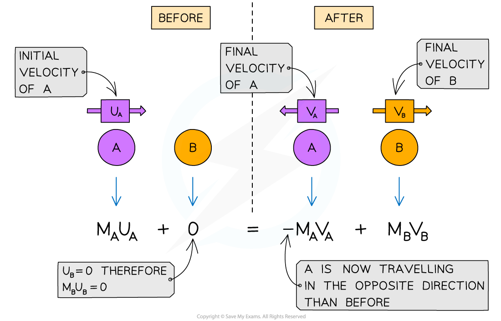
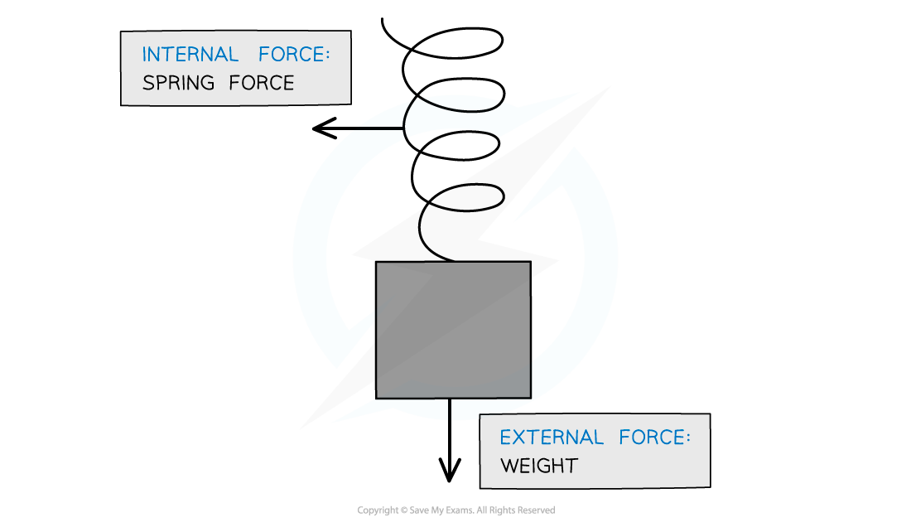

# Conservation of Momentum

## The Principle of Conservation of Momentum

> **Spec point** — `spcpt_4KhwwYmwPbgcrh5z`

## The principle of conservation of momentum

- The principle of conservation of linear momentum states that:

**The total linear momentum before a collision is equal to the total linear momentum after a collision unless the system is acted on by a resultant external force**

- Therefore:

**Total momentum before = Total momentum after**

- Momentum is a **vector** quantity, therefore:

  - **opposing vectors** can cancel each other out, resulting in a **net momentum** of **zero**
  - an object that collides with another object and **rebounds** has a **positive** velocity **before **the collision and a **negative** velocity **after **
- Momentum is** always conserved**

- For example:

  - Ball A moves with an initial velocity of $u_{A}$
  - Ball A collides with Ball B, which is stationary

- After the collision, both balls travel in opposite directions

  - Taking the direction of the initial motion of Ball A as the positive direction (to the right)
- The momentum **before **the collision is

$p_{before}=m_{A}u_{A}+0$

- The momentum **after **the collision is

$p_{after}=-m_{A}v_{A}+m_{B}v_{B}$

- The minus sign shows that Ball A travels in the **opposite** direction to the initial travel

  - If an object is stationary, like Ball B before the collision, then it has a momentum of **zero**

***The conservation of momentum for two objects A and B colliding and then moving apart***

### External and internal forces

- **External forces** are forces that act on a structure from **outside **e.g. friction and weight
- **Internal forces **are forces exchanged by the particles **in **the system e.g. tension in a string

  - Which forces are internal or external will depend on the system itself
- A system with **no external forces** acting can be described as a **closed** or **isolated** system

#### Internal and external forces for a mass on a spring

***The spring force is internal to the system because the spring is part of the system, whereas weight (the gravitational pull of the Earth on the mass) is external to the system***

## Collisions in One & Two Dimensions

> **Spec point** — `spcpt_gD2zVJW7jzFTBV22`

## Collisions in one & two dimensions

### One-dimensional momentum problems

- Recall that linear momentum is ***p = mv***
- Using the **conservation of momentum principle**, it is possible to calculate the missing velocities and masses of components in a system

- **Elastic collisions** are commonly those where objects colliding do not stick together and then move in opposite directions
- **Inelastic collisions** are where objects collide and stick together after the collision
- To find out whether a collision is **elastic **or **inelastic**, compare the amount of kinetic energy in the system before and after the collision

  - If the kinetic energy is **conserved**, it is an **elastic collision**
  - If the kinetic energy is **not conserved**, it is an **inelastic collision**

> **Worked Example**
> Trolley A has a mass of 0.80 kg.
> 
> Trolley A collides head-on with stationary Trolley B at a velocity of 3.0 m s-1.
> 
> Trolley B has twice the mass of Trolley A. The trolleys stick together.
> 
> (a) Using the conservation of momentum, calculate the common velocity of both trolleys after the collision.
> 
> (b) Show that the collision is inelastic.
> 
> **Answer:**
> 
> **(a)**
> 
> **Step 1: List the known quantities**
> 
> - Mass of Trolley A, *m*A = 0.80 kg
> - Velocity of Trolley A, *v*A = 3.0 m s-1
> - Mass of Trolley B, *m*B = 2*m*A = 1.60 kg
> 
> **Step 2: Determine the momentum before the collision**
> 
> $p_{before}=m_{A}v_{A}+m_{B}v_{B}$
> 
> `p subscript b e f o r e end subscript space equals space open parentheses 0.80 space cross times space 3.0 close parentheses space plus space 0`
> 
> $p_{before}=2.4\mathrm{kg}ms^{-1}$
> 
> - Since Trolley B was stationary before the collision, its momentum is zero
> 
> **Step 3: Determine the momentum after the collision**
> 
> `p subscript a f t e r end subscript space equals space open parentheses m subscript A space plus space m subscript B close parentheses space cross times space v subscript A plus B end subscript`
> 
> `p subscript a f t e r end subscript space equals space open parentheses 0.80 space plus space 1.60 close parentheses space cross times space v subscript A plus B end subscript`
> 
> $p_{after}=2.4\timesv_{A+B}$
> 
> **Step 4: Equate the momentum before and after the collision using the principle of conservation of momentum**
> 
> momentum before collision = momentum after collision
> 
> $p_{before}=p_{after}$
> 
> $2.4=2.4\timesv_{A+B}$
> 
> **Step 5: Calculate the common velocity of both trolleys after the collision**
> 
> $v_{A+B}=\frac{2.4}{2.4}$
> 
> $v_{A+B}=1.0ms^{-1}$
> 
> **(b)**
> 
> **Step 1: Calculate the kinetic energy of the system before the collision**
> 
> `E subscript k space b e f o r e end subscript space equals space 1 half m subscript A open parentheses v subscript A close parentheses squared space plus space 1 half m subscript B open parentheses v subscript B close parentheses squared`
> 
> `E subscript k space b e f o r e end subscript space equals space 0.5 space cross times space 0.80 space cross times space open parentheses 3.0 close parentheses squared space plus space 0`
> 
> $E_{kbefore}=3.6J$
> 
> - Since Trolley B was stationary before the collision, its kinetic energy is zero
> 
> **Step 2: Calculate the kinetic energy of the system after the collision**
> 
> `E subscript k space a f t e r end subscript space equals space 1 half m subscript A plus B end subscript open parentheses v subscript A plus B end subscript close parentheses squared`
> 
> `E subscript k space a f t e r end subscript space equals space 0.5 space cross times space open parentheses 0.8 space plus space 1.6 close parentheses space cross times space open parentheses 1.0 close parentheses squared`
> 
> $E_{kafter}=1.2J$
> 
> **Step 3: State whether the collision was inelastic**
> 
> - The kinetic energy before the collision, 3.6 J, was greater than the kinetic energy after the collision, 1.2 J
> - Therefore, the kinetic energy of the system is not conserved, and the collision is inelastic

> **Exam Hint**
> If an object is **stationary **or **at rest**, its velocity equals **0**, therefore, the momentum and kinetic energy are also equal to 0.
> 
> When an **inelastic **collision occurs in which two objects are stuck together, treat the final object as a single object with a mass equal to the **sum** of the two individual objects.

### Two-dimensional momentum problems

- Since momentum is a **vector**, in two dimensions it can be split up into its **x** and **y** **components**
- See [Scalars & Vectors](https://www.savemyexams.com/a-level/physics/cie/25/revision-notes/1-physical-quantities-and-units/1-4-scalars-and-vectors/scalars-and-vectors/) for a reminder on resolving vectors

> **Worked Example**
> A ball is thrown at a vertical wall.
> 
> The ball is thrown from position S with an initial velocity of 15.0 m s-1 at 60.0° to the horizontal.
> 
> The ball hits the wall at position P and rebounds at a velocity of 4.6 m s-1
> 
> The mass of the ball is 60 × 10-3 kg.
> 
> Calculate the change in momentum of the ball as it bounces off the wall.
> 
> 
> 
> **Answer:**
> 
> **Step 1: List the known quantities and assign direction**
> 
> - Initial horizontal velocity, *v*i = 15.0 m s-1 at 60.0° to the horizontal
> - Final horizontal velocity, *v*f = −4.6 m s-1
> - Mass of ball, *m* = 60 × 10-3 kg
> 
> **Step 2: State the change in momentum equation**
> 
> `increment p space equals space m open parentheses v subscript f space minus space v subscript i close parentheses`
> 
> **Step 3: Calculate the initial velocity**
> 
> - A change in momentum is only due to the horizontal velocity component for projectile motion
> 
> `v subscript i space equals space 15.0 space cross times space cos open parentheses 60 close parentheses`
> 
> $v_{i}=7.5ms^{-1}$
> 
> **Step 4: Calculate the change in momentum**
> 
> `increment p space equals space m open parentheses v subscript f space minus space v subscript i close parentheses`
> 
> `increment p space equals space open parentheses 60 cross times 10 to the power of negative 3 end exponent close parentheses space cross times space open parentheses negative 4.6 space minus space 7.5 close parentheses`
> 
> $\Deltap=-0.73Ns$
> 
> - The answer should be **negative **because the ball is traveling in the opposite direction after it rebounds

> **Exam Hint**
> For problems in two dimensions, make sure you’re confident resolving vectors.
> 
> Here is a little trick to help you remember which component is cosine or sine of the angle for a vector **R:**
> 
> 
> 
> ***Resolving vectors with sine and cosine***
