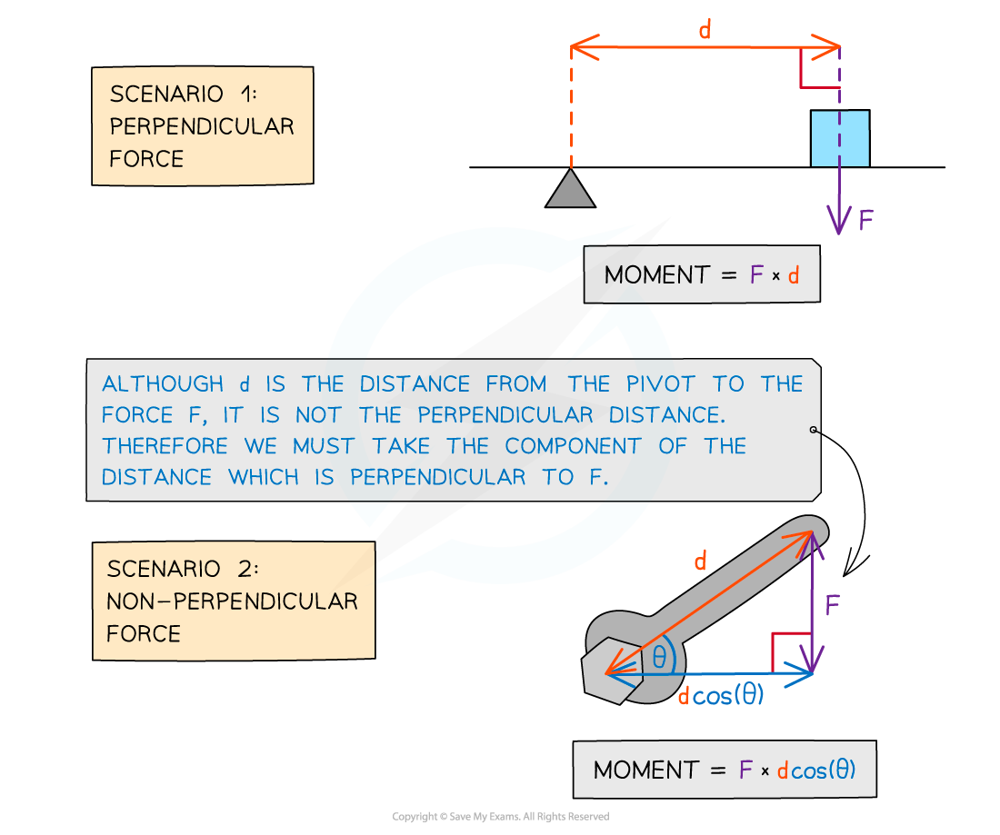

# Moments

## What is a Moment?

> **Spec point** — `spcpt_cKrDnm4jfKmSdjPT`

## What is a moment?

- A **moment **is the **turning effect of a force**
- Moments occur when forces cause objects to **rotate** about a **pivot**

- The moment of a force is given by the equation:

$\mathrm{moment}=Fd$

- Where:

  - moment = turning effect in newton metres (N m)
  - *F* = force in newtons (N)
  - *d* = perpendicular distance from the pivot in metres (m)

- The force may not always be applied **perpendicularly **to the pivot
- However, the **distance **used in the equation **must **be the perpendicular distance from the pivot
- In these cases, the **component **of the **distance **that is **perpendicular **to the pivot must be used

#### Force applied at an angle to the pivot

***When the force is applied at an angle to the pivot, the component of the distance that is perpendicular must be used***

- An example of moments in everyday life is opening a **door**

  - The door **handle **is placed on the **opposite **side of the door to the **hinge **(the hinge is the pivot)
  - This **maximises** the **distance **for a given force
  - Which provides a **greater moment** (turning effect)
  
    - This makes it easier (requires less force) to push or pull the door open

> **Worked Example**
> A uniform metre ruler is pivoted at the 50 cm mark.
> 
> A 0.5 kg weight is suspended at the 80 cm mark, causing the ruler to rotate about the pivot.
> 
> Calculate the turning moment about the pivot. Assume the weight of the ruler is negligible.
> 
> 
> 
> **Answer: **
> 
> **Step 1: List the known quantities and convert to SI units**
> 
> - Pivot at 0.50 m
> - Mass, m = 0.5 kg
> - Force applied at 0.80 m
> 
> **Step 2: State the equation for moment**
> 
> $\mathrm{moment}=Fd$
> 
> **Step 3: Identify the force applied**
> 
> - The only force acting is the force of weight on the mass
> 
> $W=mg$
> 
> $W=0.5\times9.81$
> 
> $W=4.905N$
> 
> **Step 4: Identify the perpendicular distance from the pivot**
> 
> $d=0.80-0.50=0.30m$
> 
> **Step 5: Substitute the known values into the moment equation to calculate**
> 
> $\mathrm{moment}=4.905\times0.30$
> 
> $\mathrm{moment}=1.4715Nm$
> 
> `moment space equals space 1.5 space straight N space straight m space open parentheses 2 space straight s. straight f. close parentheses`

> **Exam Hint**
> It is better to only round your answer right at the end of your calculation. Always work with at least one, preferably two more significant figures than your final answer requires. This will help you to avoid compound rounding errors that could lose you marks.
> 
> Sketching a quick diagram of all the forces acting on the object will help you visualise which forces are perpendicular to the distance from the pivot. Not all forces will provide a turning effect and it is common for questions to provide more forces than required to increase the level of difficulty of the question.
