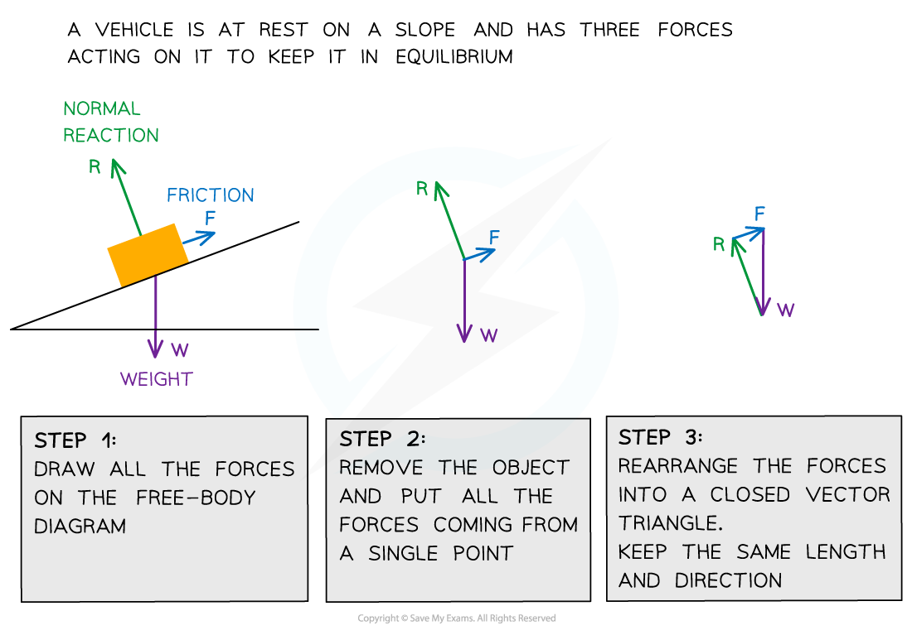

# Conditions for Equilibrium

## Equilibrium

> **Spec point** — `spcpt_9nvVcWsfBYyXnrnD`

## Equilibrium

- A system is in **equilibrium **when all the forces are **balanced**

  - There is **no **resultant force
  - There is **no** resultant torque
- In accordance with Newton's First Law, an object in equilibrium will therefore **remain at rest**, or at a **constant velocity**, and will **not rotate**
- The system is in an equilibrium state when applying the [Principle of Moments](https://www.savemyexams.com/a-level/physics/cie/25/revision-notes/4-forces-density-and-pressure/4-2-equilibrium-of-forces/principle-of-moments/)

> **Worked Example**
> Four beams of the same length, each have three forces acting on them.
> 
> Which beam has both zero resultant force and zero resultant torque acting?
> 
> 
> 
> **Answer:**
> 
> **Step 1: Consider the principle of moments**
> 
> - Zero resultant force and zero resultant torque mean that the beam is in equilibrium
> - Therefore, for the correct answer:
> 
> clockwise moment = anticlockwise moment
> 
> **Step 2: Calculate the clockwise moments for each answer option**
> 
> - For answer option **C**
> - Taking the pivot to be the point at which the 15 N force acts
> 
>   - Therefore, there is no moment caused by the 15 N force because *d* = 0
> 
> $\mathrm{clockwise} \mathrm{moment}=40\times0.5=20Nm$
> 
> **Step 3: Calculate the anticlockwise moments for each answer option**
> 
> - For answer option **C**
> 
> `anticlockwise space moment space equals space 25 space cross times space open parentheses 0.5 space plus space 0.3 close parentheses space equals space 20 space straight N space straight m`
> 
> **Step 4: Determine if the beam is in equilibrium**
> 
> $20Nm=20Nm$
> 
> clockwise moment = anticlockwise moment
> 
> - Therefore, beam **C** is in equilibrium

## Coplanar Forces in Equilibrium

> **Spec point** — `spcpt_sv29vYZ6zwYjP2P7`

## Coplanar forces in equilibrium

- ***Coplanar forces*** can be represented by **vector triangles**

  - For a recap on vector triangles see [Scalars & Vectors](https://www.savemyexams.com/a-level/physics/cie/25/revision-notes/1-physical-quantities-and-units/1-4-scalars-and-vectors/scalars-and-vectors/)
- Forces are in **equilibrium **if an object is either

  - At rest
  - Moving at **constant** velocity
- In equilibrium, coplanar forces are represented by **closed** vector triangles

  - The vectors, when joined together, form a closed path
- The most common forces acting on objects are

  - Weight
  - Normal reaction force
  - Tension (from cords and strings)
  - Friction

#### Forming a vector triangle for forces acting on a body in equilibrium

***To form a closed vector triangle, draw a free-body force diagram, then rearrange the force arrows tip to tail maintaining the length and directions of the vectors***

> **Worked Example**
> A mass hangs in equilibrium from a cable at point **X**. The tensions in the cables are *T**1* and *T**2* as shown.
> 
> 
> 
> Which diagram correctly represents the forces acting at point **X**?
> 
> 
> 
> **Answer:**
> 
> **Step 1: Draw a free-body force diagram identifying the direction of all the forces**
> 
> 
> 
> **Step 2: Arrange the vectors into a triangle, maintaining the magnitudes and directions**
> 
> 
> 
> **Step 3: Check that the vectors form a closed path**
> 
> 
> 
> - The correct answer is **A**
> 
>   - This is the only vector triangle forming a closed path

> **Exam Hint**
> The diagrams in exam questions about this topic tend to be drawn to scale, so make sure you have a ruler handy!
