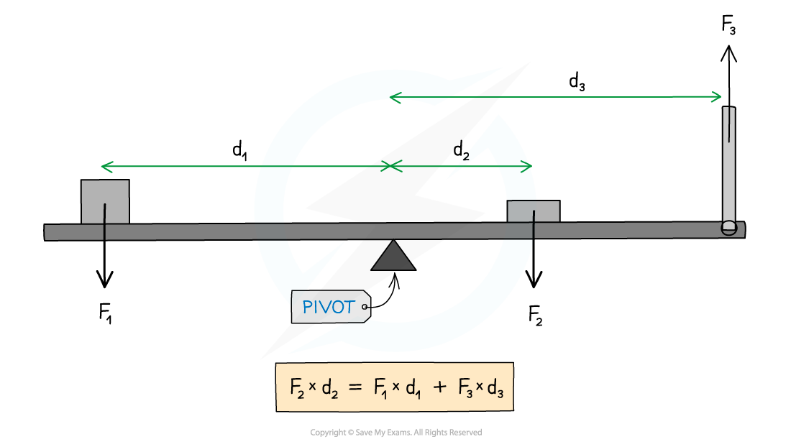

# Principle of Moments

## The Principle of Moments

> **Spec point** — `spcpt_hK7Hq6FPHKNZVQ9J`

## The principle of moments

- The principle of moments states: **For a system to be in equilibrium, the sum of clockwise moments about a point must be equal to the sum of the anticlockwise moments (about the same point)**

#### Moments acting on a balanced beam

***The sum of the anticlockwise moments of forces F******1****** and F******3****** are equal to the clockwise moment of force F******2***

- In the above diagram:

  - Force *F**2* is supplying a **clockwise **moment;
  - Forces *F**1* and *F**3* are supplying **anticlockwise **moments
  - The clockwise and anticlockwise moments are **equal **because the beam is in **equilibrium**

`F subscript 2 d subscript 2 space equals space open parentheses F subscript 1 d subscript 1 close parentheses space plus space open parentheses F subscript 3 d subscript 3 close parentheses`

> **Worked Example**
> A uniform beam of weight 40 N is 5 m long and is supported by a pivot situated 2 m from one end.
> 
> When a load of weight W is hung from that end, the beam is in equilibrium as shown in the diagram.
> 
> 
> 
> What is the value of W?
> 
> **A. **10 N
> 
> **B. **50 N
> 
> **C. **25 N
> 
> **D.** 30 N
> 
> **Answer:**
> 
> **Step 1: List the known quantities**
> 
> - Weight acting on beam, *W*B = 40 N
> - Weight acting on mass = *W*
> - Length of beam = 5 m
> - Distance to pivot (from end of beam), *d*W = 2 m
> 
> **Step 2: Recall the principle of moments**
> 
> clockwise moments = anticlockwise moments
> 
> **Step 3: Calculate the clockwise moment**
> 
> - Because the beam is uniform, the force of weight acting upon it will be exerted from its centre of gravity
> - This will be the middle of the beam
> 
> $\mathrm{Centre} \mathrm{of} \mathrm{gravity}=\frac{5}{2}=2.5m$ (from the end of the beam)
> 
> - The pivot is 2 m from the end of the beam
> - Therefore, the force acts at a distance of 2.5 − 2 = 0.5 m from the pivot
> 
> 
> 
> $\mathrm{clockwise} \mathrm{moment}=W_{B}d$
> 
> $\mathrm{clockwise} \mathrm{moment}=40\times0.5$
> 
> $\mathrm{clockwise} \mathrm{moment}=20Nm$
> 
> **Step 4: Calculate the anticlockwise moment**
> 
> $\mathrm{anticlockwise} \mathrm{moment}=Wd_{W}$
> 
> $\mathrm{anticlockwise} \mathrm{moment}=W\times2=2W$
> 
> **Step 5: Equate the clockwise and anticlockwise moments to calculate**
> 
> $\mathrm{clockwise} \mathrm{moment}=\mathrm{anticlockwise} \mathrm{moment}$
> 
> $20=2W$
> 
> $W=\frac{20}{2}=10N$
> 
> - Therefore, the answer is **A**

> **Exam Hint**
> Make sure that all the distances are in the same units and you’re considering the correct forces as clockwise or anticlockwise, as seen in the diagram below
> 
> 
