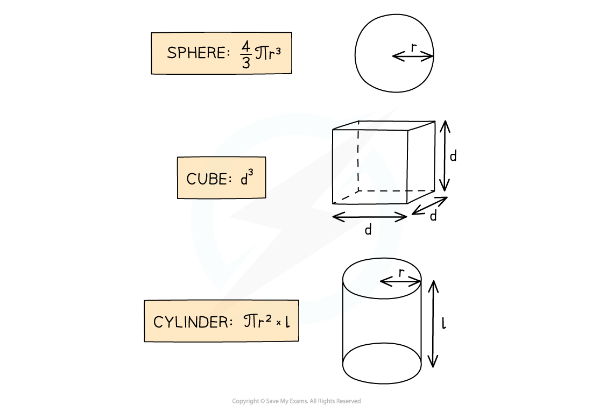

# Density

## Density

> **Spec point** — `spcpt_hbB5GHwNkXjXswMf`

## Density

- Density is the **mass per unit volume **of an object

$ρ=\frac{m}{V}$

- Where:

  - *ρ* (the Greek letter rho) = density in kilograms per metre cubed (kg m-3)
  - *m* = mass in kilograms (kg)
  - *V* = volume in metres cubed (m3)

- **Gases **are less dense than **liquids**, which are less dense than **solids**
- This is because there are fewer particles, and therefore less mass, per unit volume

#### Relative density of a gas and a solid

***Gases are less dense than solids because they have fewer particles, and therefore less mass, per unit volume***

- The **volume **of an object may not always be given directly, but can be calculated with the appropriate equation depending on the object’s shape

#### Calculating the volumes of different shapes

***Expressions for calculating the volume of a sphere, a cube and a cylinder***

> **Worked Example**
> A paving slab has a mass of 73 kg and dimensions 40 mm × 500 mm × 850 mm.
> 
> Calculate the density, in kg m-3 of the material from which the paving slab is made.
> 
> 
> 
> **Answer:**
> 
> **Step 1: List the known quantities and convert to SI units**
> 
> - Mass, *m* = 73 kg
> - Length, $l$ = 0.850 m
> - Width, *w* = 0.500 m
> - Height, *h* = 0.040 m
> 
> **Step 2: State the equation for density**
> 
> $ρ=\frac{m}{V}$
> 
> **Step 3: Calculate the volume**
> 
> $\mathrm{volume} \mathrm{of}a\mathrm{cuboid}=\mathrm{length}\times\mathrm{width}\times\mathrm{height}$
> 
> $V=lwh$
> 
> $V=0.850\times0.500\times0.040$
> 
> $V=0.017m^{3}$
> 
> **Step 4: Substitute the known values to calculate**
> 
> $ρ=\frac{73}{0.017}$
> 
> $\\rho = 4300 \text{kg} \mathrm{m}^{- 3} ( 2 \mathrm{s} . \mathrm{f} . )$

> **Exam Hint**
> - When converting a **larger** unit to a **smaller** one, you **multiply (×)**
> 
>   - E.g. 125 m = 125 × 100 = 12 500 cm
> - When you convert a **smaller** unit to a **larger** one, you **divide (÷)**
> 
>   - E.g. 5 g = $\frac{5}{1000}$ = 0.005 or 5 × 10-3 kg
> - When dealing with squared or cubic conversions, cube or square the conversion factor too
> 
>   - E.g. 1 mm3 = $\frac{1}{1000^{3}}$ = 1 × 10-9 m3
>   - E.g. 1 cm3 = $\frac{1}{100^{3}}$ = 1 × 10-6 m3
