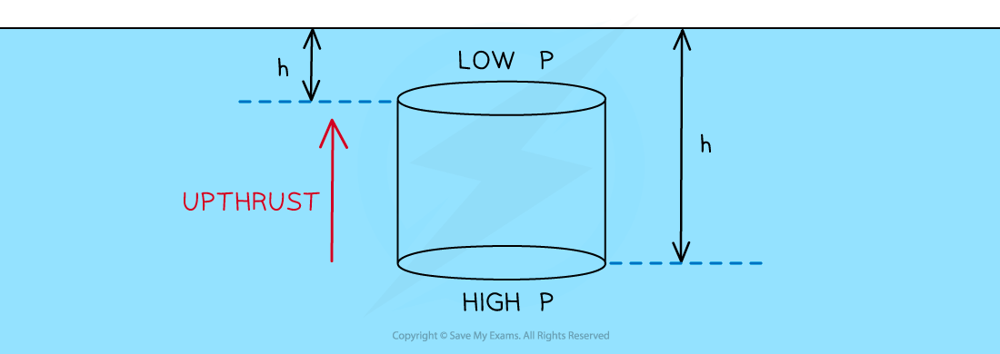

# Upthrust

## Upthrust

> **Spec point** — `spcpt_wVYyrdMv96X93GY7`

## Upthrust

- **Upthrust **is a force which pushes upwards on an object submerged in a **fluid **(liquids and gases)
- Also known as buoyancy force, upthrust is due to the **difference in hydrostatic pressure **at the top and bottom of the immersed object
- The **force **of upthrust is significantly **greater **in liquids than in gases, this is because liquids are much **denser **than gases
- Recall that hydrostatic pressure depends on the height (*h*) or depth that an object is submerged in from *p = ρgh*
- Therefore, the water pressure at the bottom of an object is greater than the water pressure at the top

#### Upthrust on a cylinder immersed in water

***The cylindrical object will experience upthrust due to the difference in hydrostatic pressure***

- Upthrust is a force and is directly proportional to the pressure. The force on the bottom of the can will be greater than the force on top of the can
- This resultant pressure causes a resultant **upward** force on the can known as upthrust
- Upthrust is why objects appear to weigh less when immersed in a liquid. If the upthrust is greater than the weight of the object, the object will rise up
- For an object to float, it must have a density less than the density of the fluid it is immersed in

> **Worked Example**
> A steel cube with cross-sectional area of 2 m2 is totally immersed in water. The scale balance reading is reduced when the cube is immersed.
> 
> 
> 
> The cube experiences pressures of 3000 Pa and 7700 Pa at the top and bottom of the cube respectively.
> 
> Which value is equal to the upthrust on the cube during immersion?
> 
> **A.** 9400 N
> 
> **B.** 6000 N
> 
> **C.** 15400 N
> 
> **D.** 92210 N
> 
> **Answer: **
> 
> **Step 1: List the known quantities**
> 
> - Pressure at top = 3000 Pa
> - Pressure at bottom = 7700 Pa
> - Cross-sectional area of cube, *A* = 2 m2
> 
> **Step 2: State the pressure equation and rearrange to make force the subject**
> 
> $p=\frac{F}{A}$
> 
> $F=pA$
> 
> **Step 3: Substitute in the known values to calculate**
> 
> - The value for pressure needed is the change in pressure between the top and the bottom of the cube
> 
> `F space equals space open parentheses 7700 space minus space 3000 close parentheses space cross times space 2`
> 
> $F=9400N$
> 
> - Therefore, the correct answer is **A**

> **Exam Hint**
> Since upthrust is a force, it is influenced by pressure, not by the density of the object as commonly misunderstood.
