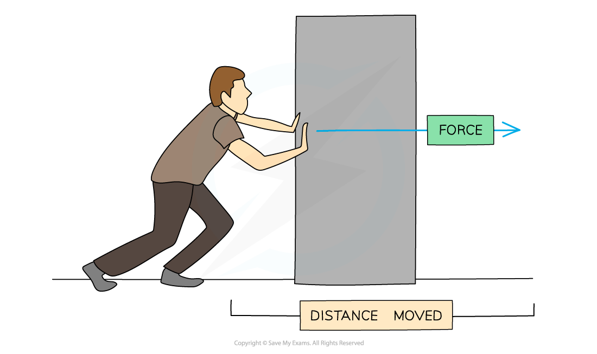

# Work & Energy

## Work Done

> **Spec point** — `spcpt_CgYnfnbfmYcTQx4h`

## Work done

- In physics, **work is done** when an **object** is **displaced** by an external force applied in the direction of its displacement

$W=Fs$

- Where:

  - *W* = work done in newton metres (N m) or joules (J)
  
    - 1 N m = 1 J
  - *F* = force in newtons (N)
  - *s* = displacement of object in metres (m)

- In the diagram below, the man’s pushing force on the block is doing work as it is transferring energy to the block (increasing its kinetic energy)

#### Man pushing a block

***Work is done when a force is used to move an object over a distance***

** **

- When work is done, energy is transferred
- **Work done** is **equal to** the amount of** energy transferred**
- Usually, if a **force** acts **in the direction** that an object is moving, then the object will **gain energy**
- If the **force** acts in the **opposite direction** to the movement, then the object will **lose energy**

> **Worked Example**
> The diagram shows a barrel of weight 2.5 × 103 N on a frictionless slope inclined at 40° to the horizontal.
> 
> 
> 
> A force is applied to the barrel to move it up the slope at constant speed.
> 
> The force applied is parallel to the slope.
> 
> How much work is done in moving the barrel a distance of 6.0 m up the slope?
> 
> **A.** 7.2 × 103 J
> 
> **B.** 2.5 × 104 J
> 
> **C.** 1.1 × 104 J
> 
> **D.** 9.6 × 103 J
> 
> **Answer: **
> 
> **Step 1: List the known quantities**
> 
> - Weight, *F**W* = 2.5 × 103 N at 40°
> 
>   - It is helpful to use *F**W* for the force of weight since *W* is used for work done
> - displacement, *s* = 6.0 m
> 
> **Step 2: State the work done equation**
> 
> $W=Fs$
> 
> **Step 3: Calculate the force in the direction of travel**
> 
> - The force, *F**A*, applied to push the barrel needs to overcome the component of the barrel's weight that is parallel to the slope
> - Since the force is parallel to the slope, the component of weight to consider is that which is parallel to the slope
> 
> 
> 
> `F_ A=F_ W×sin (40)`
> 
> `F_ A=2.5×10³×sin (40)`
> 
> $F_{A}=1607N$
> 
> **Step 4: Substitute the known values into the work done equation to calculate**
> 
> $W=1607\times6.0$
> 
> $W=9.6\times10^{3}J$
> 
> - Therefore, the correct answer is **D**

> **Exam Hint**
> A common exam mistake is choosing the incorrect force which is not parallel to the direction of movement of an object. You may have to resolve the force vector to find the component that is parallel. The force may not always be in the same direction as the movement, as shown in the worked example.
