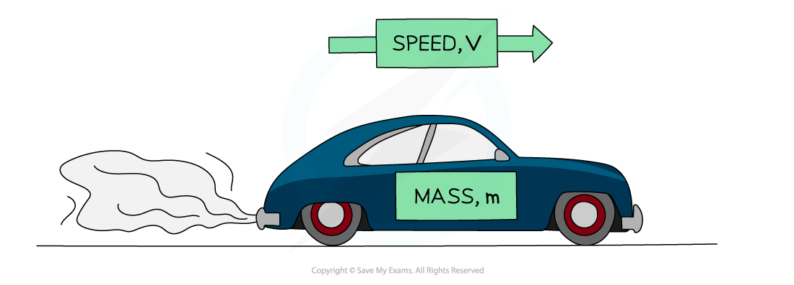

# Kinetic Energy

## Derivation of KE = 1/2mv2

> **Spec point** — `spcpt_yQxMM5BQ4NjtH9mF`

## Derivation of KE = 1/2mv2

- Kinetic energy is energy an object has due to its **motion** (or velocity)
- Resultant forces make objects accelerate as described by Newton's second law *F = ma*
- Work is done by that force and energy is transferred to the object
- Using this concept of work done and an equation of motion, the extra work done due to an object's speed can be derived

- Consider a mass, *m*, at rest which accelerates to a velocity, *v*, over a displacement, *s*
- The work done in accelerating the mass is:

$W=Fs$

- Newton's Second Law states that:

$F=ma$

- The suvat equation for velocity is: $v^{2}=u^{2}+2as$

  - If the initial velocity is zero, *u* = 0
  - And displacement, *s*
  - Then: $v^{2}=2as$
  - Rearranging to make *a* the subject:

$a=\frac{v^{2}}{2s}$

- Substituting this expression for *a* into Newton's Second Law gives:

$F=ma=\frac{mv^{2}}{2s}$

- Substituting this expression for *F* into the work done equation gives:

$W=\frac{mv^{2}}{2s}\timess=\frac{1}{2}mv^{2}$

- The mass is now able to do extra work due to its speed

  - The amount of extra work is equal to $\frac{1}{2}mv^{2}$
- The mass now has:

$E_{k}=\frac{1}{2}mv^{2}$

## Kinetic Energy

> **Spec point** — `spcpt_RSSY9GnfpxwM3HZp`

## Kinetic energy

- The **faster **an object is moving, the **greater **its **kinetic energy**
- When an object is falling, it is **gaining** kinetic energy since it is gaining speed
- This energy transferred from the **gravitational potential energy** it is losing
- An object will maintain this kinetic energy unless its speed changes

- The amount of kinetic energy an object has is determined by its mass and its speed:

$E_{k}=\frac{1}{2}mv^{2}$

- Where:

  - *E*k = kinetic energy in joules (J)
  - *m* = mass in kilograms (kg)
  - *v* = velocity in metres per second (m s-1)

#### A car travelling forwards

***Kinetic energy is the energy an object has when it is moving, determined by its mass and its speed***

> **Worked Example**
> A body travelling with a speed of 12 m s-1 has kinetic energy 1650 J. The speed of the body is increased to 45 m s-1. Determine the body's new kinetic energy.
> 
> **Answer:**
> 
> **Step 1: List the known quantities**
> 
> - Initial speed, *v*i = 12 m s-1
> - Initial kinetic energy, *E*k i = 1650 J
> - Final speed, *v*f = 45 m s-1
> 
> **Step 2: State the kinetic energy equation**
> 
> $E_{k}=\frac{1}{2}mv^{2}$
> 
> **Step 3: Determine the object's mass**
> 
> - The mass will not change
> - Therefore, mass can be calculated from the initial kinetic energy
> 
> $m=\frac{2E_{ki}}{v_{i}^{2}}$
> 
> $m=\frac{2\times1650}{12^{2}}$
> 
> $m=23\mathrm{kg}$
> 
> **Step 4: Substitute the known values to calculate the final kinetic energy**
> 
> $E_{kf}=\frac{1}{2}mv_{f}^{2}$
> 
> $E_{kf}=0.5\times23\times45^{2}$
> 
> $E_{kf}=23000J$
