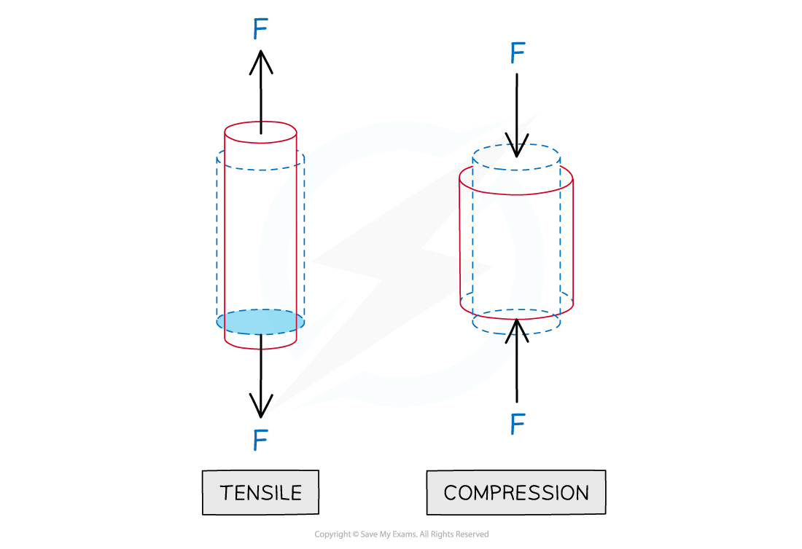
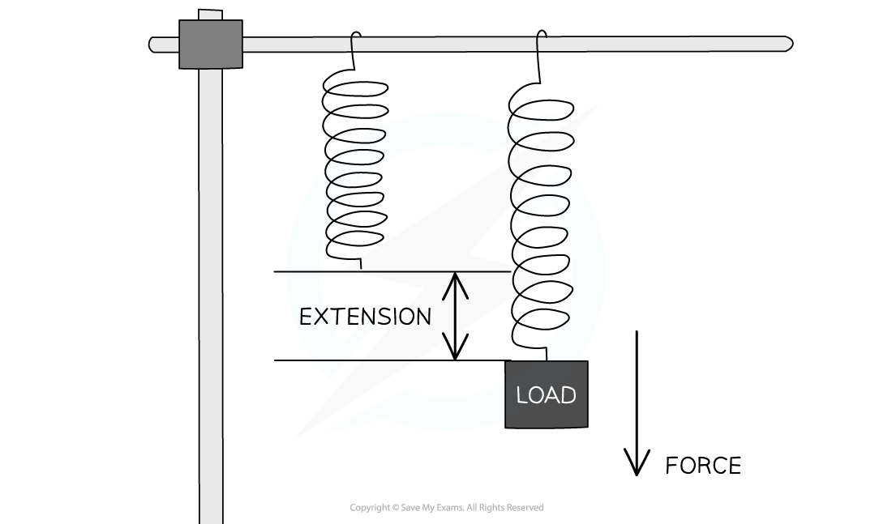
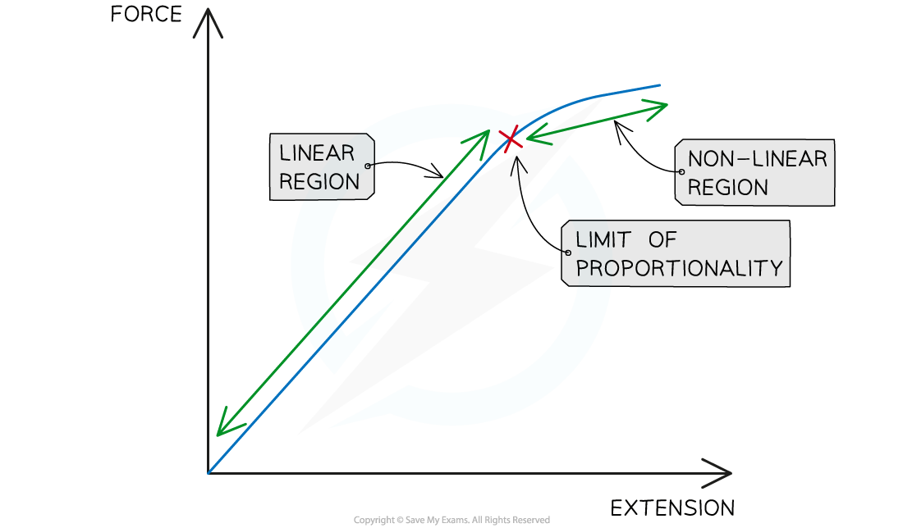

# Extension & Compression

## Tensile Force

> **Spec point** — `spcpt_HKCxB84gdQWvBR4p`

## Tensile force

- Forces can change the size and **shape** of a body, as well as their motion

  - When forces change the size or shape of a body this is known as **deformation**
- Forces acting in opposite directions stretch or compress a body

  - When two forces **stretch** a body, they are described as **tensile forces**
  - When two forces **compress** a body, they are known as **compressive forces**

#### Tensile and compressive forces

***Tensile forces act to increase the length of an object, compressive forces act to reduce the length of an object in a given dimension***

## Extension & Compression

> **Spec point** — `spcpt_s675kDyqfM2Zmp9y`

## Extension & compression

- A **load **attached to the end of a spring

  - applies a **force** to the spring
  - which causes it to **extend** or **compress**
- The **natural length **of a spring is its length without any force applied
- A spring that increases in length undergoes **extension**

  - The amount of extension can be calculated by **subtracting** the **natural length** from the **extended length**
- A spring that decreases in length undergoes **compression**

  - The amount of compression can be calculated by **subtracting** the **compressed length** from the **natural length**

#### Tensile force on a spring

***Stretching a spring with a load produces a force that leads to an extension***

- When a spring **demonstrates elastic behaviour** a load applied creates an extension that can be removed so the spring returns to its original length

  - This occurs until the point at which the spring reaches its **limit of proportionality**
- When the spring **exceeds **the **limit of proportionality**, the relationship between force and extension is **no longer proportional**

  - The spring no longer obeys Hooke's law

### Force–extension graphs

- The way a material responds to a given force can be shown on a **force-extension graph**

  - Every material will have a unique force-extension graph depending on its properties
- A force-extension graph contains a **linear **and then a **non-linear** region

  - The **limit of proportionality** is the point at which the force-extension graph **changes** from the linear to the non-linear region

#### Force-extension graph

***Linear and non-linear regions of a force-extension graph***

> **Worked Example**
> Which graph represents the force-extension relationship of a rubber band that is stretched almost to its breaking point?
> 
> 
> 
> **Answer: A**
> 
> - Rubber bands can be stretched up to twice their original size or more - this is because the long chain molecules become fully aligned and can no longer move past each other
> 
>   - This is shown by graph A - after the section of linear proportionality (the straight line), the gradient increases significantly, so, a large force is required to extend the rubber band by even a small amount
> - Graph B is incorrect as the gradient decreases, suggesting that less force is required to cause a small extension
> - Graph C is incorrect as this shows a material that does not break easily, such as a metal
> - Graph D is incorrect as the plateau suggests no extra force is required to extend the rubber as it has already been stretched

> **Worked Example**
> Cylindrical samples of steel, glass and rubber are each subjected to a gradually increasing tensile force F. The extensions e are measured and graphs are plotted as shown below.
> 
> 
> 
> Correctly label the graphs with the materials: steel, glass, rubber.
> 
> 

> **Exam Hint**
> Exam questions may ask for the total length of a material after a load is placed on it and it has extended. Remember to add the extension to the original length of the material to get its final full length
