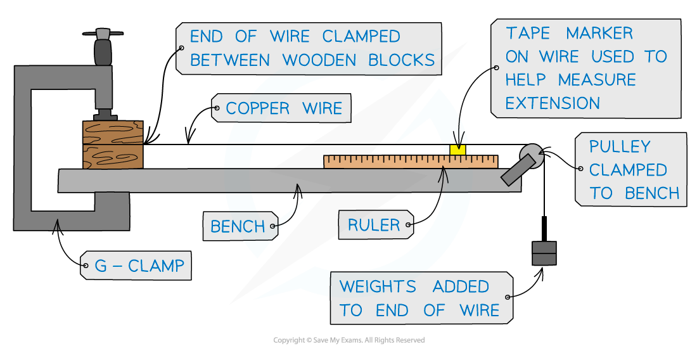

# The Young Modulus

## Stress, Strain & the Young Modulus

> **Spec point** — `spcpt_rYsWzngGmd5KB6wb`

## Stress, strain & the Young modulus

### Stress

- Tensile stress is the **applied force per unit cross sectional area** of a material

$σ=\frac{F}{A}$

- Where:

  - *σ *is tensile stress in Pa
  - *F* is applied force in N
  - *A* is the cross-sectional area of the object in m2
- The **ultimate tensile stress** is the **maximum** force per original cross-sectional area a wire is able to support at the point it breaks

### Strain

- Strain is the **extension per unit length**

  - Strain is the deformation of a solid due to stress in the form of elongation or contraction
- Note that strain, *ε* , is a **dimensionless** unit because it is the ratio of lengths given by the equation

$ε=\frac{x}{L}$

- Where:

  - *x* is extension in metres (m)
  - *L* is the original length of the object, also in metres (m)

### Young modulus

- The Young modulus, *E* , is a measure of the ability of a material to withstand changes in length when a load is added

  - Young modulus is a measure of how **stiff **or **elastic** a material is
- The Young Modulus is defined as the** ratio of stress and strain **and is given by the equation

$E=\frac{σ}{ε}=\frac{FL}{Ax}$

- Where:

  - *E *is Young modulus where its unit are the same as stress: **Pa** (since strain is unitless)
- For a material demonstrating elastic behaviour, **stress and strain**, like force and extension, are also directly proportional to one another
- The directly proportional nature of the stress-strain relationship can be shown by drawing a stress-strain graph

  - The **gradient** of the linear section of a stress-strain graph is the **Young modulus**

#### Stress-strain graph

***A stress-strain graph is a straight line with its gradient equal to Young modulus***

> **Worked Example**
> A metal wire that is supported vertically from a fixed point has a load of 92 N applied to the lower end.
> 
> The wire has a cross-sectional area of 0.04 mm2 and obeys Hooke’s law.
> 
> The length of the wire increases by 0.50%. What is the Young modulus of the metal wire?
> 
> **A.** 4.6 × 107Pa
> 
> **B.** 4.6 × 1012 Pa
> 
> **C.** 4.6 × 109 Pa
> 
> **D. **4.6 × 1011 Pa
> 
> **Answer: D**
> 
> **Step 1: List the known quantities:**
> 
> - Load force, *F* = 92 N
> - Cross-sectional area, *A *= 0.04 mm2
> - Extension is 0.50% of the original length
> 
> **Step 2: Determine the stress:**
> 
> - Convert the area to m2
> 
> $A = 0.04 mm^{2} = 0.04 ( \text{mm} \times \text{mm} ) = 0.04 ( 10^{- 3} \mathrm{m} \times 10^{- 3} \mathrm{m} )$
> 
> $A=0.04\times10^{-6}m^{2}$
> 
> - Substitute this into the stress equation
> 
> $σ=\frac{F}{A}=\frac{92}{0.04\times10^{-6}}=2.3\times10^{9}\mathrm{Pa}$
> 
> **Step 3: Determine strain:**
> 
> - Strain is defined as the extension per unit length
> - If extension is 0.50% of length, then strain is simply this value as a decimal number
> 
> $\\epsilon = 0.50 \% = \frac{0.50}{100} = 0.005$
> 
> **Step 4: Calculate the Young modulus:**
> 
> - Substitute these values into the equation
> 
> $E=\frac{σ}{ε}=\frac{2.3\times10^{9}}{0.005}=4.6\times10^{11}\mathrm{Pa}$

> **Exam Hint**
> To remember whether stress or strain comes first in the Young modulus equation, try thinking of the phrase ‘When you’re stressed, you show the strain’ i.e. $\frac{\mathrm{stress}}{\mathrm{strain}}$.

## Young's Modulus Experiment

> **Spec point** — `spcpt_qkG3QFFQHX9jszFb`

## Young's modulus experiment

### Equipment

- To measure the Young modulus of a metal in the form of a wire requires the wire to be clamped over a pulley as shown in the diagram below

#### Experimental equipment to determine the Young modulus

***As the wire stretches, the tape marker moves along the ruler, showing the extension of the wire. This is based on the assumption that the wire stretches the same amount at all points along its length.***

- A tape or reference marker is needed on the wire to accurately measure the extension with the applied load

  - The independent variable is the **load**
  - The dependent variable is the **extension**

### Method

1. Measure the **original length** of the wire using a metre ruler and mark this **reference point** with tape
2. Measure the **diameter **of the wire with a micrometre screw gauge or digital callipers
3. Add the first mass and calculate the weight used to create the extension e.g. 300 g
4. Record the **total length** from the reference point on the metre ruler
5. Add more mass and record the new total length from the metre ruler
6. Subtract the original length from the new total length to obtain the **extension**

### Improving experiment and reducing uncertainties

- Reduce uncertainty of the cross-sectional area by measuring the diameter* d* in several places along the wire and then calculating an average
- After each reading remove the load and check that the wire returns to its original shape after each reading
- Take several readings with each loads and find the average extension
- Use a Vernier scale to measure the extension of the wire

### Measurements required to determine the Young modulus

1. Determine extension from final and initial readings

#### Example table of results

| **Mass / kg** | **Load / N** | **Initial length / mm** | **Final length / mm** | **Extension / × 10****−3**** m** |
|---|---|---|---|---|
| 0.2 | 2.0 | 500 | 500.1 | 0.1 |
| 0.3 | 2.9 | 500.1 | 500.4 | 0.3 |
| 0.4 | 3.9 | 500.4 | 501.0 | 0.6 |
| 0.5 | 4.9 | 501.0 | 501.9 | 0.9 |
| 0.6 | 5.9 | 501.9 | 503.2 | 1.3 |
| 0.7 | 6.9 | 503.2 | 504.9 | 1.7 |
| 0.8 | 7.8 | 504.9 | 507.0 | 2.1 |

#### Table with additional data

| **QUANTITY / UNIT** | **SIZE** |
|---|---|
| Length *L* / m | 1.382 |
| Diameter 1 / mm | 0.277 |
| Diameter 2 / mm | 0.280 |
| Diameter 3 / mm | 0.275 |
| Average diameter / mm | 0.277 |

2. Plot a graph of force against extension and draw a line of best fit

3. Determine the gradient of the force-extension graph

#### Force-extension graph

***This gradient is neither stress nor strain, but can be used to calculate Young's modulus***

4. Calculate the cross-sectional area *A* of the wire from:

$A=\frac{πd^{2}}{4}$

where *d* is the average diameter of the wire

5. Calculate the Young modulus from:

$E=\frac{σ}{ε}=\frac{FL}{Ax}=\mathrm{gradient}\times\frac{L}{A}$

using the gradient of the force-extension graph, the initial length of the wire and it's average cross-sectional area

> **Exam Hint**
> Although every care should be taken to make the experiment as reliable as possible, you will be expected to suggest improvements in producing more accurate and reliable results (e.g. repeat readings and use a longer length of wire)
