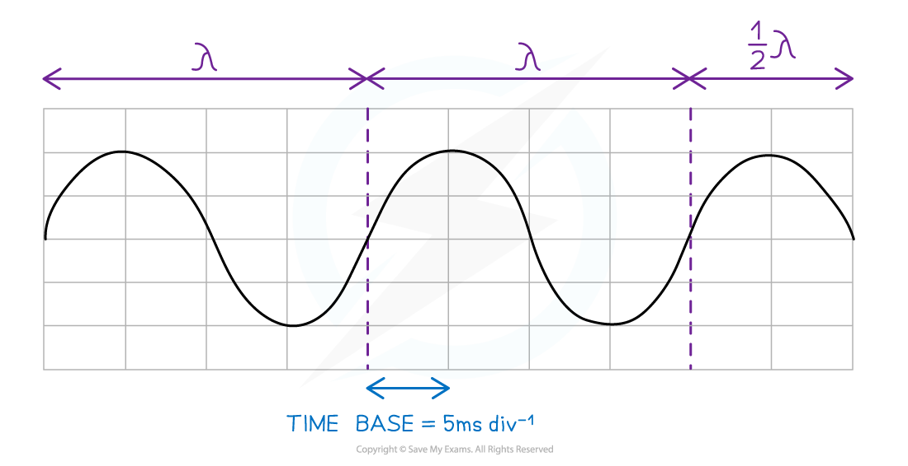

# Cathode-Ray Oscilloscope

## Cathode-Ray Oscilloscope

> **Spec point** — `spcpt_dTNy8QQ58cNNYvVD`

## Cathode-ray oscilloscope

- A cathode-ray oscilloscope is a laboratory instrument used to display, measure and analyse waveforms of electrical circuits
- An **a.c.** current on an oscilloscope is represented as a transverse wave

  - The oscilloscope can be used to determine its frequency and amplitude
- A **d.c** voltage on an oscilloscope is represented as a **horizontal line** at the relevant voltage
- The x-axis is the **time** and the y-axis is the **voltage (**or** y-gain)**

#### Cathode-ray oscilloscope display

***Diagram of cathode-ray oscilloscope display showing wavelength and time-base setting***

*** ***

- The period of the wave can be determined from the **time-base**

  - Time-base is **how many seconds each division represents **measured commonly in **s div****-1**** **or **s cm****-1**
- Count the number of wavelengths shown on the screen
- Divide the total time by the number of wavelengths to obtain the time period *T *
- Calculate the frequency of the wave using $f=\frac{1}{T}$

> **Worked Example**
> A cathode-ray oscilloscope (c.r.o.) is used to display the trace from a sound wave. The time-base is set at 7 µs mm-1.
> 
> 
> 
> What is the frequency of the sound wave?
> 
> **A.** 2.4 Hz
> 
> **B.** 24 Hz
> 
> **C. **2.4 kHz
> 
> **D. **24 kHz
> 
> **Answer: C**
> 
> **Step 1: Determine the period of the wave:**
> 
> - One full wave covers three horizontal squares, which is a distance of 6 cm
> - There are 60 mm in 6 cm
> 
>   - Each mm represents a time of 7 μs
>   - Time period, *T* = 60 × (7 × 10−6) = 4.2 × 10−4 s
> 
> **Step 2: Use the frequency equation to determine frequency:**
> 
> - Recall the frequency equation
> 
> $f=\frac{1}{T}=\frac{1}{4.2\times10^{-4}}=2380\mathrm{Hz}$
> 
> - Recall that 1000 Hz = 1 kHz and the answer must be given to 2 significant figures
> 
> $f=2.4\mathrm{kHz}$

> **Exam Hint**
> The time-base setting varies with units for seconds (commonly ms) and the unit length (commonly mm). Unit conversions are very important for the calculation of the time period and frequency
