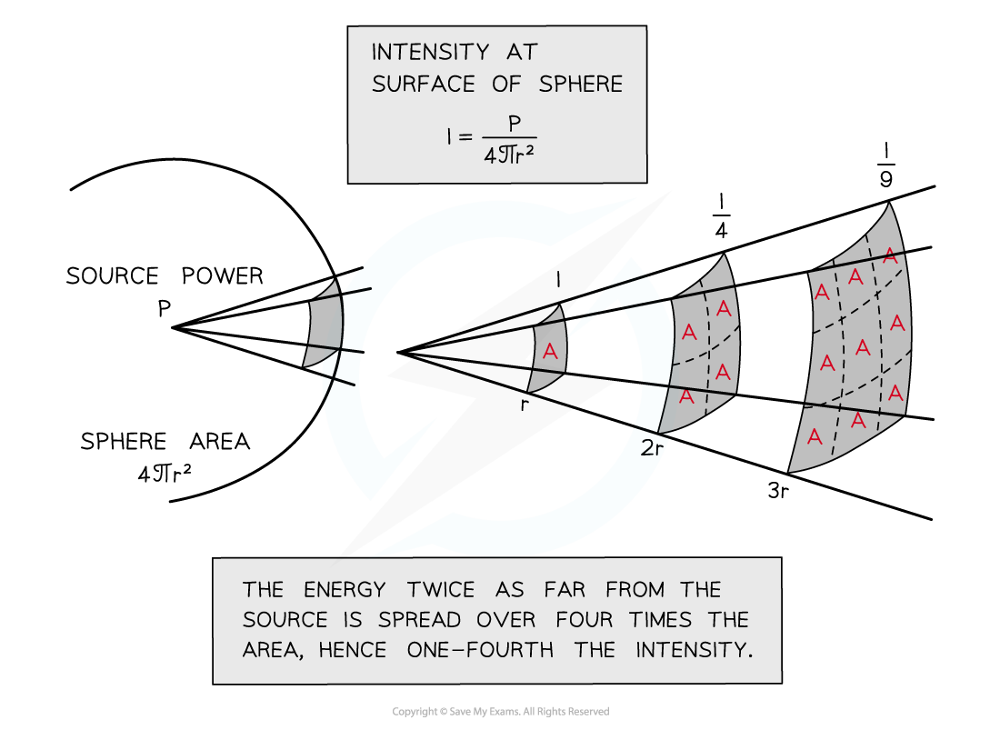

# Wave Intensity

## Wave Intensity

> **Spec point** — `spcpt_w392W8FRPQqd4h9p`

## Wave intensity

- [Progressive waves](https://www.savemyexams.com/a-level/physics/cie/25/revision-notes/7-waves/7-1-progressive-waves/progressive-waves/) transfer **energy**
- The amount of energy passing through a unit area per unit time is the **intensity** of the wave
- Therefore, the **intensity** is defined as **power per unit area**

$I=\frac{P}{A}$

- Where

  - *I* is intensity in W m−2
  - *P* is power in W
  - *A* is area in m2

- The **area** the wave passes through is **perpendicular** to the direction of its **velocity**
- The **intensity** of a progressive wave is also **proportional** to its **amplitude** **squared** and frequency squared

$I\proptoA^{2}$

$I\proptof^{2}$

- Where

  - *A* is amplitude in m
  - *f* is frequency in Hz
- Recall that ∝ means "proportional to"

- This means that if the frequency or the amplitude is doubled, the intensity increases by a factor of 4 (22)

#### Spherical waves

- A spherical wave is a wave from a point source which spreads out equally in all directions
- The area the wave passes through is the **surface area** of a sphere:** 4πr****2**
- As the wave travels further from the source, the energy it carries passes through increasingly larger areas as shown in the diagram below:

#### Inverse square law for intensity

***Intensity is proportional to the amplitude squared***

*** ***

- Assuming none of the wave energy is absorbed, the intensity *I* decreases with increasing distance from the source
- The **inverse square law **states that $I\propto\frac{1}{r^{2}}$

  - The inverse square law means when the source is twice as far away, the intensity is 4 times smaller

> **Worked Example**
> The intensity of a progressive wave is proportional to the square of the amplitude of the wave. It is also proportional to the square of the frequency. The variation with time t of displacement x of particles when two progressive waves Q and P pass separately through a medium, are shown on the graphs.
> 
> 
> 
> The intensity of wave Q is I0.What is the intensity of wave P?
> 
> **Answer:**
> 
> **Step 1: Compare waves Q and P:**
> 
> - The amplitude of wave **Q** is twice the amplitude of wave **P**
> - The frequency of wave **P** is double the frequency of wave **Q**
> 
> **Step 2: Evaluate how amplitude affects the intensities:**
> 
> - **Q** has twice the amplitude of **P**
> 
> $\frac{A_{Q}}{A_{P}}=2$
> 
> - The ratio of amplitudes squared is equal to the ratio of intensities, because intensity and amplitude squared are proportional
> 
> $\frac{A_{Q}^{2}}{A_{P}^{2}}=4=\frac{I_{Q}}{I_{P}}$
> 
> $I_{Q}=4I_{P}$
> 
> - So **Q**'s larger amplitude increases its intensity by a factor of 4
> 
> **Step 3: Evaluate how frequency affects the intensities:**
> 
> - **Q** has half the frequency of **P**
> 
> $\frac{f_{Q}}{f_{P}}=\frac{1}{2}$
> 
> - The ratio of frequencies squared is equal to the ratio of intensities because intensity and frequency squared are proportional
> 
> $\frac{f_{Q}^{2}}{f_{P}^{2}}=\frac{1}{4}=\frac{I_{Q}}{I_{P}}$
> 
> $I_{Q}=\frac{1}{4}I_{P}$
> 
> - So **Q**'s lower frequency decreases its intensity by a factor of 4
> 
> **Step 4: Determine the intensity of wave P in terms of *****I******0***** :**
> 
> - **P **has a lower amplitude which reduces its intensity by a factor of 4 compared to **Q**
> - However, **P** has a higher frequency which increases its intensity by a factor of 4 compared to **Q**
> - These effects **cancel out**, so wave **P** has an intensity of ***I******0*** , which is equal to that of wave **Q**

> **Exam Hint**
> The key concept with intensity is that it has an inverse square relationship with distance (not a linear one). This means the energy of a wave decreases very rapidly with increasing distance
