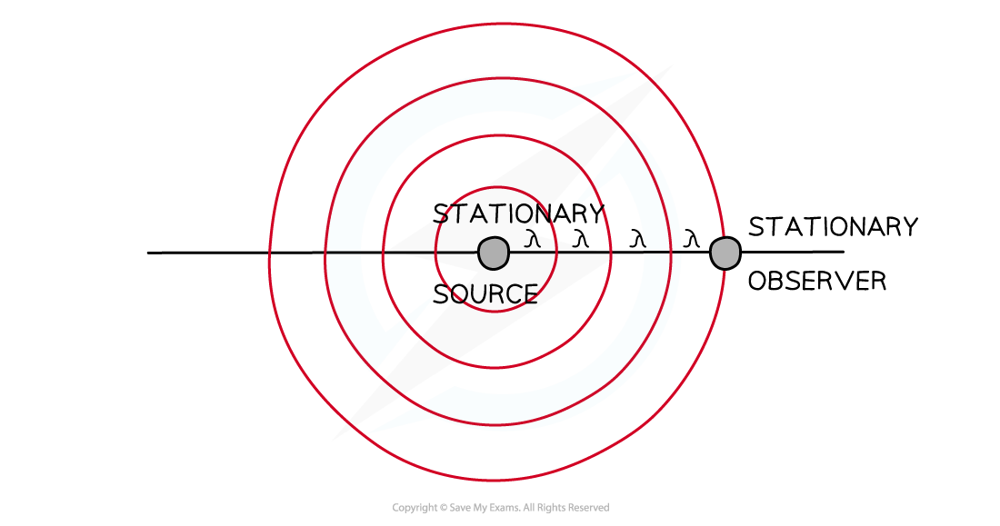
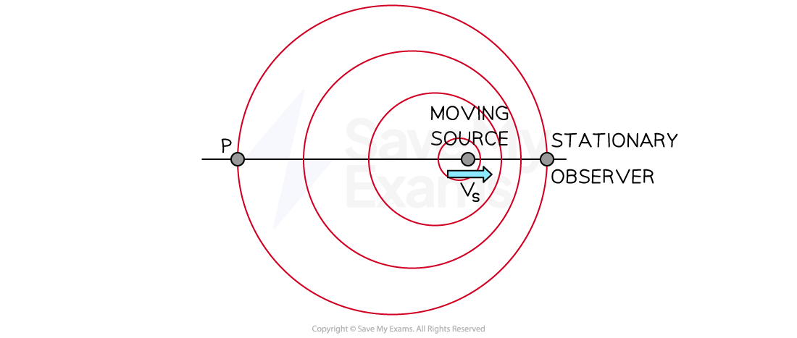

# Doppler Effect for Sound Waves

## Doppler Shift of Sound

> **Spec point** — `spcpt_Q5pSpTZtccxnzV3J`

## Doppler shift of sound

- The whistle of a train or the siren of an ambulance appears to decrease in frequency (sounds lower in pitch) as it moves further away from you
- This frequency change due to the relative motion between a source of sound or light and an observer is known as the **Doppler effect **(or **Doppler shift**)
- When the observer (e.g. yourself) and the source of sound (e.g. ambulance siren) are both **stationary**, the waves are at the **same** frequency for both the observer and the source

#### Waves emitted from a stationary source

***According to the observer stationary relative to the source, the frequency is equal to that measured by the source***

- When the source starts to move **towards** the observer, the wavelength of the waves is **shortened**

  - The sound therefore appears at a **higher** frequency to the observer

#### Waves emitted by a moving source

***The source and observer disagree on their measurements of the frequency of the wave***

*** ***

- Notice how the waves are closer together between the source and the observer compared to point P and the source
- If the observer was at point P instead, they would hear the sound at a lower frequency due to the wavelength of the waves **broadening**
- The frequency is **increased** when the source is moving **towards **the observer
- The frequency is **decreased** when the source is moving **away** from the observer

> **Worked Example**
> A cyclist rides past a stationary observer ringing their bell as they ride away.
> 
> Which of the following accurately describes the Doppler shift caused by the sound of the bell as the cyclist moves away from the observer?
> 
> |   | **Wavelength** | **Frequency** | **Pitch** |
> |---|---|---|---|
> | **A** | Shorter | Higher | Higher |
> | **B** | Longer | Lower | Higher |
> | **C** | Shorter | Higher | Lower |
> | **D** | Longer | Lower | Lower |
> 
> **Answer: D**
> 
> - As the cyclist rides away from the observer, the wavelength increases or becomes **longer**
> 
>   - This rules out options **A** and **C**
> - A longer wavelength means a lower frequency (from the wave equation $v=fλ$)
> - A lower frequency corresponds to a sound of lower pitch
> 
>   - Therefore, the correct answer is **D**

## Calculating Doppler Shift

> **Spec point** — `spcpt_YcK6qGNKGmSfy7GD`

## Calculating Doppler shift

- When a **source** of sound waves **moves relative** to a **stationary observer**, the observed frequency can be calculated using the equation below:

$f_{o} = f_{s} ( \frac{v}{v \pm v_{s} } )$

- Where

  - *f**o** *is the observed frequency in Hz
  - *f**s** *is the source frequency in Hz
  - *v *is wave velocity in m s−1
  - *v**s** *is the velocity of the source relative to the observer, again in m s−1
- Use the speed of sound given in the question (often 340 m s-1 in air)
- The ± depends on whether the source is moving towards or away from the observer

  - If the source is moving **towards**, the denominator is v - vs
  - If the source is moving **away**, the denominator is v + vs

> **Worked Example**
> A police car siren emits a sound wave with a frequency of 450 Hz. The car is travelling away from an observer at speed of 45 m s-1. The speed of sound is 340 m s-1.
> 
> Which of the following is the frequency the observer hears?
> 
> **A. **519 Hz
> 
> **B.** 483 Hz
> 
> **C.** 397 Hz
> 
> **D.** 358 Hz
> 
> **Answer: C**
> 
> **Step 1: Choose the correct version of the Doppler shift equation:**
> 
> - The source is moving away from the observer so choose the plus symbol
> 
> $f_{o} = f_{s} ( \frac{v}{v + v_{s} } )$
> 
> **Step 2: Substitute the given values:**
> 
> - The observer's recording of frequency is
> 
> $f_{o} = 450 \times ( \frac{340}{340 + 45} ) = 397 \text{Hz}$

> **Exam Hint**
> Be careful as to which frequency and velocity you use in the equation. The ‘source’ is always the object which is moving and the ‘observer’ is always stationary.
