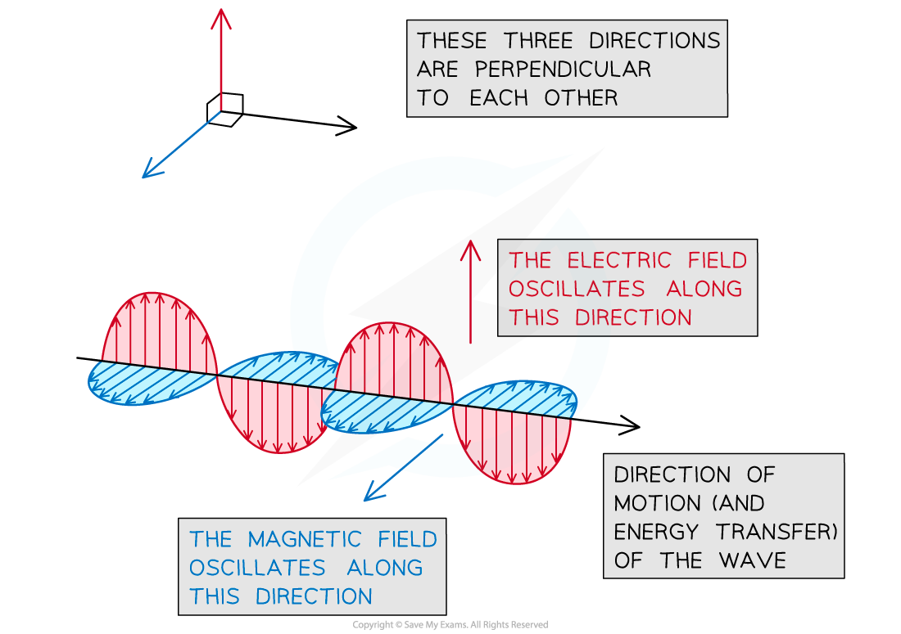
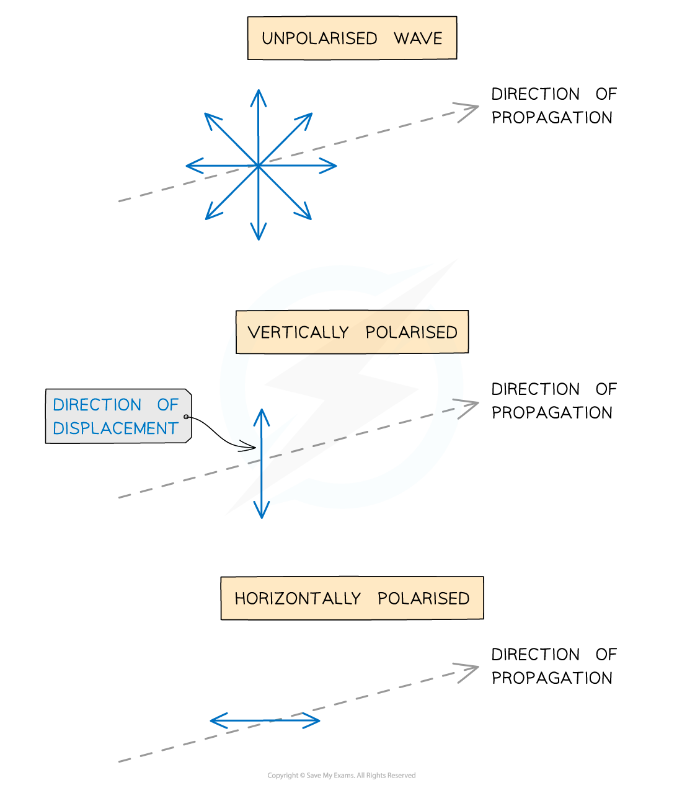
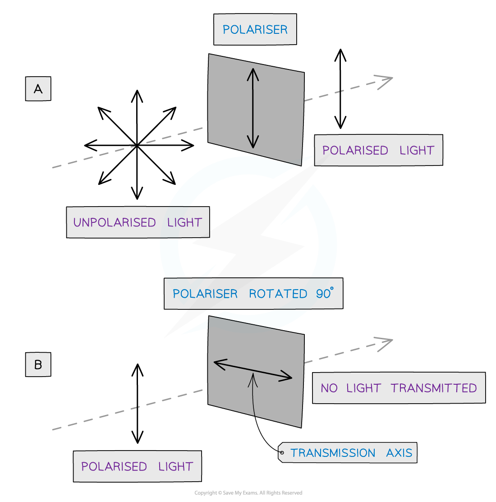
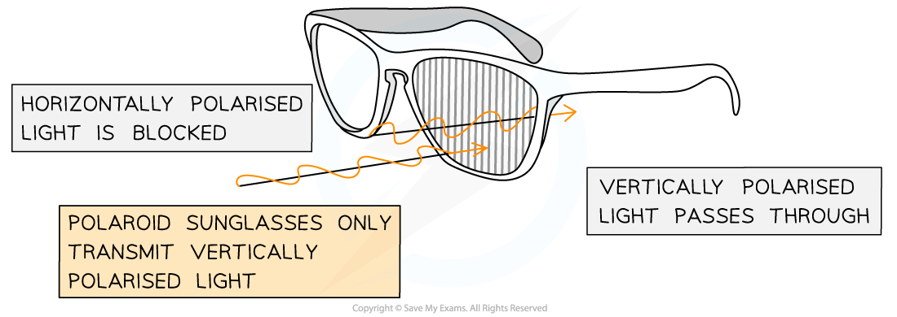
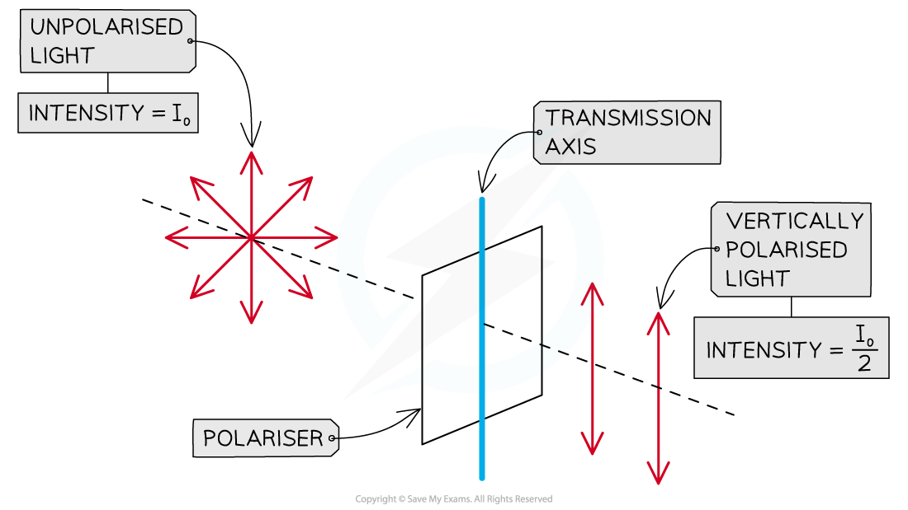
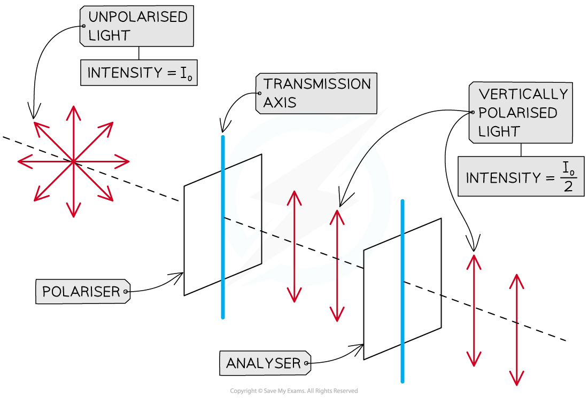

# Polarisation

## Polarisation

> **Spec point** — `spcpt_fNzpTbgtKjTqJhWc`

## Polarisation

### Polarisation of transverse waves

- [Transverse waves](https://www.savemyexams.com/a-level/physics/cie/25/revision-notes/7-waves/7-2-transverse-and-longitudinal-waves/transverse-and-longitudinal-waves/) are waves that oscillate with their displacement perpendicular to their direction of travel

  - These oscillations can happen in **any plane **perpendicular to the propagation direction
- An [electromagnetic wave](https://www.savemyexams.com/a-level/physics/cie/25/revision-notes/7-waves/7-4-electromagnetic-spectrum/electromagnetic-spectrum/) is an example of a **transverse wave** that oscillates in **more than one plane**

  - A magnetic field oscillates on one plane
  - An electric field oscillates on a different plane
  - Both planes are at right angles to each other and to the direction of wave motion

***An electromagnetic wave is generated by the combined oscillation of an electric and a magnetic field***

- When transverse waves are **polarised**

  - vibrations are restricted to **one** plane of oscillation
  - vibrations are still **perpendicular** to the direction of propagation / energy transfer
- The difference between unpolarised and polarised waves are shown in the diagram below

  - The blue arrows represent the direction of the **plane of oscillation** of the transverse wave
- An **unpolarised** wave oscillates in **many planes** of oscillation
- A **vertically polarised** wave oscillates only in the **vertical plane**
- A **horizontally polarised** wave oscillates only in the **horizontal plane**

#### Different planes of polarisation

***Diagram showing the displacement of unpolarised and polarised transverse waves***

### Polarising filters

- Waves can be polarised by passing through a **polariser** or **polarising filter**.

  - Polarisers only allow oscillations in a **certain plane** to be transmitted through the filter
- A **polariser** is an optical layer or lens that consists of **many parallel tiny slits**

  - A polariser only allows waves vibrating parallel to the direction of these slits to pass through
  - Waves that are not orientated in the correct plane are blocked by the filter and do not pass through

#### Action of a polarising filter

***Diagram showing an unpolarised and polarised wave travelling through polarisers***

- Only unpolarised waves can be polarised

  - This is shown in diagram A
  - When a polarised wave passes through a filter with a** transmission axis perpendicular** to the wave (diagram B), **none** of the wave will **pass through**

#### Polaroid sunglasses

- **Polaroid sunglasses** are an example of a polarisation
- Polaroid sunglasses contain lenses with polarising filters with transmission axes that are **vertically oriented**

  - This means the glasses do not allow any **horizontally polarised light** to pass through

#### Polaroid sunglasses

***Polaroid sunglasses contain vertically oriented polarising filters which block out any horizontally polarised light***

> **Worked Example**
> The following are statements about waves.
> 
> Which statement below describes a situation in which polarisation should happen?
> 
> **A.** Radio waves pass through a metal grid
> 
> **B.** Surface water waves are diffracted
> 
> **C.** Sound waves are reflected
> 
> **D.** Ultrasound waves pass through a metal grid
> 
> **Answer: A**
> 
> - Polarisation only occurs for transverse waves, therefore, **C** and **D** can be ruled out as sound and ultrasound are both longitudinal waves
> - Waves are not polarised when diffracted, hence we can also rule out option **B**
> - Radio waves are transverse waves - they can be polarised by a metal grid so only the waves that fit through the grid will be transmitted, therefore, **A** is correct

## Malus's Law

> **Spec point** — `spcpt_TPFGCdQXyf7xG2QV`

## Malus's law

### Intensity of polarised electromagnetic waves

- The ***intensity*** of electromagnetic waves is reduced as a result of polarisation
- If unpolarised electromagnetic waves of intensity *I**0* pass through a polariser, the **intensity of the transmitted polarised waves falls by a half**

  - ** **$I=\frac{I_{0}}{2}$ is known as the **half rule**

#### Intensity of polarised and unpolarised light

***The intensity of polarised light transmitted by a polariser is half the intensity of the unpolarised light incident on it***

### Intensity of analysed electromagnetic waves

- A second polarising filter placed after the first is known as an **analyser **

#### Intensity of waves when polariser and analyser have the same orientation

***When the polariser and the analyser have the same orientation (i.e. parallel transmission axes), the intensity of analysed light is the same as the intensity of polarised light***

### Malus's law

- **Malus's law** states that if the analyser is rotated by an angle *θ*  **with respect to the polariser**, the intensity of the waves transmitted by the analyser is given by the equation

`I=I_ 0 cos² (θ)`

- Where

  - *I* is intensity of transmitted light in W m−2
  - *I*0 is maximum intensity (same units)
- If the polariser and the analyser have the **same orientation**, electromagnetic waves transmitted by the analyser have the **same** **intensity** as waves that are incident upon it, since cos(0) = 1

  - If **vertically polarised **electromagnetic waves with intensity $\frac{I_{0}}{2}$ are incident on an analyser with a **vertical transmission axis**, **all** of the **waves **will be **transmitted** through the analyser
  - The **intensity** between the polariser and the analyser will **not decrease **

- If the analyser is rotated by **90° **with respect to the polariser (*θ* = 90°), the intensity of the light transmitted by the analyser will be **zero**, since *cos*(90°) = 0

  - If **vertically polarised light** is incident on an **analyser** with a **horizontal transmission axis**, none of the light will be transmitted through the analyser
  - In this instance,** all** the waves will be **absorbed**

#### Table of transmission depending on polariser orientation

| **Angle of transmission axis, θ / degrees** | **Direction of transmission axis** | **cos****2****θ** | **Transmitted intensity *****/ *****W m****−2** | **Maximum or minimum light intensity transmitted** |
|---|---|---|---|---|
| 0 | Vertical | 1 | *I*0 | Max |
| 180 | Vertical | 1 | *I*0 | Max |
| 90 | Horizontal | 0 | 0 | Min |
| 270 | Horizontal | 0 | 0 | Min |

> **Worked Example**
> Unpolarised light is incident on a polariser.
> 
> The light transmitted by the first polariser is then incident on a second polariser.
> 
> The polarising (or transmission) axis of the second polariser is 30° to that of the first. The intensity incident on the first polariser is *I*.
> 
> What is the intensity emerging from the second polariser?
> 
> **A.** 0.75 *I*
> 
> **B.** 0.38 *I*
> 
> **C.** 0.87 *I*
> 
> **D.** 0.43 *I*
> 
> **Answer: B**
> 
> **Step 1: Apply the half rule:**
> 
> - When light passes through the first polariser, half its intensity is lost
> 
> $I_{1}=\frac{1}{2}I$
> 
> **Step 2: Use Malus's law:**
> 
> - The angle of the transmission axis is 30°
> - In this case, *I*0 in Malus's equation is *I*1 here, because the light has already passed through the first polariser
> 
> `I_ 2=I_ 1 cos² (θ)=1 half I cos² (30 degree)=1 half I×3 / 4`
> 
> $I_{2}=\frac{3}{8}I=0.375I$
> 
> - To 2 significant figures, this is option **B**

> **Exam Hint**
> Remember when using Malus’s law to **square** the cosine of the angle (cos2 θ)
> 
> Remember that the unpolarised light coming through will always halve in intensity when it becomes polarised through an polariser. Only **then** should you use Malus' law to find the intensity of the light after it has passed through the analyser. Therefore, the I and I0 in Malus' law are the intensities of light that are already polarised.
