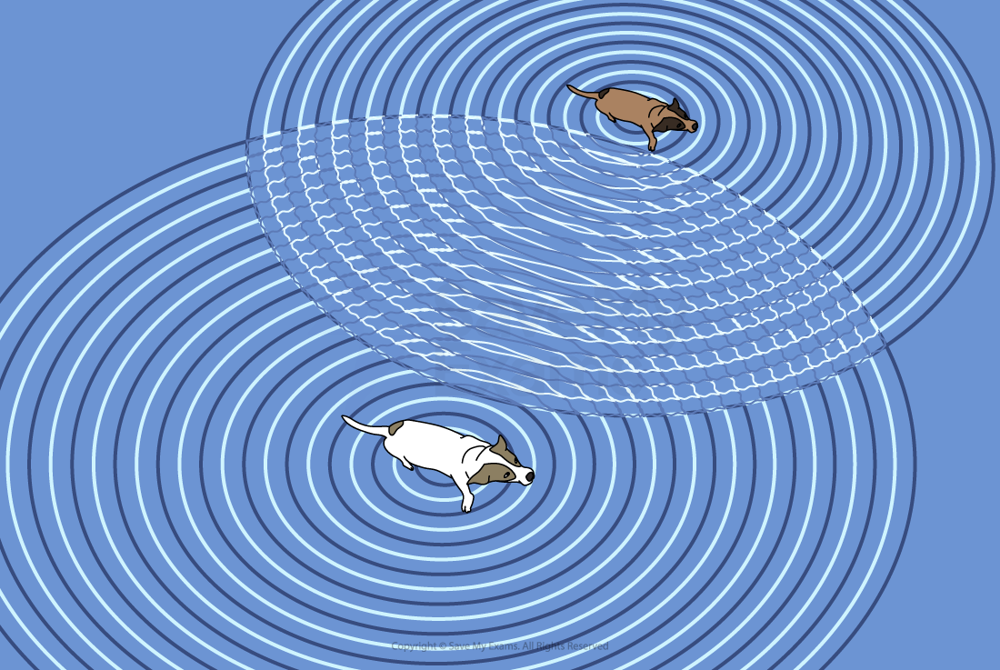
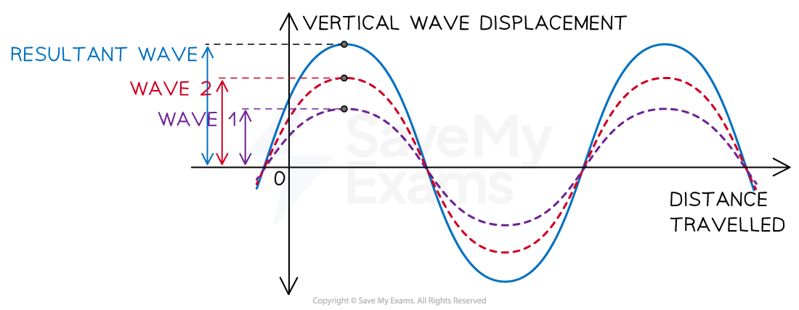
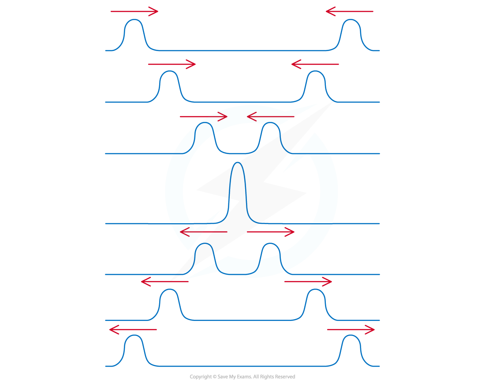

# The Principle of Superposition

## The Principle of Superposition

> **Spec point** — `spcpt_nPP65pgJhsqh9Sp6`

## The principle of superposition

- When two or more waves arrive at the same point and overlap, their amplitudes combine

  - This is called **superposition**
- The **principle of superposition** states that:

**When two or more waves overlap at a point, the displacement at that point is equal to the sum of the displacements of the individual waves**

- The superposition of **surface water waves** shows the effect of this overlap

  - There are areas of zero displacement, where the water is flat
  - There are areas of increased displacement, where the water waves are higher

***The dogs make waves in the water which superimpose to give areas of both zero and increased displacement.***

- It is possible to analyse superposition clearly when the waves are drawn on a vertical displacement (amplitude)-displacement graph

***Waves can superimpose so their amplitudes are added together often creating a larger resultant amplitude***

- ***Interference***** **is the effect of this overlap

  - This is explained in the next revision note on [Interference & coherence](https://www.savemyexams.com/a-level/physics/cie/25/revision-notes/8-superposition/8-3-interference/interference-and-coherence/)
- Individual wave displacements may be positive or negative and are **combined** in the same way as other **vector** quantities
- It is possible to analyse superposition clearly when the waves are drawn on a displacement-time graph

- Superposition can also be demonstrated with **two pulses**

  - When the pulses meet, the resultant displacement is also the **algebraic sum** of the displacement of the individual pulses
  - After the pulses have interacted, they then carry on as normal

***When two pulses overlap their displacements combine to form a resultant displacement***

> **Worked Example**
> Two overlapping waves of the same types travel in the same direction. The variation with x and y displacement of the wave is shown in the figure below.
> 
> 
> 
> Use the principle of superposition to sketch the resultant wave.
> 
> **Answer:**
> 
> - The graph of the superposition of both waves is in black:
> 
> 
> 
> - To plot the correct amplitude at each point, sum the amplitude of **both** graphs at that point
> 
>   - E.g. at point A, each graph has a value of 0.7. Therefore, the same point with the resultant superposition is 2 × 0.7 = 1.4
>   - Each square on the y-axis represents 0.2

> **Exam Hint**
> The best way to draw the superposition of two waves is to find where the superimposed wave has its maximum and minimum amplitudes. It is then a case of joining them up to form the wave. Where the waves intersect determines how much constructive or destructive interference will occur.
