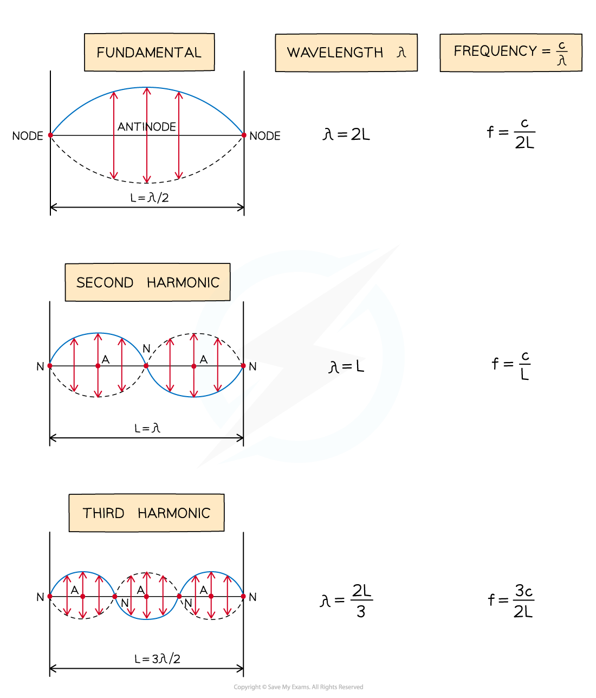
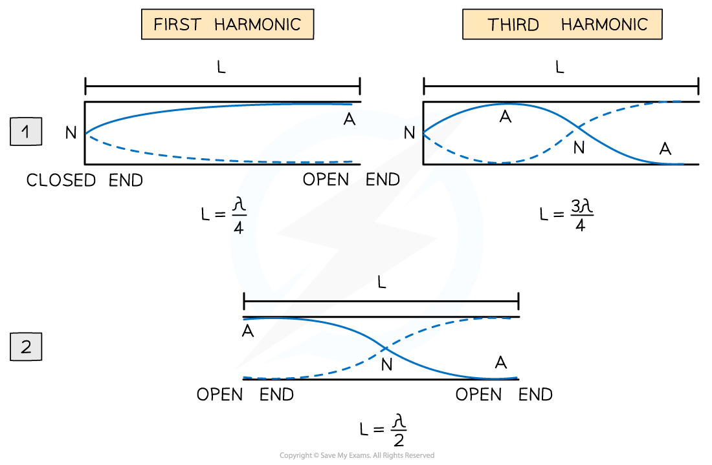
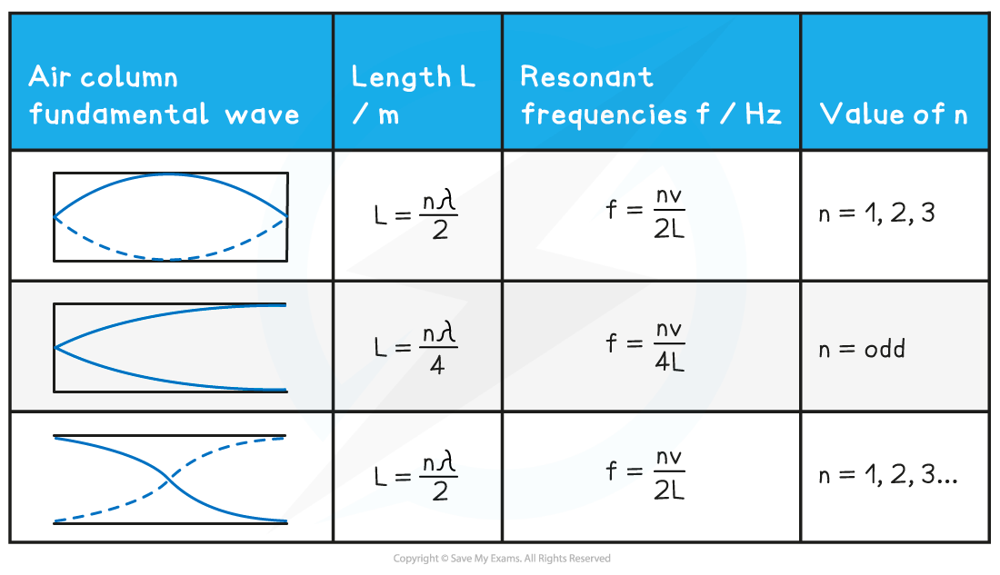

# Wavelength of Stationary Waves

## Wavelength of Stationary Waves

> **Spec point** — `spcpt_gxMqFRS6hsJQQxYJ`

## Wavelength of stationary waves

- **Stationary waves** have **different wave patterns **depending on the **frequency** of the vibration and the** situation** in which they are created

### Two fixed ends

- When a stationary wave, such as a vibrating string, is fixed at both ends, the simplest wave pattern is a single loop made up of **two nodes** and an **antinode**

  - This is called the **fundamental mode** of vibration or the **first harmonic**
- The particular frequencies (i.e. resonant frequencies) of standing waves possible in the string depend on its length *L* and its speed *v*
- As you **increase the frequency**, the **higher harmonics** begin to appear

  - The frequencies can be calculated from the string length and wave equation
- For a string of length *L*, the wavelength of the lowest harmonic is 2*L* $λ_{n}=\frac{2L}{n}$

  - This is because there is only one loop of the stationary wave, which is a half wavelength

$λ_{1}=\frac{2L}{1}=2L$

- The second harmonic has **three nodes** and **two antinodes**

  - So the wavelength is equal to the length of the string

$λ_{2}=\frac{2L}{2}=L$

- The third harmonic has **four nodes **and **three antinodes**

$λ_{3}=\frac{2L}{3}$

- The ***n*****th harmonic** has ***n***** antinodes** and ***n***** + 1 nodes**
- The ***n*****th wavelength** has a wavelength of $\frac{2L}{n}$
- The wavelengths and frequencies of the first three harmonics can be summarised as follows:

#### Wavelength and frequencies of different harmonics

***Diagram showing the first three modes of vibration of a stretched string with corresponding frequencies***

### One or two open ends in an air column

- When a stationary wave is formed in an air column with one or two open ends,  slightly different wave patterns are seen in each

#### Harmonics in an air column

***Diagram showing modes of vibration in pipes with one end closed and the other open or both ends open***

- Image **1** shows stationary waves in a column which is **closed at one end**

  - At the **closed **end, a **node **forms
  - At the **open **end, an **antinode **forms

- Therefore, the fundamental mode is made up of a quarter wavelength with one node and one antinode

  - Every harmonic after that adds on an extra node and antinode
  - Hence, **only odd** harmonics form

- Image **2** shows stationary waves in a column which is **open at both ends**

  - An **antinode **forms at each **open **end

- Therefore, the fundamental mode is made up of a half wavelength with one node and two antinodes

  - Every harmonic after that adds on an extra node and an antinode
  - Hence, **odd** and **even** harmonics can form

- In summary, a column length *L* for a wave with wavelength *λ* and resonant frequency *f* for stationary waves to appear is as follows:

#### Air Column Length & Frequencies Summary Table

> **Worked Example**
> A standing wave is set up in a column of length *L* when a loudspeaker placed at one end emits a sound wave of frequency *f*. The column is closed at the other end. The speed of sound is 340 m s−1.
> 
> 
> 
> For a column of length 7.5 m, what is the wavelength of the second lowest note produced?
> 
> **Answer:**
> 
> **Step 1: Determine the positions of the nodes and antinodes**
> 
> - One end of the column is closed, and the loudspeaker represents an open end
> - Hence, an antinode forms at the loudspeaker (open end) and a node forms at the closed end
> - The fundamental frequency represents the lowest note - this would be 1 node and 1 antinode
> - So, the second-lowest note must have 2 nodes and 2 antinodes
> 
> 
> 
> **Step 2: Write an expression for the length of the sound wave in the column**
> 
> - In the column, there is a quarter wavelength and a half wavelength, or $\frac{3}{4}λ$
> - Therefore, the length of the column is:
> 
> $L=\frac{3λ}{4}$
> 
> - **Note:** for a column with an open and closed end,** **$L=\frac{nλ}{4}$, this would represent the third harmonic (n = 3)
> 
> **Step 3: Determine the wavelength of the second lowest note**
> 
> $λ=\frac{4L}{3}=\frac{4\times7.5}{3}=10m$

> **Exam Hint**
> The fundamental counts as the first harmonic or *n* = 1 and is the lowest frequency with half or quarter of a wavelength. A full wavelength with both ends open or both ends closed is the **second** harmonic. Make sure to match the correct wavelength with the harmonic asked for in the question!
