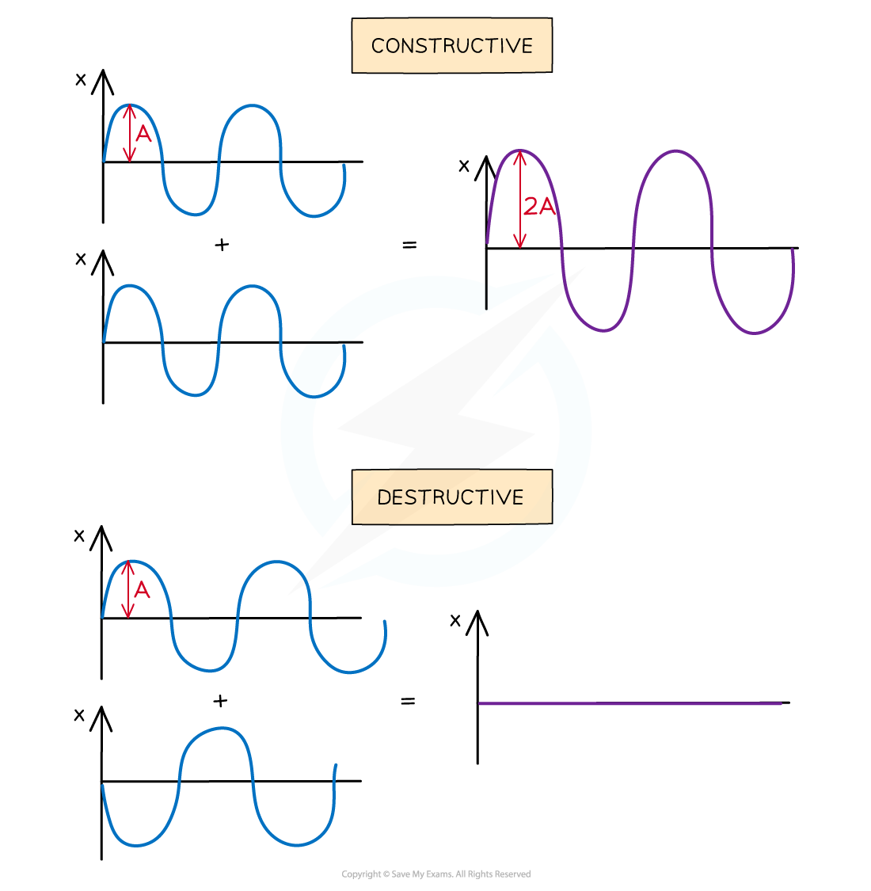
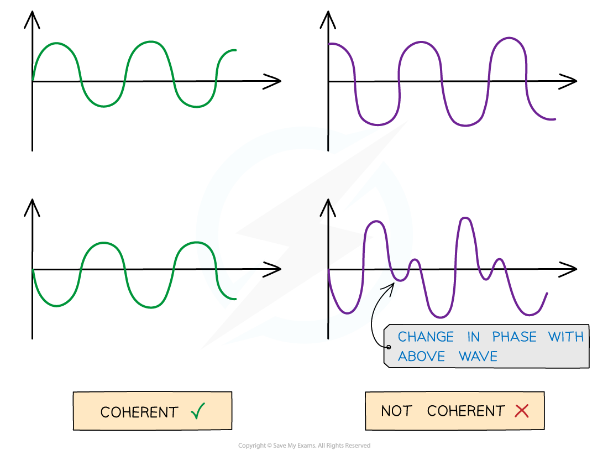

# Interference & Coherence

## Interference & Coherence

> **Spec point** — `spcpt_nQf2JTC4vpMYZVK7`

## Interference & coherence

### Interference

- Interference occurs when waves **overlap** and their resultant displacement is the **sum of the displacement of each wave**
- This result is based on the principle of[ superposition](https://www.savemyexams.com/a-level/physics/cie/25/revision-notes/8-superposition/8-1-stationary-waves/the-principle-of-superposition/) and the resultant waves may be smaller or larger than either of the two individual waves
- Interference of two waves can either be:

  - In **phase**, causing **constructive interference. **The peaks and troughs line up on both waves. The resultant wave has double the amplitude
  - In **anti-phase**, causing **destructive interference. **The peaks on one wave line up with the troughs of the other. The resultant wave has no amplitude

#### Constructive and destructive interference

***Waves in superposition can undergo constructive or destructive interference***

#### Conditions for constructive and destructive interference

- In general, for waves emitted by two coherent sources very close together:
- The condition for **constructive interference** is:

**path difference = **$nλ$

- The condition for **destructive interference** is:

**path difference =** `(n+thin 1 half) λ`

- Where:

  - *λ* = wavelength of the waves in metres (m)
  - *n* = 0, 1, 2, 3... (any other integer)

### Coherence

- At points where the two waves are neither in phase nor in antiphase, the resultant amplitude is somewhere in between the two extremes
- Waves are **coherent** if they have the same **frequency** and **constant phase difference**

#### Coherent vs. incoherent waves

***Coherent v non-coherent wave. The abrupt change in phase creates an inconsistent phase difference***

*** ***

- Coherence is vital in order to produce an observable interference pattern
- Laser light is an example of a coherent light source, whereas filament lamps produce incoherent light waves

> **Worked Example**
> The diagram shows the interferences of coherent waves from two point sources.
> 
> 
> 
> Which row in the table correctly identifies the type of interference at points **X**, **Y** and **Z**.
> 
> |   | **X** | **Y** | **Z** |
> |---|---|---|---|
> | **A** | Constructive | Destructive | Constructive |
> | **B** | Constructive | Constructive | Destructive |
> | **C** | Destructive | Constructive | Destructive |
> | **D** | Destructive | Constructive | Constructive |
> 
> **Answer: B**
> 
> - At point X:
> 
>   - Both peaks of the waves are overlapping. This is **constructive** interference and rules out options C and D
> - At point Y:
> 
>   - Both troughs are overlapping so **constructive** interference occurs there
> - At point Z:
> 
>   - A peak of one of the waves meets the trough of the other. This is **destructive** interference (Row B)

> **Exam Hint**
> Think of ‘constructive’ interference as ‘building’ the wave and ‘destructive’ interference as ‘destroying’ the wave.
