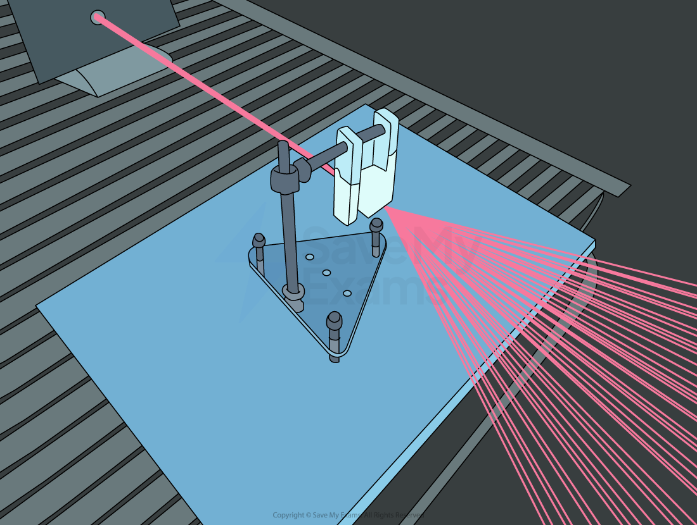
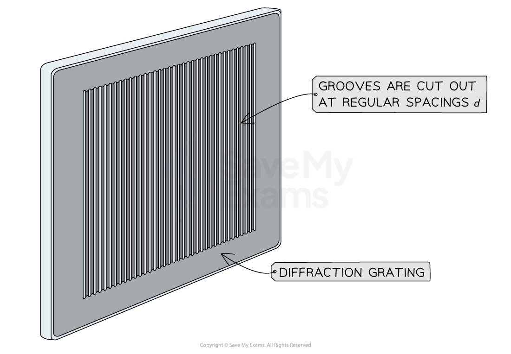
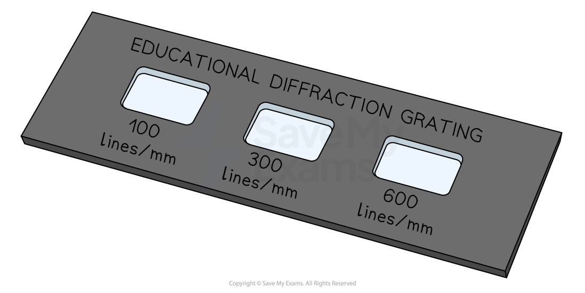
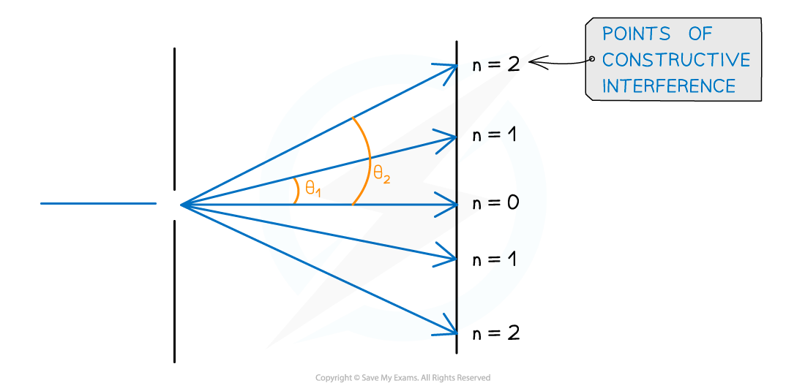
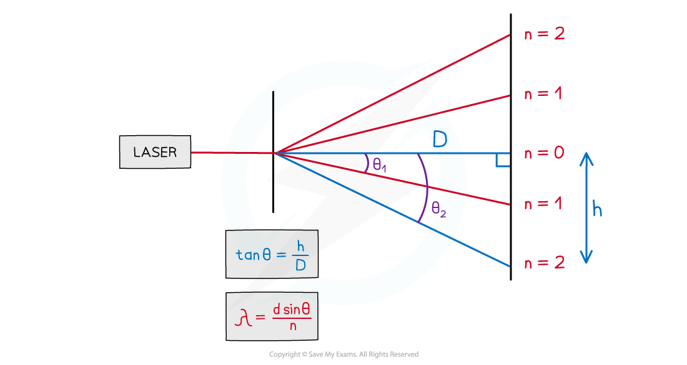

# The Diffraction Grating

## The Diffraction Grating Equation

> **Spec point** — `spcpt_zbG2Xc9VnZdqTwNG`

## The diffraction grating equation

- A diffraction grating is a piece of **optical equipmen**t that creates a diffraction pattern when it diffracts monochromatic light into bright and dark fringes

***A laser light is diffracted using a diffraction grating***

- A diffraction grating consists of a **large number **of very **thin**, **equally spaced** **parallel slits** carved into a glass plate

***A diffraction grating consists of many parallel equally spaced slits cut into the glass plate***

- Just like for single and double-slit diffraction the regions where **constructive interference** occurs are also the regions of **maximum intensity**
- Their location can be calculated using the **diffraction grating equation**

`d sin open parentheses theta close parentheses space equals space n lambda`

- Where:

  - *d* = spacing between adjacent slits (m)
  - *θ* = angle between the zero-order and *n*th-order maxima (degrees)
  - *n* = order of maxima (*n* = 0, 1, 2, 3...)
  - *λ *= wavelength of light source (m)

### Slit spacing

- Diffraction gratings come in **different sizes**

  - The sizes are determined by the number of** lines per millimetre** (lines / mm) or lines per m
  - This is represented by the symbol *N*
- *d* can be calculated from *N* using the equation

  - If *N *is given in terms of lines per mm then *d *will be in mm
  - If *N *is given in terms of lines per m then *d *will be in m

$d=\frac{1}{N}$

***Diffraction gratings come in different sizes according to the number of lines per mm***

### Angular separation

- The angular separation of each maxima is calculated by rearranging the grating equation to make θ the subject
- The angle θ is taken from the centre meaning the higher orders of *n *are at greater angles

***Angular separation increases as the order of maxima increases***

- The angular separation between two angles is found by subtracting the smaller angle from the larger one
- The angular separation between the first and second maxima at n1 and n2 is ***θ******2***** – *****θ******1***

### Orders of maxima

- The **maximum angle of diffraction** with which maxima can be seen is when the diffracted light travels along the plane of the grating

  - This means *θ* = 90° and sin *θ* = 1
- The highest order of maxima visible is therefore calculated by the equation:

$n=\frac{d}{λ}$

- Since *n* is an integer number of maxima, if the value obtained is a decimal it must be rounded **down **to determine the highest-order visible

  - E.g If *n* is calculated as 2.7 then *n* = 2 is the highest-order visible

> **Worked Example**
> An experiment was set up to investigate light passing through a diffraction grating with a slit spacing of 1.7 µm. The fringe pattern was observed on a screen. The wavelength of the light is 550 nm.
> 
> 
> 
> Calculate the angle α between the two second-order lines.
> 
> **Answer:**
> 
> **Step 1: List the known quantities**
> 
> - Order of maxima, *n* = 2
> - Diffraction slit spacing, *d* = 1.7 µm = 1.7 × 10–6 m
> - Wavelength, *λ *= 550 nm = 550 × 10–9 m
> 
> **Step 2: Rearrange for *****β***** and substitute in the values**
> 
> `d sin open parentheses theta close parentheses space equals space n lambda`
> 
> `sin open parentheses beta close parentheses space equals space fraction numerator n lambda over denominator d end fraction`
> 
> `sin open parentheses beta close parentheses space equals space fraction numerator 2 space cross times space open parentheses 550 space cross times space 10 to the power of negative 9 end exponent close parentheses space over denominator 1.7 space cross times space 10 to the power of negative 6 end exponent end fraction space equals space 0.64706`
> 
> `beta space equals space sin to the power of negative 1 end exponent open parentheses 0.64706 close parentheses space equals space 40.32 to the power of degree`
> 
> **Step 3: Calculate α**
> 
> - *β *is the angle from the centre to the second-order line
> 
> `alpha space equals space 2 beta space equals space 2 cross times 40.32 space equals space 81 degree space open parentheses 2 space straight s. straight f close parentheses`

> **Exam Hint**
> Take care that the angle *θ* is the correct angle taken from the centre and not the angle taken between two orders of maxima.

## Determining the Wavelength of Light

> **Spec point** — `spcpt_cSF2TgJrgW884gPT`

## Determining the wavelength of light

### Method

- The **wavelength** of light can be determined by **rearranging** the grating equation to make the wavelength *λ *the subject

`d sin open parentheses theta close parentheses space equals space n lambda space rightwards arrow space lambda space equals space fraction numerator d sin open parentheses theta close parentheses over denominator n end fraction`

- The value of *θ*, the angle to the specific order of maximum measured from the centre, can be calculated through **trigonometry**
- Create a **right angled triangle **to determine the** angle **of diffraction,* θ*

  - The **distance** from the **grating to the screen** is marked as ***D***
  - The **distance** between the **centre and the order of maxima** (e.g. *n* = 2 in the diagram below) on the screen is labelled as ***h****, *the fringe spacing
- Measure both of these values with a ruler
- Obtain the ratio $\mathrm{tan}θ=\frac{\mathrm{opposite}}{\mathrm{adjacent}}=\frac{h}{D}$

#### Order of maxima and wavelength

***The wavelength of light is calculated by the angle to the order of maximum***

- Calculate the inverse of tan to find `theta space equals space tan to the power of negative 1 end exponent open parentheses h over D close parentheses`
- Substitute for *θ* back into the diffraction grating equation to find the value of the wavelength (with the corresponding order *n*)

### Improving the experiment and reducing uncertainties

- The fringe spacing can be subjective depending on its intensity on the screen. Take multiple measurements of *h* (between 3-8) and find the average
- Use a Vernier scale to record *h*, in order to reduce percentage uncertainty
- Reduce the uncertainty in *h* by measuring between the two *n*th-order maxima and halving
- Increase the grating to screen distance *D *to increase the fringe separation (although this may decrease the intensity of light reaching the screen)
- Conduct the experiment in a darkened room, so the fringes are clearer
- Use grating with more lines per mm, so values of *h* are greater to lower percentage uncertainty
