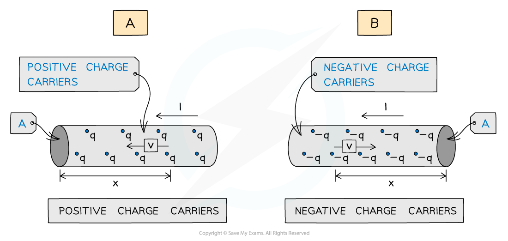

# Calculating Electric Current & Charge

## Calculating Electric Charge

> **Spec point** — `spcpt_w7pBqYM2Hd6FdHgk`

## Calculating electric charge

- Current can also be defined as the charge passing through a circuit per unit time
- Electric charge is measured in units of **coulombs (C)**
- Charge, current and time are related by the following equation:

***Q = It ***

- Where:

  - *Q* = charge (C)
  - *I* = current (A)
  - *t* = time (s)

> **Worked Example**
> When will 8 mA of current pass through an electrical circuit?
> 
> **A.** When 1 J of energy is used by 1 C of charge
> 
> **B. **When a charge of 4 C passes in 500 s
> 
> **C.** When a charge of 8 C passes in 100 s
> 
> **D.** When a charge of 1 C passes in 8 s
> 
> **Answer: B**
> 
> **Step 1: Write out the equation relating current, charge and time**
> 
> $Q=It$
> 
> $I=\frac{Q}{t}$
> 
> **Step 2: Rule out any obviously incorrect options**
> 
> - Option **A** does not contain time, so can be ruled out
> 
> **Step 3: Try the rest of the options to determine the correct answer**
> 
> - Consider option **B**:
> 
> *I* = 4 ÷ 500 = 8 × 10–3 = 8 mA
> 
> - Consider option **C**:
> 
> *I* = 8 ÷ 100 = 80 × 10–3 = 80 mA
> 
> - Consider option **D**:
> 
> *I* = 1 ÷ 8 = 125 × 10–3 = 125 mA
> 
> - Therefore, the correct answer is **B**

> **Exam Hint**
> Although electric charge can be positive or negative, since the conventional direction of current is the flow of **positive **charge the current should always be a positive value for your exam answers.

## Calculating Current in a Current Carrying Conductor

> **Spec point** — `spcpt_dgVDp57yWTbBpq22`

## Calculating current in a current carrying conductor

- In a conductor, current is due to the movement of charge carriers
- These charge carriers can be negative or positive; however, the** conventional current** is always taken to be the flow of **positive **charge from the positive terminal toward the negative terminal
- In conductors, the charge carrier is usually free **electrons**
- In the image below, the conventional current in each conductor flows from right to left but the charge carriers move in the opposite direction, as shown by the direction of the **drift speed** *v*

  - In diagram A, the **drift speed** refers to the speed of the **positive **charge as if it were flowing through the conductor
  - In diagram B, the **drift speed **refers to the speed of the **negative **charge carriers actually flowing through the conductor
  - The effect is the same, which is why the **model **of positive charge flow works, despite it not being accurate

#### Current in a current carrying conductor

***The charge carriers move in opposite directions, as shown by the direction of the drift speed v.***

- The **drift speed** is the **average speed** of the charge carriers travelling through the conductor
- This value is quite slow (only about a cm per s)
- However, since the **number density** of charge carriers is so **large**, current is seen to flow **instantaneously**
- The current can be expressed in terms of the number density (number of charge carriers per unit volume) *n*, the cross-sectional area *A*, the drift speed *v* and the charge of the charge carriers *q* ***I = Anvq***

  - *I* = current (A)
  - *A* = cross-sectional area (m2)
  - *n* = number density of charge carriers (m-3)
  - *v* = average drift speed of charge carriers (ms-1)
  - *q* = charge of each charge carrier (C)

- The same equation is used whether the charge carriers are positive or negative

> **Worked Example**
> A copper wire has 9.2 × 1028 free electrons m-3. The wire has a current of 3.5 A and a cross-sectional area of 1.5 mm2.
> 
> Calculate the average drift speed of the electrons.
> 
> **Answer:**
> 
> **Step 1: List the known quantities**
> 
> - Number density of charge carriers, $n=9.2\times10^{28}m^{-3}$
> - Current, $I=3.5A$
> - Cross-sectional area, $A=1.5\mathrm{mm}^{2}=1.5\times10^{-6}m^{2}$
> - Charge on an electron, $q=1.60\times10^{-19}C$
> 
> **Step 2: State the current in a conductor equation**
> 
> $I=Anvq$
> 
> **Step 3: Rearrange for drift speed v**
> 
> $v=\frac{I}{Anq}$
> 
> **Step 4: Substitute in values**
> 
> $v = \frac{3.5}{( 1.5 \times 10^{- 6} ) ( 9.2 \times 10^{28 ) ( 1.60 \times 10^{-19} } )}$
> 
> $v = 0.16 \times 10^{- 3} ms^{- 1} ( 2 \mathrm{s} . \mathrm{f} )$
