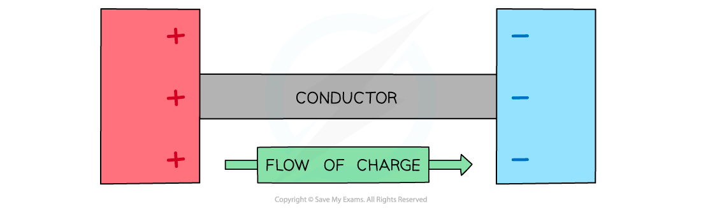
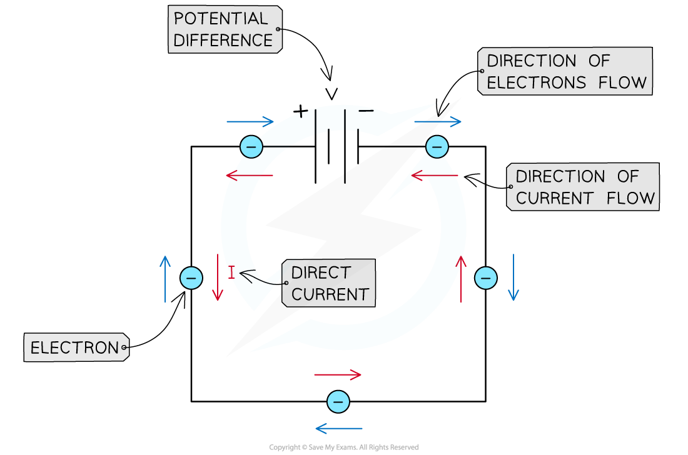

# Electric Current

## Defining Electric Current

> **Spec point** — `spcpt_KcfypwC9VzMPbTfz`

## Defining electric current

- Electric current is **the flow of charge** carriers and is measured in units of **amperes (*****A*****) **or **amps**
- Charge carriers can be either positive or negative
- When a conductor is exposed to a potential difference, charge carriers will flow

#### Charge flowing between conductors

***Charge can flow between two conductors. The direction of conventional current in a metal is from positive to negative***

- In electrical wires, the current is a flow of **electrons**
- Electrons are negatively charged; they flow away from the negative terminal of a cell towards the positive terminal
- Conventional current is defined as the flow of positive charge from the **positive terminal of a cell to the negative terminal**

  - This is the opposite to the direction of electron flow, as conventional current was described before the discovery of the electron

#### Conventional current and electron flow

***By definition, conventional current always goes from positive to negative (even though electrons go the other way)***

- Current is measured using an **ammeter**
- Ammeters should always be connected in **series** so that the charged particles flow through the ammeter

#### An ammeter in a circuit

***An ammeter can be used to measure the current around a circuit and always connected in series***

## Quantisation of Charge

> **Spec point** — `spcpt_XXYrjzbhDGc9qbbW`

## Quantisation of charge

- The charge carried by charged particles is **quantised**
- Charge is carried in discrete amounts or quanta (sometimes referred to as packets)
- Charge is measured in coulombs (C)

  - The charge of an electron is -1.60 × 10-19 C
  - The charge of a proton by comparison is 1.60 × 10-19 C
  - This value is known as the elementary charge
- In this way, the quantity of charge is dependent on how many protons or electrons are present; charge always occurs in multiples of the magnitude of the elementary charge
