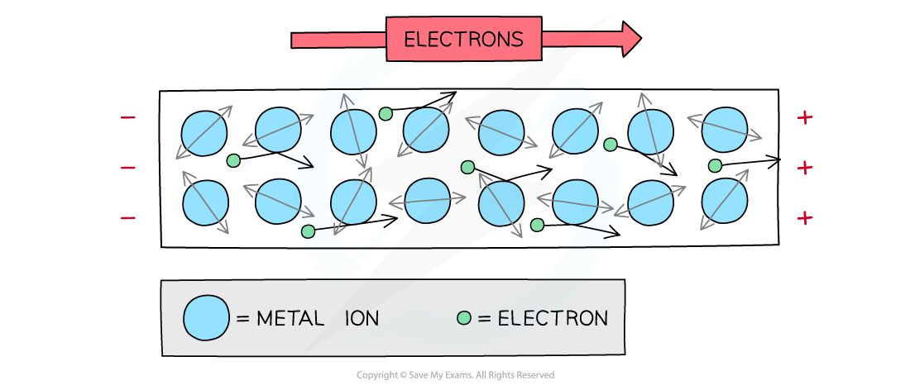
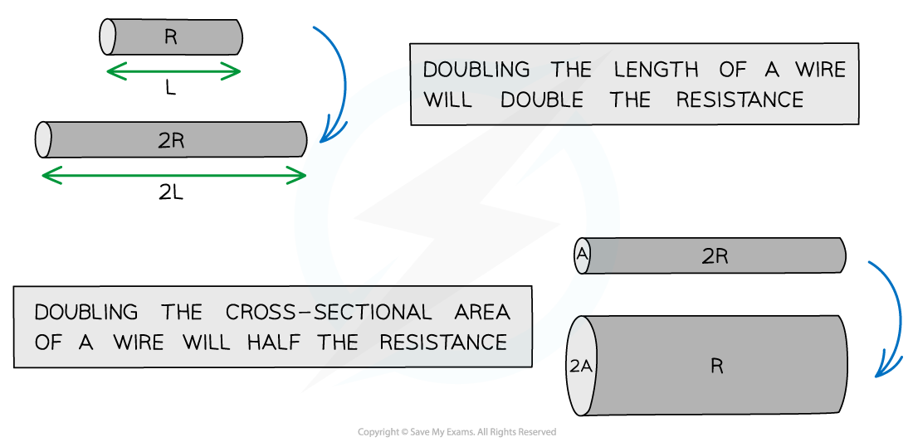

# Resistivity

## Resistivity 

> **Spec point** — `spcpt_JwxWX7wQqcfzgxDB`

## Resistivity

- All materials have some **resistance** to the flow of charge
- As **free** **electrons** **move** through a metal wire, they collide with the vibrating ions
- As a result of the collisions, the electrons **transfer** some of their **kinetic** **energy** to the metal ions in the wire
- The faster the ions vibrate, the greater the temperature of the wire
- In this way, resistance causes **heating **of the wire

#### Free electrons and resistivity

***Free electrons collide with metal ions in the wire, which resists their flow***

- Resistance depends on:

  - the **length** of the wire
  - the **cross-sectional area **through which the current is passing
  - the **resistivity** of the material

$R=\frac{ρL}{A}$

- Where:

  - *R* = resistance (Ω)
  - *ρ* = resistivity (Ω m)
  - *L* = length (m)
  - *A* = cross-sectional area (m2)

- The resistivity equation shows that:

  - the **longer** the wire, the **greater** its resistance
  - the **thicker** the wire, the **smaller** its resistance

#### Wire properties and resistance

***The length and width of the wire affect its resistance***

- Resistivity is a property of a material

  - It describes the extent to which a material opposes the flow of electric current through it: $ρ=\frac{RA}{L}$, the resistance of a sample of unit length and unit cross-sectional area
  - It depends on the material and its temperature, not on the sample's length or cross-sectional area

- Resistivity is measured in **Ω m**

#### Resistivity of materials at room temperature table

|   | ** Material** | ** Resistivity ρ / Ω m** |
|---|---|---|
| Metals | Copper | 1.7 x 10-8 |
| Gold | 2.4 x 10-8 |   |
| Aluminium | 2.6 x 10-8 |   |
| Semiconductors | Germanium | 0.6 |
| Silicon | 2.3 x 103 |   |
| Insulators | Glass | 1012 |
| Sulfur | 1015 |   |

- The **higher **the resistivity of a material, the **greater** its **resistance**

  - For example, copper has a relatively low resistivity at room temperature, making it the ideal material for use in electrical wires, as current flows through it very easily

- Insulators have such a high resistivity that virtually no current will flow through them

> **Worked Example**
> Two electrically-conducting cylinders made from copper and aluminium respectively.
> 
> Their dimensions are shown below.
> 
> 
> 
> Copper resistivity = 1.7 × 10-8 Ω m
> 
> Aluminium resistivity = 2.6 × 10-8 Ω m
> 
> Which cylinder is the better conductor?
> 
> **Answer:**
> 
> **Step 1: State the resistivity equation:**
> 
> $R=\frac{ρL}{A}$
> 
> **Step 2: Determine the resistance of the copper cylinder**
> 
> $A=πr^{2}=π(\frac{d}{2})^{2}=π(\frac{5\times10^{-3}}{2})^{2}=2.0\times10^{-5}m^{2}$
> 
> `R = (( 1.7 x 10 ^ - 8 ) ( 8 x 10 ^ - 3 ))/(2.0 x 10 ^ - 5 ) = 6.8 x 10 ^ - 6 capital omega`
> 
> **Step 3: Determine the resistance of the aluminium cylinder**
> 
> $A=πr^{2}=π(\frac{d}{2})^{2}=π(\frac{10\times10^{-3}}{2})^{2}=7.9\times10^{-5}m^{2}$
> 
> $R=\frac{2.6\times10^{-8}\times16\times10^{-3}}{7.9\times10^{-5}}=5.3\times10^{-6}Ω$
> 
> **Step 4: State which is the better conductor**
> 
> - The better conductor will have lower resistance
> - The resistance of the aluminium cylinder is less than the copper cylinder
> - Therefore, the aluminium cylinder is the better conductor

> **Exam Hint**
> You won’t need to memorise the value of the resistivity of any material, these will be given in the exam question.
> 
> Remember, for a circular wire, $A = \pi r^{2} = \pi ( \frac{d}{2} )^{2}$, so the cross-sectional area  is proportional to the diameter squared. This means if the diameter doubles, the area increases by a factor of four, causing the resistance to drop by a quarter.
