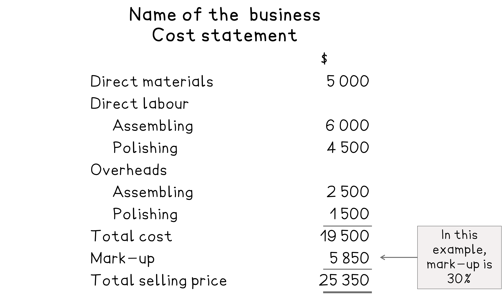
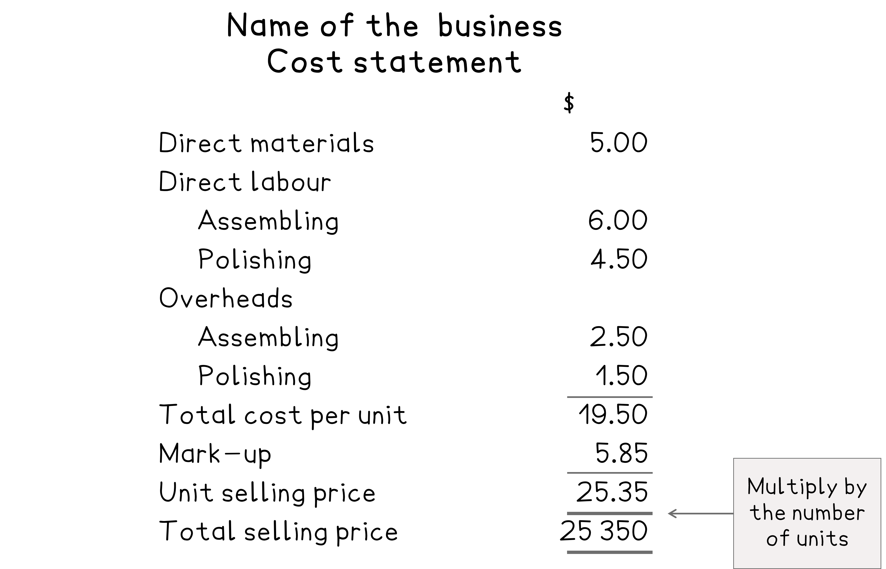

# Costing Statements for Selling Price

## Costing statements using absorption costing

> **Spec point** — `spcpt_b6JBSYmqFBB83ZNm` · how to apply traditional costing methods to prepare costing statements using unit, job and batch costing principles in both manufacturing and service businesses as applicable
how to prepare costing and profit statements using absorption costing

## Costing statements using absorption costing

### What are cost statements?

- Costing statements show the **total cost** of a product, job, batch, or service
- It shows the **detailed elements **of cost

### How do I prepare a costing statement using absorption costing?

- **STEP1 ** Calculate the **prime cost **

  - Start with **direct materials **
  - **Add** direct labour
  - **Add** other direct costs
- **STEP 2** Calculate the **total cost **

  - Start with the **prime cost**
  - **Add** indirect costs/overheads
- **STEP 3** Calculate the **markup **

  - **Start** with total cost
  - **Multiply** this by the provided **percentage markup **
- **STEP 4** Calculate the** total selling price **

  - Start with the cost
  - **Add** markup

*Example of a cost statement*

- Alternatively, you can find the total selling price for **one unit** and then multiply by the number of units

*Example of a cost statement including the selling price for one unit*

> **Worked Example**
> A factory manufactures 500 tables.
> 
> The data below is given per unit:
> 
> | Direct materials | 10kg at \$12.50 per kg |
> |---|---|
> | Direct labour |   |
> | Assembling department | 5 hours at \$7.50 per hour |
> | Polishing department | 3 hours at \$4.25 per hour |
> | Machine hours |   |
> | Assembling department | 1.5 hours |
> | Polishing department | 3 hours |
> | Overhead absorption rates | \$5.00 per labour hour  \$4.50 per machine hour |
> 
> Markup is set at 20%.
> 
> Prepare a costing statement to calculate the total selling price.
> 
> **Answer: **
> 
> Use labour hours for assembling department overheads
> 
> Use machine hours for polishing department overheads
> 
> |   |   | \$ |
> |---|---|---|
> | Direct materials | *10 × \$12.50 × 500* | 62 500 |
> | Direct labour |   |   |
> | Assembling department | *5 × \$7.50 × 500* | 18 750 |
> | Polishing department | *3 × \$4.25 × 500* | 6 375 |
> | Overheads |   |   |
> | Assembling department | *5 × \$5.00 × 500* | 12 500 |
> | Polishing department | *3 × \$4.50 × 500* | <u>6 750</u> |
> | Total cost |   | 106 875 |
> | Markup | *20% × \$106 875* | <u>21 375</u> |
> | Total selling price |   | <u>128 250</u> |
> 
> **Final answer:** **Total selling price is \$128 250**
> 
> **Alternative layout**
> 
> |   |   | \$ |
> |---|---|---|
> | Direct materials | *10 × \$12.50* | 125.00 |
> | Direct labour |   |   |
> | Assembling department | *5 × \$7.50* | 37.50 |
> | Polishing department | *3 × \$4.25* | 12.75 |
> | Overheads |   |   |
> | Assembling department | *5 × \$5.00* | 25.00 |
> | Polishing department | *3 × \$4.50* | <u>13.50</u> |
> | Cost per unit |   | 213.75 |
> | Markup | *20% × \$213.75* | <u>42.75 </u> |
> | Unit selling price |   | <u>256.50</u> |
> | Total selling price | *\$256.50 × 500* | <u>126 750 </u> |
> 
> **Final answer:** **Total selling price is \$128 250**
