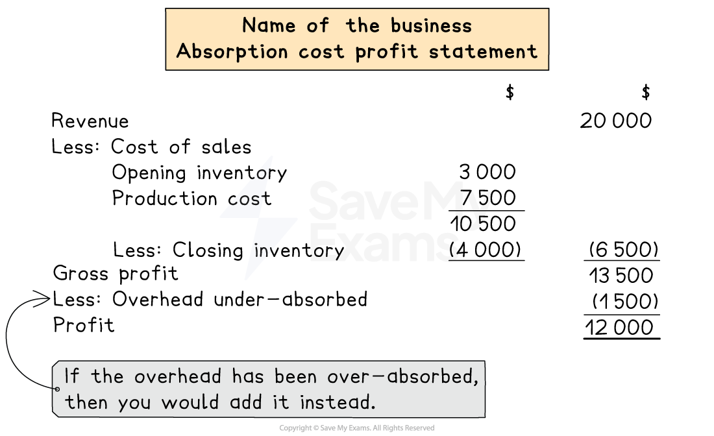

# Profit Statements

## Profit statements using absorption costing 

> **Spec point** — `spcpt_WMsNX3rKNn2M8dT2` · how to prepare costing and profit statements using absorption costing

## Profit statements using absorption costing

### What are profit statements?

- Profit statements show the **profit **or** loss **made from selling a product/service

### How do I prepare a profit statement using absorption costing?

- **STEP 1** Calculate the **sales revenue **

  - Selling price per unit × number of units sold
- **STEP 2 ** Calculate the **cost of sales**

  - Start with opening inventory
  - **Add** production cost
  
    - Including the fixed costs
  - **Subtract** closing inventory
- **STEP 3**
Calculate the** gross profit**

  - Sales revenue - cost of sales
- **STEP 4**
**Adjust **for the **under-absorption** or **over-absorption** to find the profit or loss

  - **Add **overheads **over-absorbed **
  - **Subtract** overheads **under-absorbed**
- **STEP 5** Subtract any other **non-production costs** to calculate the **profit or loss **

*Layout of a profit statement using absorption costing*

> **Worked Example**
> Jane manufactures a single product. She uses a system of absorption costing.
> 
> The following budgeted data is available for one unit of the product.
> 
> |   | \$ |
> |---|---|
> | Selling price | 14 |
> | Direct materials | 4 |
> | Direct labour | 3 |
> 
> Budgeted production: 20 000 units per month
> 
> Budgeted fixed overheads: \$23 000 per month
> 
> On 1 August, Jane held 2 000 units.
> 
> The following actual results are available.
> 
> Sales: 12 000 units
> 
> Production: 18 000 units
> 
> Fixed overheads: \$25 000
> 
> Prepare the profit statement for the month of August to calculate the profit or loss.
> 
> **Answer: **
> 
> - Sales revenue *\$14 × 12 000 = \$168 000*
> - Production cost
> 
>   - Direct materials *\$4 × 18 000 = \$72 000 *
>   - Direct labour *\$3 × 18 000 = \$54 000*
>   - Fixed overheads *25 000 ÷ 20 000 = \$1.25 per unit* *\$1.25 × 18 000 = \$22 500*
>   - Total
> 
> *\$72 000 + \$54 000 + \$22 500 = \$148 500*
> 
> - Opening inventory *(\$4 + \$3 + \$1.25) × 2 000 = \$16 500*
> - Closing inventory *Opening inventory + Production - Sales * *= 2 000 + 18 000 - 12 000 * *= 8 000 units* *(\$4 + \$3 + \$1.25) ×  8 000 = \$66 000*
> - Calculate the overheads that are over-absorbed or under-absorbed
> 
>   - Actual overheads - Overheads absorbed
> 
> *25 000 - 22 500 = 2 500 under-absorbed*
> 
> **Profit statement for the month of August**
> 
> |   |   | \$ |
> |---|---|---|
> | Revenue |   | 168 000 |
> | Cost of sales: |   |   |
> | Opening inventory | 16 500 |   |
> | Production costs | 148 500 |   |
> | Less: Closing inventory | <u>(66 000)</u> | <u>(99 000)</u> |
> | Gross profit |   | 69 000 |
> | Less: Overheads under-absorbed |   | <u>(2 500)</u> |
> | Profit for the month |   | <u>66 500</u> |
> 
> **Final answer:** **Profit for August is \$66 500**
