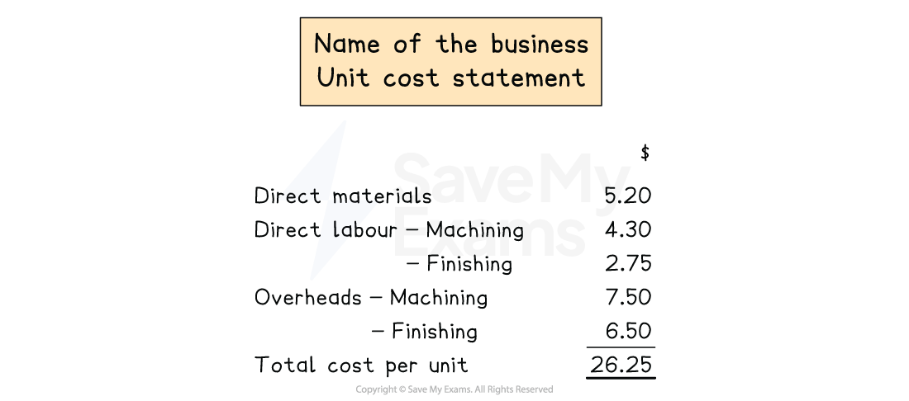
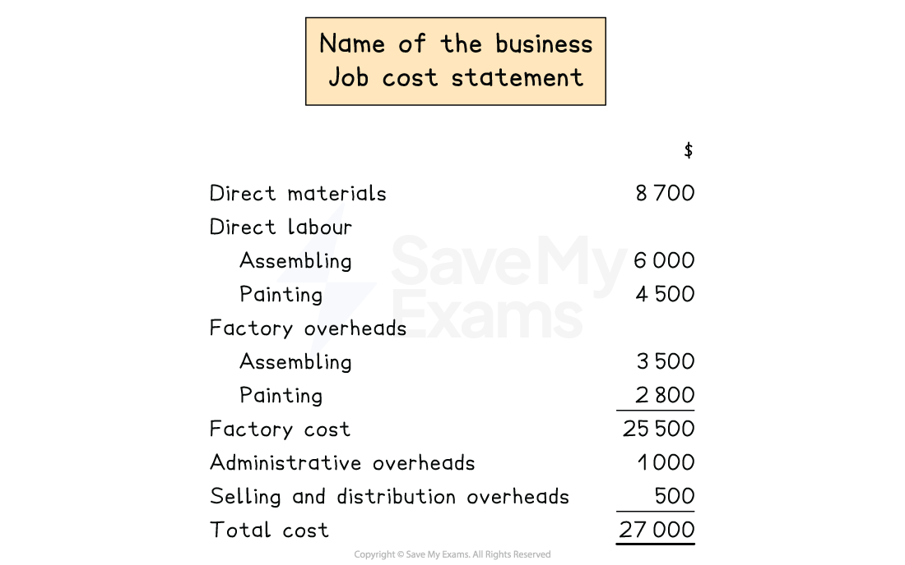
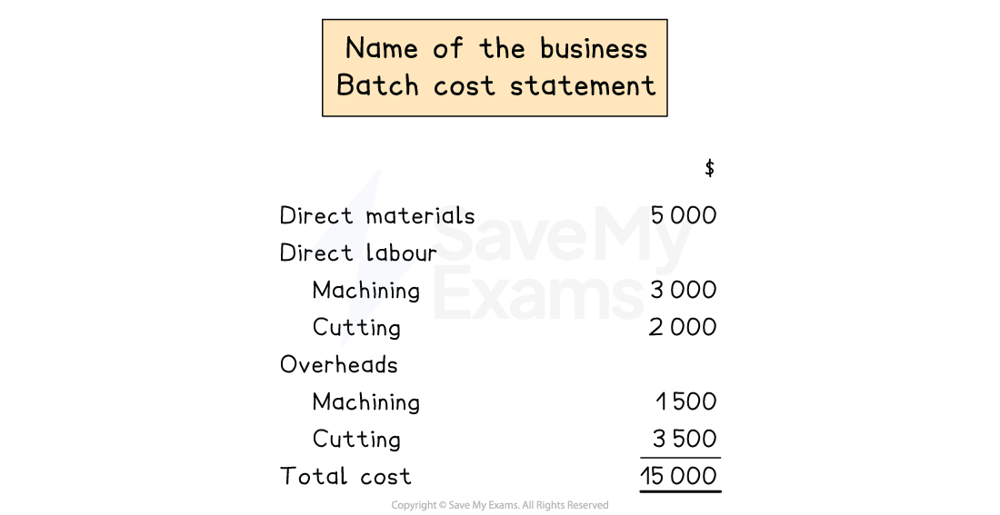

# Unit, Job & Batch Costing

## Unit costing

> **Spec point** — `spcpt_z3fB4pqq4bFYCmW4` · how to apply traditional costing methods to prepare costing statements using unit, job and batch costing principles in both manufacturing and service businesses as applicable

## Unit costing

### What is unit costing?

- Unit costing is where the** **cost of producing a** single unit **of product or service is calculated
- It is used when production is **continuous** and** identical **products** **are produced
- $\mathrm{Unit} \mathrm{cost}=\frac{\mathrm{Total} \mathrm{production} \mathrm{cost}}{\mathrm{Number} \mathrm{of} \mathrm{units} \mathrm{produced}}$

### How do I prepare a costing statement for a unit?

- **STEP 1** Calculate the **direct materials cost per unit**

  - **Multiply the **cost per direct material unit (e.g. cost per metre) by the amount of direct materials used per unit
- **STEP 2 ** Calculate the** direct labour cost per unit**

  - **Multiply** the hourly rate by the hours spent per unit
  - These may have different hourly rates for each department
  
    - E.g. machining department, assembly department
- **STEP 3** Calculate** overheads per unit**

  - **Multiply** the overhead absorption rate by machine hours or labour hours used per unit
  
    - Machine hours for **machine-intensive **departments
    - Labour hours for** labour-intensive** departments

*Example of a unit cost statement*

> **Exam Hint**
> For service businesses, there is no direct material cost or factory overheads.

> **Worked Example**
> Company X manufactures tables.
> 
> The following data is available per unit for the year ended 31 December 2020.
> 
> | Direct materials | 5kg at \$2.50 per kg |
> |---|---|
> | Direct labour |   |
> | Machining department | 4 hours at \$10.75 per hour |
> | Finishing department | 2 hours at \$8.50 per hour |
> | Machine hours |   |
> | Machining department | 2.5 hours |
> | Finishing department | 1.5 hours |
> | Overhead absorption rates | \$5.50 per labour hour  \$6.20 per machine hour |
> 
> Calculate the cost of producing one table.
> 
> **Answer**:
> 
> Use machine hours for machining department overheads
> 
> Use labour hours for finishing department overheads
> 
> | Unit cost statement: |   | \$ |
> |---|---|---|
> | Direct materials | *5 × \$2.50* | 12.50 |
> | Direct labour |   |   |
> | Machining department | *4 × \$10.75* | 43.00 |
> | Finishing department | *2 × \$8.50* | 17.00 |
> | Overheads |   |   |
> | Machining department | *2.5 × \$6.20* | 15.50 |
> | Finishing department | *2 × \$5.50* | <u>11.00</u> |
> | Total cost per unit |   | <u>99.00</u> |
> 
> **Final answer:** **Cost per unit is \$104.50**

## Job costing

> **Spec point** — `spcpt_TnpHyKj5gxsTJC8X` · how to apply traditional costing methods to prepare costing statements using unit, job and batch costing principles in both manufacturing and service businesses as applicable

## Job costing

### What is job costing?

- Job costing is where the cost of a** special order **is calculated
- It is used when each job is** customised** or** made to order**

### How can I prepare a costing statement using job costing?

- A cost statement using job costing is prepared to determine the total cost and cost per job
- **STEP 1** Calculate the **direct materials cost **
- **STEP 2 ** Calculate **direct labour cost **
- **STEP 3** Calculate **manufacturing overheads**

  - **Add** to direct costs to get total production cost
- **STEP 4 ** Calculate** administrative and selling and distribution overheads **

  - **Add **to total production cost to get total cost of job

*Example of a job cost statement*

> **Exam Hint**
> Most exam questions only include production costs. However, there has been a question where you needed to find the factory cost and then apply a percentage to it to find the selling and distribution overheads.

> **Worked Example**
> Company Y produces boats. A customer places a special order for a custom boat.
> 
> The following budgeted data is available for the year ended 31 December 2024.
> 
> | Direct materials | \$15 000 |
> |---|---|
> | Direct labour |   |
> | Assembling | \$5 000 |
> | Painting | \$6 500 |
> | Overhead absorption rates | \$5.00 per labour hour  \$4.50 per machine hours |
> | Overheads - Assembling | 500 labour hours  3 500 machine hours |
> | Overheads - Painting | 6 000 labour hours  250 machine hours |
> | Administrative overheads | \$500 |
> | Selling and distribution overheads | \$200 |
> 
> Prepare a job cost statement and calculate the total cost for the customer's order.
> 
> **Answer: **
> 
> Use machine hours for assembling department overheads
> 
> Use labour hours for painting department overheads
> 
> |   |   | \$ |
> |---|---|---|
> | Direct materials |   | 15 000 |
> | Direct labour |   |   |
> | Assembling |   | 5 000 |
> | Painting |   | 6 500 |
> | Overheads |   |   |
> | Assembling | *3 500 × \$4.50* | 15 750 |
> | Painting | *6 000 × \$5.00* | <u>30 000</u> |
> | Factory cost |   | 72 250 |
> | Administrative overheads |   | 500 |
> | Selling and distribution overheads |   | <u>200</u> |
> | Total cost of job |   | <u>72 950</u> |
> 
> **Final answer:** **Cost of job is \$72 950**

## Batch costing

> **Spec point** — `spcpt_xRCtrMstXhksNjs5` · how to apply traditional costing methods to prepare costing statements using unit, job and batch costing principles in both manufacturing and service businesses as applicable

## Batch costing

### What is batch costing?

- Batch costing is where the **cost of producing a batch of identical products** is calculated
- It is **used when products are produced in batches** rather than individually or continuously
- $\mathrm{Cost} \mathrm{per} \mathrm{unit}=\frac{\mathrm{Total} \mathrm{cost} \mathrm{of} \mathrm{batch}}{\mathrm{Number} \mathrm{of} \mathrm{units} \mathrm{in} \mathrm{the} \mathrm{batch}}$

### How can I prepare a cost statement using batch costing?

- **STEP 1** Determine the **batch size **

  - Batch size = Total units produced in the batch
- **STEP 2** Calculate** direct material cost **
- **STEP 3** Calculate **direct labour cost **
- **STEP 4 ** Calculate **factory overheads **
- **STEP 5 ** Calculate **total cost of batch **

  - **Add** total direct costs and factory overheads

*Example of a batch cost statement*

> **Worked Example**
> Company Z manufactures toys in batches.
> 
> The following budgeted data is available for the year ended 31 March 2023 for one batch.
> 
> | Direct materials | \$20 000 |
> |---|---|
> | Direct labour |   |
> | Assembling | \$15 000 |
> | Colouring | \$5 000 |
> | Overheads |   |
> | Assembling | 2 000 labour hours  5 000  machine hours |
> | Colouring | 3 000 labour hours  2 000 machine hours |
> | Overhead absorption rates | \$3.00 per labour hour  \$4.50 per machine hour |
> 
> Calculate the cost of the batch by preparing a batch cost statement.
> 
> **Answer: **
> 
> Use machine hours for assembling department overheads
> 
> Use labour hours for colouring department overheads
> 
> |   |   | \$ |
> |---|---|---|
> | Direct materials |   | 20 000 |
> | Direct labour |   |   |
> | Assembling |   | 15 000 |
> | Colouring |   | 5 000 |
> | Overheads |   |   |
> | Assembling | *5 000 × \$4.50* | 22 500 |
> | Colouring | *3 000  × \$3.00* | <u>9 000</u> |
> | Total cost |   | <u>71 500</u> |
> 
> **Final answer:** **Cost of the batch is \$71 500**
