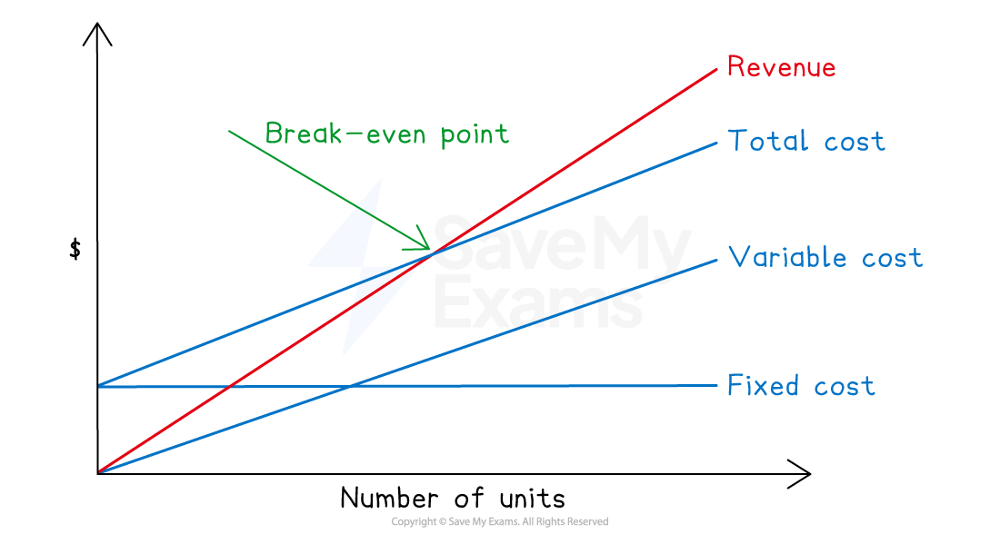
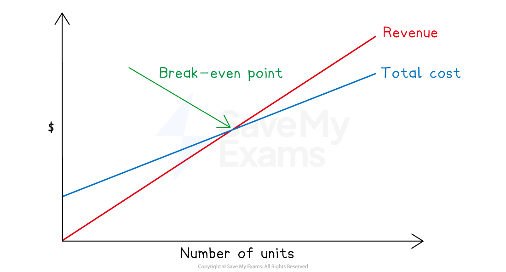
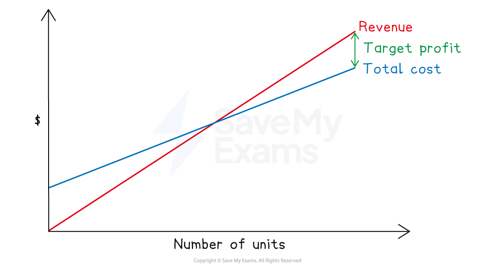
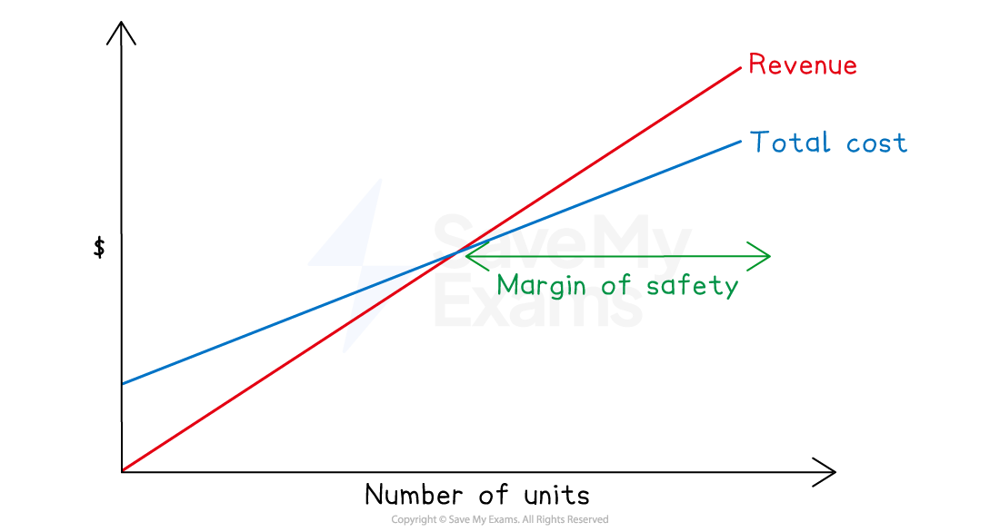

# Break-even Analysis

## Break-even charts

> **Spec point** — `spcpt_kdz6fchghWVQr3FB` · how to interpret a break-even chart

## Break-even charts

### What is a break-even chart?

- A break-even chart is a **graphical representation **of costs, revenue, and profit at **different levels of output**
- The **number of units sold or produced** is plotted on the **horizontal** axis
- The **costs and revenue** in monetary terms (\$) are plotted on the **vertical **axis
- The line for **fixed cost** is **horizontal **because it doesn’t change with the output level
- The lines for **variable cost **and **revenue** increase as output level increases
- The line for **total cost**

  - **starts **at the same value as the **fixed cost**
  - and is **parallel **to the line for **variable cost**
- The **break-even point** is the point at which **total revenue equals total costs **

  - Total costs are covered by sales
  - No profit or loss is made

*Break-even chart*

> **Exam Hint**
> You will never be required to construct a break-even chart in the exam. You just need to be able to interpret them and use them in calculations.

## Calculations using a break-even chart

> **Spec point** — `spcpt_mQdHw2DVQmHR2cZm` · how to calculate the break-even point, contribution to sales ratio, level of output or sales to achieve a target profit, and margin of safety

## Calculations using a break-even chart

### How do I calculate the break-even point?

- The formula for the **number of units** required to break-even is:

  - $\mathrm{Break}-\mathrm{even} \mathrm{point} \mathrm{in} \mathrm{units}=\frac{\mathrm{Total} \mathrm{fixed} \mathrm{costs}}{\mathrm{Contribution} \mathrm{per} \mathrm{unit}}$
  - If your answer is a decimal, you should always **round your answer up** to the next whole number
- There are two formulas for the** sales revenue** required to break-even:

  - $\mathrm{Break}-\mathrm{even} \mathrm{point} \mathrm{in} \mathrm{sales} \mathrm{revenue}=\mathrm{Break}-\mathrm{even} \mathrm{units}\times\mathrm{Selling} \mathrm{price} \mathrm{per} \mathrm{unit}$
  - $\mathrm{Break}-\mathrm{even} \mathrm{point} \mathrm{in} \mathrm{sales} \mathrm{revenue}=\frac{\mathrm{Total} \mathrm{fixed} \mathrm{costs}}{\mathrm{Contribution} \mathrm{to} \mathrm{sales} \mathrm{ratio}}$

*Break-even point*

> **Exam Hint**
> You can use whichever formula you want. However, if a question first asks you to find the contribution to sales ratio, then it is easier to use that to find the break-even point.
> 
> If you forget the formulas, you can easily derive them using algebra. Let $x$ be the number of units sold, $S$ be the selling price per unit, $F$ be the fixed cost and $V$ be the variable cost per unit.
> 
> $\begin{gathered} \text{Revenue} = \text{Total} \text{cost} \\ S x & = F + V x \\ S x - V x & = F \\ x ( S - V ) & = F \\ x = \frac{F}{S - V} \end{gathered}$

> **Worked Example**
> The following forecasted data is available.
> 
> |   | \$ |
> |---|---|
> | Total fixed costs | 100 000 |
> | Direct materials | 3 000 |
> | Direct labour | 5 000 |
> | Other direct costs | 6 000 |
> | Sales revenue  (10 000 units) | 200 000 |
> 
> Calculate the break-even point in units.
> 
> **Answer**:
> 
> Calculate the total variable cost
> 
> *Variable costs = Direct materials + Direct labour + Other direct costs*
> 
> *= \$3 000 + \$5 000 + \$6 000*
> 
> *= \$14 000*
> 
> Calculate the total contribution
> 
> *Contribution = Revenue - Variable costs*
> 
> *= \$200 000 - \$14 000*
> 
> *= \$186 000*
> 
> Calculate the contribution per unit
> 
> *Contribution per unit = Total contribution ÷ Number of units*
> 
> *= \$186 000 ÷ 10 000*
> 
> *= \$18.60 per unit*
> 
> Calculate the break-even point in units
> 
> *Break-even point in units = Total fixed costs ÷ Contribution per unit*
> 
> *  = \$100 000 ÷ 18.6 *
> 
> *  = 5 376.34*
> 
> Round up to the next whole number
> 
> **Final answer:** **Break-even point in units is 5 377 units**

### How do I calculate the level of output required to achieve a target profit?

- The formula for the **number of units** required to achieve a target profit is:

  - $\mathrm{Level} \mathrm{of} \mathrm{output} \mathrm{required} \mathrm{in} \mathrm{units}=\frac{\mathrm{Total} \mathrm{fixed} \mathrm{costs}+\mathrm{Target} \mathrm{profit}}{\mathrm{Contribution} \mathrm{per} \mathrm{unit}}$
  - If your answer is a decimal, you should always **round your answer up** to the next whole number
- There are two formulas for the** sales revenue** required to achieve a target profit:

  - $\mathrm{Level} \mathrm{of} \mathrm{output} \mathrm{required} \mathrm{in} \mathrm{sales} \mathrm{revenue}=\frac{\mathrm{Total} \mathrm{fixed} \mathrm{costs}+\mathrm{Target} \mathrm{profit}}{\mathrm{Contribution} \mathrm{to} \mathrm{sales} \mathrm{ratio}}$
  - $\mathrm{Level} \mathrm{of} \mathrm{output} \mathrm{required} \mathrm{in} \mathrm{sales} \mathrm{revenue}=\mathrm{Target} \mathrm{profit} \mathrm{units}\times\mathrm{Selling} \mathrm{price} \mathrm{per} \mathrm{unit}$

*Target profit*

> **Worked Example**
> Total fixed cost \$40 000
> 
> Variable cost per unit \$30 per unit
> 
> Selling price per unit \$50 per unit
> 
> What is the level of output required in units and in sales revenue for a target profit of \$60 000?
> 
> **Answer**:
> 
> Calculate the contribution per unit
> 
> *Contribution per unit = Selling price per unit - Variable cost per unit*
> 
> *= \$50 -\$ 30*
> 
> *= \$20 per unit*
> 
> Calculate the number of units required to make the profit
> 
> *Level of output required in units = (Total fixed costs + Target profit) ÷ Contribution per unit*
> 
> *= (\$40 000 + \$60 000) ÷ \$20*
> 
> *= 5 000 units*
> 
> **Final answer:** **The level of output required to achieve a target profit of \$60 000 is 5 000 units**
> 
> Multiply this by the selling price per unit
> 
> *5 000 × \$50*
> 
> *= \$250 000*
> 
> Or calculate the contribution to sales ratio and use the relevant formula
> 
> *Sales to contribution ratio = \$20 ÷ \$50 = 0.4*
> 
> *Level of output required in sales revenue = (Total fixed costs + Target profit) ÷ Contribution to sales ratio*
> 
> *= (\$40 000 + \$60 000) ÷ 0.4*
> 
> *= \$250 000*
> 
> **Final answer:** **The level of output required to achieve a target profit of \$60 000 is \$250 000 in sales revenue**

### How do I calculate the margin of safety?

- The margin of safety is the **difference **between **actual/forecast output **and the **break-even level of output**
- It shows how much sales can fall before a business **reaches** the break-even point
- The formula for the **number of units** in the margin of safety is:

  - $\mathrm{Margin} \mathrm{of} \mathrm{safety} \mathrm{in} \mathrm{units}=\mathrm{Actual}/\mathrm{forecasted} \mathrm{production} \mathrm{units}-\mathrm{Break}-\mathrm{even} \mathrm{point} \mathrm{units}$

*Margin of safety*

> **Worked Example**
> Forecasted production 15 000 units.
> 
> Break-even point units 10 000 units.
> 
> Calculate the margin of safety in units.
> 
> **Answer**:
> 
> Use the formula
> 
> *Margin of safety in units = Forecasted production - Break-even point in units*
> 
> *= 15 000 - 10 000*
> 
> **Final answer:** **Margin of safety is 10 000 units **

## Uses & limitations of break-even analysis

> **Spec point** — `spcpt_MYp5ZDVTCKrRRZnW` · the use and limitations of break-even analysis

## Uses & limitations of break-even analysis

### What are the uses of break-even analysis?

- Break-even analysis can **calculate** break-even point, level of output to achieve target profit, margin of safety which helps management with marketing **decisions**
- The visual** graphical** representation is **easy **to understand
- Assists **short-term** decision-making

  - Such as setting selling prices

### What are the limitations of break-even analysis?

- Fixed costs are treated as **staying the same, **but they may only stay fixed up to a certain point

  - i.e. they may be stepped
- Analysis is only based on **budgets**
- Costs may change due to **changes in market**
