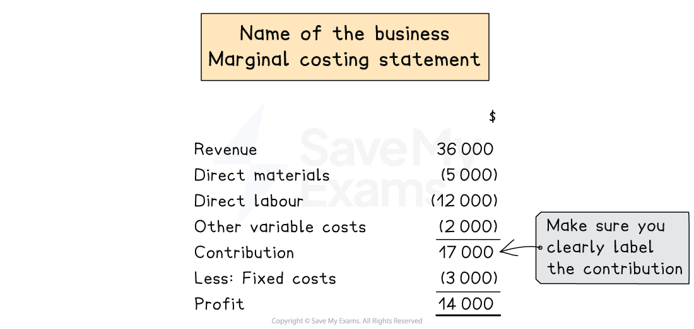

# Marginal Costing Statement

## Profit statements using marginal costing

> **Spec point** — `spcpt_VkNSqKMq76X73PQh` · how to prepare costing and profit statements using marginal costing

## Costing statements using marginal costing

### How do I prepare a marginal costing statement?

- A marginal costing statement shows the **contribution**
- **STEP 1** Calculate **sales revenue **

  - Selling price per unit × sales volume
- **STEP 2** Calculate **direct material cost **
- **STEP 3** Calculate **direct labour cost **
- **STEP 4 ** Calculate** other variable costs **

  - E.g. royalties, indirect factory materials

- **STEP 5** Calculate** contribution **

  - **Subtract** variable costs from sales revenue
- **STEP 6** Calculate **fixed costs **

  - Fixed costs include costs that **don't change** with production volume
  
    - E.g. factory rent, factory machinery depreciation
- **STEP 7** Calculate** profit** for the month

  - **Subtract** fixed costs from contribution

*Example of marginal costing statement *

> **Worked Example**
> The following data is available for the year ended 31 March 2018.
> 
> |   | \$ |
> |---|---|
> | Sales revenue | 47 000 |
> | Direct materials | 15 000 |
> | Direct labour | 11 000 |
> | Other variable costs | 5 000 |
> | Factory rent | 10 000 |
> | Factory machinery depreciation | 4 000 |
> 
> Prepare a marginal costing statement for the month to calculate the profit for the month.
> 
> **Answer**:
> 
> Identify the variable and fixed costs:
> 
> - Variable:
> 
>   - Direct materials, direct labour, other variable costs
> - Fixed:
> 
>   - Factory rent, factory machinery depreciation
> 
> |   | \$ |
> |---|---|
> | Revenue | 47 000 |
> | Direct materials | (15 000) |
> | Direct labour | (11 000) |
> | Other variable costs | <u>(5 000)</u> |
> | Contribution | 16 000 |
> | Less fixed costs | <u>(14 000)</u> |
> | Profit for the month | <u>2 000</u> |
> 
> **Final answer:** **Profit for the month is \$2 000**
