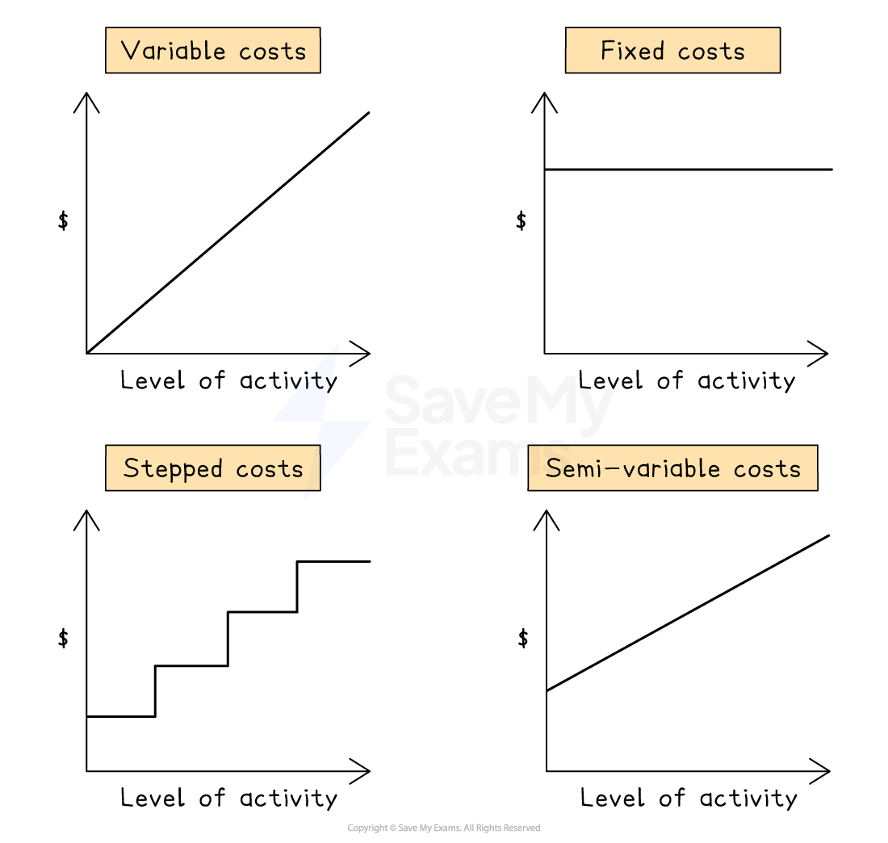

# Types of Costs

## Direct & indirect costs

> **Spec point** — `spcpt_FGX8GpmbP84NyCRp` · accounting for material and labour costs
how to identify and calculate the elements of direct and indirect costs

## Direct & indirect costs

### How are material and labour costs accounted for?

- Material and labour costs are accounted so they can be included in the cost of production
- Accounting for** material costs** involves:

  - Recording **purchases **and** usage** of inventory
  - Allocating **direct material costs** to **production costs**
  - Allocating **indirect material costs **to **overheads**
- Accounting for **labour costs** involves:

  - Recording **wages **
  - Allocating **direct labour costs** to **production **
  - Allocating **indirect labour costs **to **overheads**

### What is a direct cost?

- Direct costs are those that can be **specifically associated** with the **manufacture** of one unit of production
- Examples include:

  - Direct materials
  - Direct labour
  - Other direct costs
  
    - E.g. royalties

### How are direct costs calculated?

- Direct material and labour costs are calculated by multiplying the rate per unit by the quantity used

  - $\mathrm{Direct} \mathrm{materials} \mathrm{cost}=\mathrm{Cost} \mathrm{per} \mathrm{unit}\times\mathrm{Units} \mathrm{used}$
  
    - Unit could be kg, litres, metres etc.
  - $\mathrm{Direct} \mathrm{labour} \mathrm{cost}=\mathrm{Cost} \mathrm{per} \mathrm{hour}\times\mathrm{Hours} \mathrm{used}$
- Other direct costs are also included in direct costs

  - E.g. royalties costed \$200, so include \$200 in direct costs

> **Worked Example**
> Product A requires 2 metres of fabric and 6 hours of labour to manufacture.
> 
> Each metre of fabric is \$4 and the wage rate per hour is \$8.
> 
> Royalty cost is \$3 per unit.
> 
> Calculate the direct cost per unit.
> 
> **Answer: **
> 
> Direct materials:
> 
> *2m × \$4 per m = \$8 per unit*
> 
> Direct labour
> 
> *6 hours × \$8 per hour = \$48 per unit*
> 
> Other direct costs (royalties): \$3 per unit
> 
> Direct cost = Direct materials + Direct labour + Other direct costs
> 
> *8 + 48 + 3 = 59*
> 
> **Final answer:** **\$59 per unit**

### What are indirect costs?

- Indirect costs are those that **cannot** economically **be specifically associated** with the **manufacture** of one unit of production
- Indirect costs are also known as **overheads and **can be classified as

  - **production overheads**
  
    - Production overheads are included in production costs
  - **administrative overheads**
  - or** sales and distribution overheads **
  
    - Administrative overheads and sales and distribution overheads are included in total costs but **not **production costs
- Examples include:

  - Depreciation of machinery
  - Electricity
  - Rent of factory
  - Maintenance costs

> **Exam Hint**
> Direct costs are often variable costs, while indirect costs are often fixed costs.
> 
> Remembering this can help when classifying costs.

### How are indirect costs calculated?

- Indirect costs are often divided into a factory portion and an administrative portion using specified allocation percentages

  - The **factory portion** is included in **production cost **
  - While the **administrative portion** is **not **included in production cost
- Indirect cost included in production cost = Indirect cost × Allocation percentage

> **Worked Example**
> Rent and rates was \$125 000 for the year ended 31 December 2024.
> 
> Rent and rates are to be allocated 60% to the factory and 40% to the office.
> 
> Calculate the amount of rent and rates to be included in production cost.
> 
> **Answer: **
> 
> *125 000 × 60% = 75 000*
> 
> Add **\$75 000** to direct costs and this will be the production cost.

## Fixed, variable, semi-variable & stepped costs

> **Spec point** — `spcpt_pwpZfdjgbHRXxpPy` · how to identify and calculate fixed costs, variable costs, semi-variable costs and stepped costs

## Fixed, variable, semi-variable & stepped costs

### What are fixed costs?

- Fixed costs are costs that **remain unchanged** within a certain level of activity/output

  - E.g. depreciation of machinery ** **

### What are variable costs?

- Variable costs are costs that are **constant per unit**
- Total variable **cost increases **as **output increases**

  - E.g. direct material costs

### How can fixed costs and variable costs be calculated?

- Use the **high-low method**:
- **STEP 1** Identify periods with higher and lower activity level
- **STEP 2** Calculate the variable cost per unit `Variable スペース cost スペース per スペース unit スペース イコール スペース 開き括弧 Higher スペース output スペース units スペース ひく スペース Lower スペース output スペース units 閉じ括弧 分の 開き括弧 Higher スペース activity スペース total スペース cost スペース ひく スペース Lower スペース activity スペース total スペース cost 閉じ括弧 分数の終わり`
- **STEP 3** Calculate the fixed cost `Fixed スペース cost スペース イコール スペース Higher スペース activity スペース total スペース cost スペース ひく スペース 開き括弧 Variable スペース cost スペース per スペース unit スペース ストレート x スペース Higher スペース output スペース units 閉じ括弧` OR `Fixed スペース cost スペース イコール スペース Lower スペース activity スペース total スペース cost スペース ひく スペース 開き括弧 Variable スペース cost スペース per スペース unit スペース ストレート x スペース Lower スペース output スペース units 閉じ括弧`

> **Worked Example**
> Total cost at 1 000 units = \$8 000
> 
> Total cost at 600 units = \$6 400
> 
> Calculate the variable cost per unit and fixed costs.
> 
> **Answer:**
> 
> **STEP 1**
> 
> - Higher activity level = 1 000 units at \$8 000
> - Lower activity level = 600 units at \$6 400
> 
> **STEP 2**
> 
> - Variable cost per unit is
> 
> *(8 000 - 6 400) ÷ (1 000 - 600) = \$4 per unit*
> 
> **STEP 3**
> 
> - Fixed cost
> 
> *8 000 - (4 × 1 000) = \$4 000*
> 
> - Or fixed cost
> 
> *6 400 - (4 × 600) = 4 000*
> 
> **Final answer:** **Variable cost is \$4 per unit**
> 
> **Final answer:** **Fixed cost is \$4 000**

### What are semi-variable costs?

- Semi-variable costs are costs that are **partly fixed and partly affected by production level**
- For example, electricity is a semi-variable cost

  - Fixed: Standing charge
  - Variable: Cost per unit of electricity used

### How can semi-variable costs be calculated?

- Use the **high-low method**:
- **STEP 1**
Identify periods with higher and lower activity level
- **STEP 2**
Find the **variable cost** per unit

  - `Variable スペース cost スペース per スペース unit スペース イコール スペース 開き括弧 Higher スペース output スペース units スペース ひく スペース Lower スペース output スペース units 閉じ括弧 分の 開き括弧 Higher スペース activity スペース total スペース cost スペース ひく スペース Lower スペース activity スペース total スペース cost 閉じ括弧 分数の終わり`
- **STEP 3**
Find the **fixed costs**

  - `Fixed スペース cost スペース イコール スペース Higher スペース activity スペース total スペース cost スペース ひく スペース 開き括弧 Variable スペース cost スペース per スペース unit スペース かける スペース Higher スペース output スペース units 閉じ括弧`
  - Or `Fixed スペース cost スペース イコール スペース Lower スペース activity スペース total スペース cost スペース ひく スペース 開き括弧 Variable スペース cost スペース per スペース unit スペース かける スペース Lower スペース output スペース units 閉じ括弧`
- **STEP 4**
Write it as a **formula**

  - `Semi ひく variable スペース cost スペース イコール スペース Fixed スペース costs スペース たす スペース 開き括弧 Variable スペース cost スペース per スペース unit スペース かける スペース Number スペース of スペース units 閉じ括弧`

### What are stepped costs?

- Stepped costs are fixed for a **given level of activity** and increases when that level is exceeded
- For example, factory rent is a stepped cost

  - Rent is fixed for one space but increases when an additional space is rented

### How can stepped costs be calculated?

- From identifying ranges:
- **STEP 1** Identify the ranges and the relevant costs for these ranges
- **STEP 2** Add the relevant costs together

> **Worked Example**
> Supervisor cost:
> 
> 1 supervisor is required for every 20 workers.
> 
> Each supervisor has a salary of \$2 000
> 
> What is the supervisor cost for 35 workers?
> 
> **Answer:**
> 
> Number of steps required:
> 
> *35*$\div$*20 = 1.75*
> 
> *Round up to 2 supervisors*
> 
> *2 × \$2 000 = \$4 000*
> 
> **Final answer:** **Total supervisor cost is \$4 000**

*Types of costs*
