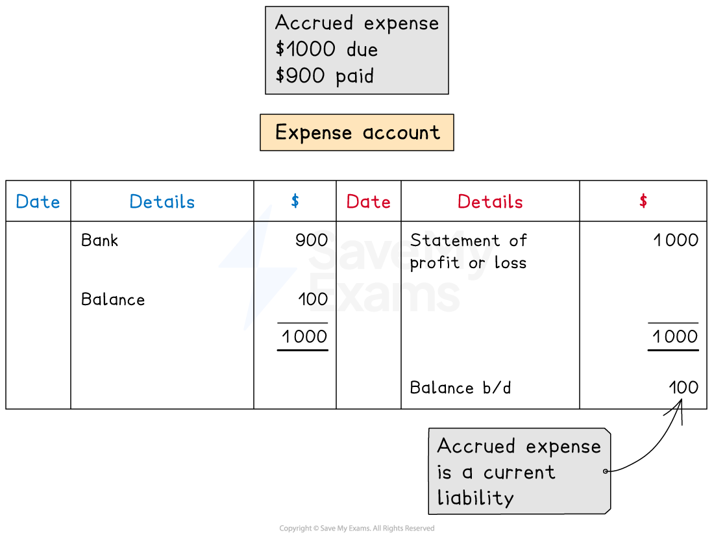
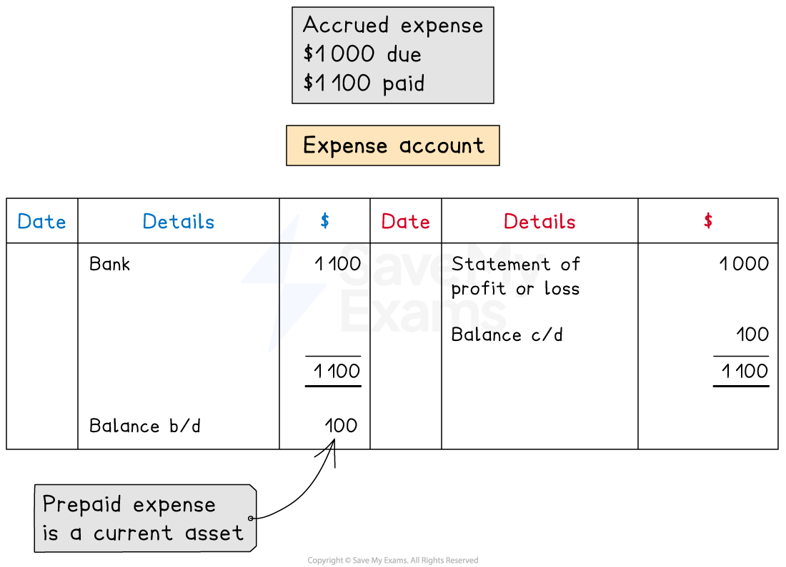

# Accrued & Prepaid Expenses

## Accrued expenses

> **Spec point** — `spcpt_TrDspJRRJQk8RBpx`

## Accrued expenses

### What is an accrued expense?

- An **accrued expense** is an expense that is **still owed** at the **end of a financial period**

  - This is also called an **accrual**
  - The expense is **in arrears**
- Accrued expenses can occur at the end of a financial period when a** business pays less than the amount due** in that period

  - This usually happens when the **invoice period** of an expense **does not align** with the **financial period** of the business
  - The business might** pay at the end of the invoice period**
  
    - However, this might be **after the end of current financial period**
- An accrued expense is a **liability** to the business

  - The business **owes money**

### How do I record accrued expenses?

- The **expense account** will have a **credit balance** if there is an **accrual** at the end of the financial period

  - This indicates that it is a** liability,** as the business still owes money for that period
- The **full amount that is due** for the period is stated on the **statement of profit or loss**
- The **amount that is accrued** appears on the **statement of financial position** as a **current liability**

  - It is included in the amount for **other payables**

*Example of an expense account with an accrual*

## Prepaid expenses

> **Spec point** — `spcpt_9MqCBCvxXyVjVP6y`

## Prepaid expenses

### What is a prepaid expense?

- A **prepaid expense** is an expense for the **next financial period** that is **paid in advance** during the current financial period

  - This is also called a **prepayment**
- Prepaid expenses can occur at the end of a financial period when a** business pays more than the amount due** in that period

  - This commonly happens when the **invoice period** of an expense **does not align** with the **financial period** of the business
  - The business might** **pay an expense** in full as soon as they receive an invoice **
  
    - However, this invoice might also cover part of the **next financial period**
- A prepaid expense is an **asset** to the business

  - The business has paid too much to the supplier for that period
  - Technically, the **business is owed money** by the supplier

### How do I record prepaid expenses?

- The **expense account** will have a **debit balance** if there is a **prepayment** at the end of the financial period

  - This indicates that it is an** asset,** as the business has already made payments that relate to the next financial period
- The **full amount that is due** **for the period** is stated on the **statement of profit or loss**
- The **amount that is prepaid** appears on the **statement of financial position** as a **current asset**

  - It is included in the amount for **other receivables**

*Example of an expense account with a prepayment*
