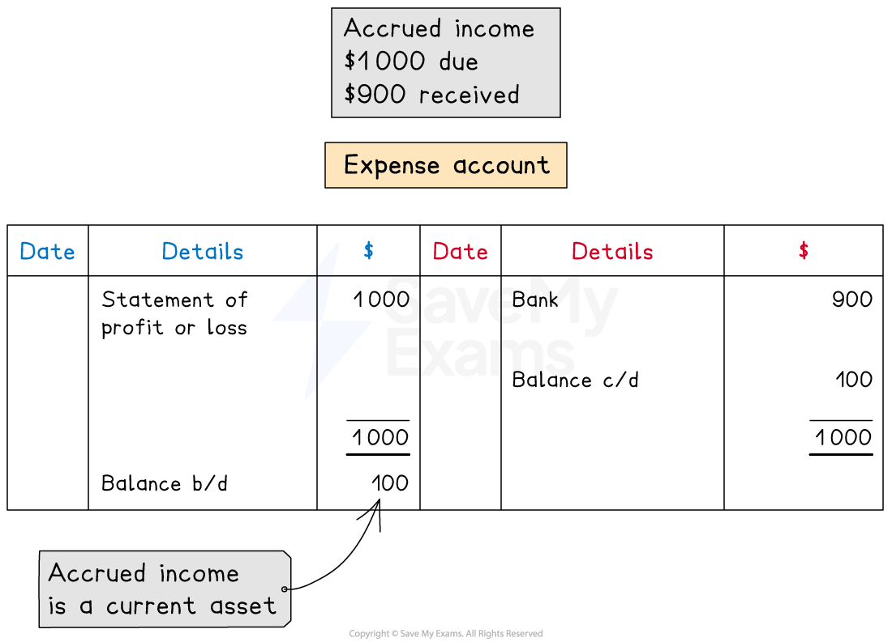
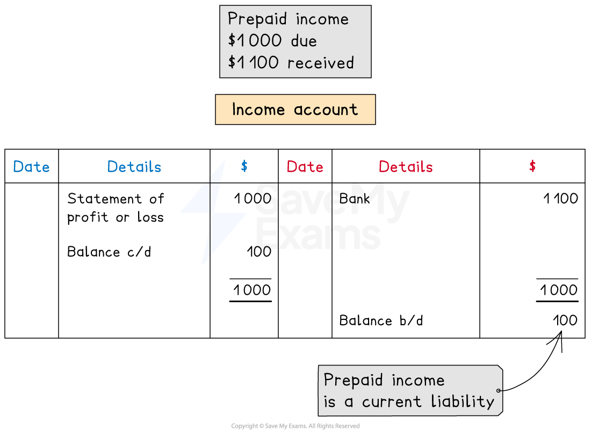

# Accrued & Prepaid Incomes

## Accrued income

> **Spec point** — `spcpt_pRRf8ynSnp2cWxBW`

## Accrued income

### What is an accrued income?

- An **accrued income** is an income that is **still owed** to the business at the **end of a financial period**

  - This is also called an **accrual**
  - The income is **in arrears**
- Accrued income can occur at the end of a financial period when a** business receives less than the amount due** in that period

  - This commonly happens when the **invoice period** of an income **does not align** with the **financial period** of the business
  - The business might** receive payment at the end of the invoice period**
  
    - However, this might be **after the end of the current financial period**
- An accrued income is an **asset** to the business

  - The business is **owed money **by its customers

### How do I record accrued income?

- The **income account** will have a **debit balance** if there is an **accrual** at the end of the financial period

  - This indicates that it is an** asset,** as the business is still owed money from customers for that period
- The **full amount that is due** for the period is stated on the **statement of profit or loss**
- The **amount that is accrued** appears on the **statement of financial position** as a **current asset**

  - It is included in the amount for **other receivables**

*Example of an income account with an accrual*

## Prepaid income

> **Spec point** — `spcpt_BXmzrnVCy7CDSyDC`

## Prepaid income

### What is a prepaid income?

- A **prepaid income** is an income for the next financial period that is **received in advance** during the current **end of a financial period **

  - This is also called a **prepayment**
- Prepaid income can occur at the end of a financial period when a** business receives more than the amount due** in that period

  - This commonly happens when the **invoice period** of an income **does not align** with the **financial period** of the business
  - The business might** receive payment in full as soon as they issue an invoice**
  
    - However, this invoice might also cover part of the next** financial period**
- A prepaid income is a **liability** to the business

  - The business has received too much from the customer for that period
  - Technically, the **business owes that money** to the customer for that period

### How do I record prepaid income?

- The **income account** will have a **credit balance** if there is a **prepayment** at the end of the financial period

  - This indicates that it is a** liability**
- The **full amount that is due** for the period is stated on the **statement of profit or loss**
- The **amount that is prepaid** appears on the **statement of financial position** as a **current liability**

  - It is included in the amount for **other payables**

*Example of an income account with an accrual*
