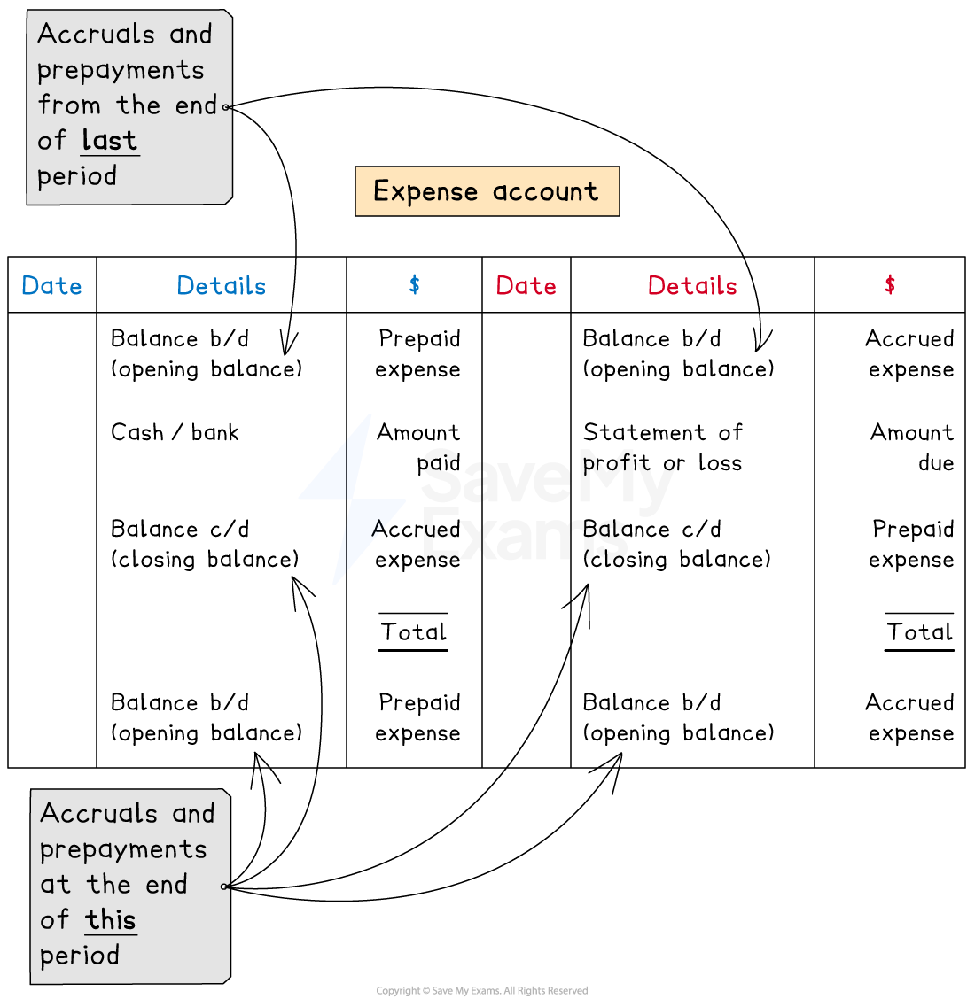

# Expense Accounts with Accruals & Prepayments

## Expense accounts with accruals & prepayments

> **Spec point** — `spcpt_SS4YCfWfntbCTTXM`

## Expense accounts with accruals & prepayments

### How do I complete an expense account?

- Put the **opening balance** on the correct side

  - **Credit **side if the amount is an **accrual**
  - **Debit **side if the amount is a **prepayment**
- Put the **amount paid** on the **debit **side

  - Label this as **cash **or **bank**
- Put the **amount due** on the **credit** side

  - Label this as **statement of profit or loss**
- Put the **closing balance** on the correct side

  - **Debit **side if the amount is an **accrual**
  - **Credit **side if the amount is a **prepayment**

*Layout of an expense account showing the entries on each side for accruals and prepayments*

> **Exam Hint**
> Students sometimes get confused about where to put the closing balances. A good way to make sure that you put them on the correct side, is to also include the opening balances for the following year. Then the closing balances will be on the opposite side.

### How do I calculate a missing value in an expense account?

- You can use a **ledger account** to find any missing value

  - Fill in the **amounts** that you know on the **correct sides**
  - Find the **missing value** which** balances** the account
- You can use this method to find

  - the **amount paid**
  - the** amount to transfer** to the statement of profit or loss
  - the **amount accrued or prepaid** at the end of the year

> **Exam Hint**
> You might be asked to complete an expense account which deals with two expenses together. You would complete this using the same method. You can combine the balances if they appear on the same side. If you combine them, it is good practice to show both values separately and the combined total. You can combine the entries for the statement of profit or loss in a similar way as shown in the following worked example.

> **Worked Example**
> Yuzra combines rent and rates into one single ledger account.
> 
> On 1 January 2023
> 
> - \$500 was owed for rent
> - \$800 was owed for rates
> 
> On 1 January 2024
> 
> - \$400 was owed for rent
> - \$200 was prepaid for rates
> 
> During the year (2023)
> 
> - \$4 900 was paid for rent by cheque
> - \$2 300 was paid for rates by cheque
> 
> Prepare the rent and rates account in the ledger for Yuzra for the financial year ended 31 December 2023. Balance the account and bring down the balances on 1 January 2024. Clearly show the amount that is transferred to the statement of profit or loss.
> 
> **Answer**:
> 
> Identify which side each amount needs to be posted to:
> 
> - On 1 January 2023, both amounts were owed by Yuzra
> 
>   - Therefore they represent liabilities
>   - The opening balances will appear on the credit side
> - On 1 January 2024, Yuzra owed rent
> 
>   - The opening balance for January 2024 will be on the credit side
>   - Therefore the closing balance for December 2023 will be on the debit side
> - On 1 January 2024, Yuzra had prepaid rates which represents an asset
> 
>   - The opening balance for January 2024 will be on the debit side
>   - Therefore the closing balance for December 2023 will be on the credit side
> 
> Deal with the payments during the year:
> 
> - The payments for rent and rates will be on the debit side
> 
>   - Because they would appear on the credit side in the cash book
> 
> Calculate the amount that should be transferred to the statement of profit or loss for rent and rates
> 
> You can either do this by
> 
> - balancing the account for rent and rates separately
> - or calculating how much should have been paid for the financial year
> 
> Here are the calculations to find the amounts due:
> 
> - Rent: \$4 900 (amount paid)
> 
>   - - \$500 (amount owed from last year)
>   - + \$400 (amount owed at end of this year)
>   - = \$4 800
> - Rates: \$2 300 (amount paid)
> 
>   - - \$800 (amount owed from last year)
>   - - \$200 (amount prepaid for next year)
>   - = \$1 300
> 
> **Final answer:** **Yuzra**
> **Rent and Rates Account**
> 
> | **Final answer:** **Date** | **Final answer:** **Details** | **Final answer:** **\$** | **Final answer:** **Date** | **Final answer:** **Details** | **Final answer:** **\$** |
> |---|---|---|---|---|---|
> | **Final answer:** **2023**  **Final answer:** **Dec 31** | **Final answer:** **Bank**  **Final answer:** **   Rent 4 900**  **Final answer:** **   Rate 2 300** | **7 200** | **Final answer:** **2023**  **Final answer:** **Jan 1** | **Final answer:** **Balance b/d**  **Final answer:** **   Rent 500**  **Final answer:** **   Rates 800** | **Final answer:** **1 300** |
> | **Final answer:** **Dec 31** | **Final answer:** **Balance c/d (rent)** | **Final answer:** **400** | **Final answer:** **Dec 31** | **Final answer:** **Statement of profit or loss**  **Final answer:** **   Rent 4 800**  **Final answer:** **   Rates 1 300    ** | **6 100** |
> |   |   | <u>            </u> | **Final answer:** **Dec 31** | **Final answer:** **Balance c/d (rates)** | **Final answer:** **200** |
> |   |   | **Final answer:** **7 600** |   |   | **Final answer:** **7 600** |
> | **Final answer:** **2024**  **Final answer:** **Jan 1** | **Final answer:** **Balance b/d (rates)** | **Final answer:** **200** | **Final answer:** **2024**  **Final answer:** **Jan 1** | **Final answer:** **Balance b/d (rent)** | **Final answer:** **400** |
