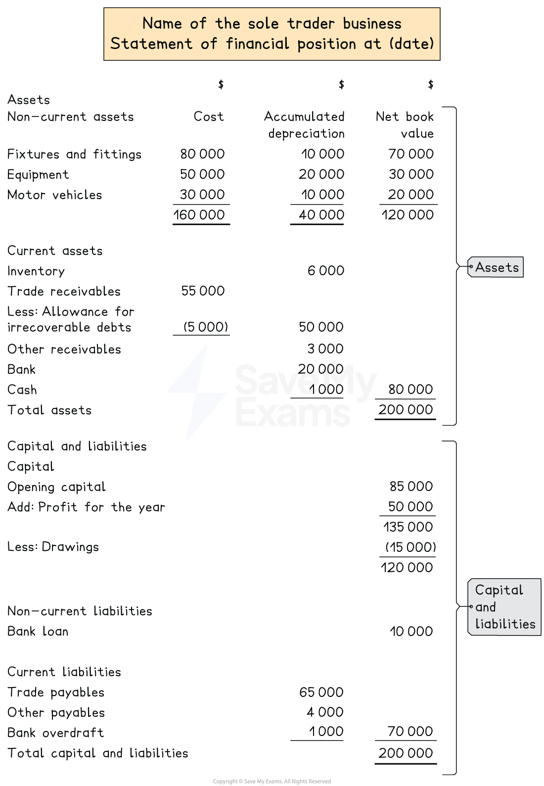
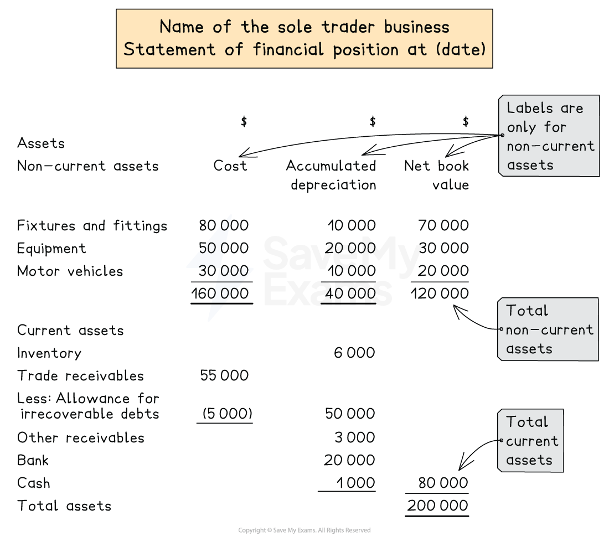
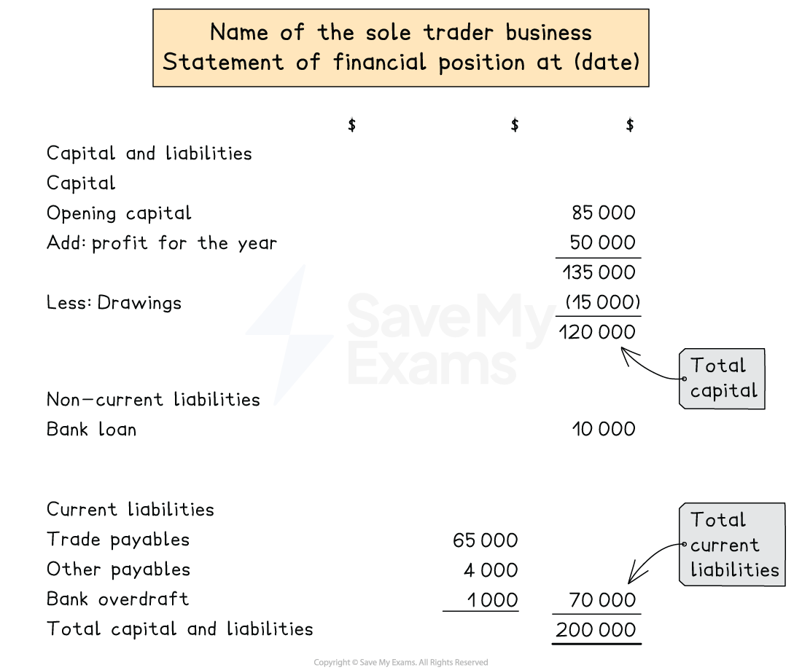

# Statement of Financial Position

## Statements of financial position for sole traders

> **Spec point** — `spcpt_Z9vV4zXCXzZpB7YC` · how to prepare a statement of profit or loss and statement of financial position for a sole trader from full or incomplete accounting records. The business may be a trading or a service business

## Statements of financial position for sole traders

### What is the statement of financial position?

- The **statement of financial position** is one of the financial statements of a sole trader business
- It shows the position of the business in terms of its ***assets***, ***liabilities*** and ***capital**** *at a **particular date  **

  - It provides a **snapshot** of the business on a particular date
- The statement of financial position is split into **two halves**

  - The **assets **are listed in the first half
  - The **capital **and **liabilities **are listed in the second half
  - The **totals **for each half will be **equal**
- The statement of financial position is prepared in **exactly the same way** for a trading and a service business
- The **figures **used to prepare the statement of financial position will be taken from the **trial balance** or **list of balances**

  - Additional information will be given after the trial balance
  - This is where the valuation of the closing inventory is given
- The statement of the financial position is prepared after the** statement of profit or loss**

  - The profit or loss for the year will increase or decrease the capital
- The statement of financial position is **not part of the double entry system**

  - The balances of the accounts are stated on the statement
  - They are not transferred to the statement

*Layout of a statement of financial position*

> **Exam Hint**
> On a trial balance, both bank and bank overdraft will be listed as "bank". If it is a debit balance, then there is money in the bank, and it is an asset. If it is a credit balance, then money is owed to the bank (it is a bank overdraft), and it is a liability.

### What is the layout for the assets section?

- The ***non-current assets*** are listed **first**

  - Any **intangible **non-current assets are listed first
  
    - These are the non-current assets that **do not have a physical form** but still add value to the business
    - Such as intellectual property, goodwill and brand names
  - Followed by **tangible** non-current assets
  
    - These are the non-current assets that **have a physical form** and are obtained to help the business generate profit rather than for resale
    - Such as equipment, machinery, motor vehicles, land and buildings etc
- **Three values** are stated for each non-current asset in separate columns in the following order:

  - **Cost**
  - **Accumulated depreciation**
  - **Net book value**
- The **total **for each column is calculated

  - The total for the net book value column is the total value for the non-current assets
- The ***current assets*** are listed after the non-current assets
- The values for the current assets are listed in the middle column

  - If there is an **allowance for irrecoverable debts** then the far left column is used to **subtract **its balance **from the trade receivables**
  - The total is put in the far right column
- The **total assets value** is found by adding the total non-current assets and the total current assets
- It is conventional to list the assets within each section in **order of their *****liquidity***

  - Starting with the least liquid assets

*Layout of the assets section of the statement of financial position*

> **Exam Hint**
> For the inventory value, make sure you use the value of the closing inventory. A service business might not have inventory. For example, a taxi driver will not have any inventory.

### How do I complete the capital and liabilities section?

- **Firstly**, calculate the **capital **in the far right column

  - Start with the opening capital from the beginning of the financial year
  - Add (or subtract) the profit (or loss) for the year
  - Subtract any drawings
  - This gives the capital at that date
- **Secondly**, list the ***non-current liabilities***

  - If there is just one item then put it in the far right column
  - Otherwise, list them in the middle column and put the total in the far right column
- **Thirdly**, list the ***current liabilities***

  - List them in the middle column and put the total in the far right column
- **Finally**, calculate the **total capital and liabilities** by adding together:

  - The capital
  - The total non-current liabilities
  - The total current liabilities

*Layout of the capital and liabilities section of the statement of financial position*

> **Exam Hint**
> If you are given the information in a trial balance, identify the items that would appear on the statement of financial position.  You might find it helpful to annotate with *SoFP *to differentiate from those which would appear on the statement of profit or loss.

> **Worked Example**
> The following trial balance has been extracted by the book-keeper of Bilal Aba at 31 December 2023.
> 
> | ** ** | **Debit**  **\$** | **Credit**  **\$** |
> |---|---|---|
> | Trade receivables | 73 217 |   |
> | Trade payables |   | 19 745 |
> | Capital at 1 January 2023 |   | 58 466 |
> | Bank |   | 550 |
> | Cash | 400 |   |
> | Bank loan |   | 10 000 |
> | Loan interest | 500 |   |
> | Rent and rates | 4 862 |   |
> | Salaries | 33 872 |   |
> | Machinery | 8 000 |   |
> | Drawings | 12 715 |   |
> | Purchases | 141 195 |   |
> | Revenue (Sales) |   | 205 471 |
> | Inventory at 1 January 2023 | <u>19 471 </u> | <u>                     </u> |
> |   | <u>294 232</u> | <u>294 232 </u> |
> 
> **Additional information: **
> 
> - Inventory at 31 December 2023 is valued at  \$4 060
> - The machinery was purchased during the year and the depreciation charge is \$600
> - The profit for the year, after including depreciation, is \$9 031
> 
> Prepare a statement of financial position for Bilal Aba at 31 December 2023.
> 
> **Answer**:
> 
> - Identify which items appear on the statement of financial position by labelling them as *SoFP*
> - Add extra rows for
> 
>   - the closing inventory
>   - provision for depreciation
>   - and profit for the year
> 
> | ** ** | **Debit**  **\$** | **Credit**  **\$** | **Statement of financial position?** |
> |---|---|---|---|
> | Trade receivables | 73 217 |   | *SoFP* |
> | Trade payables |   | 19 745 | *SoFP* |
> | Capital at 1 January 2023 |   | 58 466 | *SoFP* |
> | Bank |   | 550 | *SoFP* |
> | Cash | 400 |   | *SoFP* |
> | 5 year loan |   | 10 000 | *SoFP* |
> | Loan interest | 500 |   |   |
> | Rent and rates | 4 862 |   |   |
> | Salaries | 33 872 |   |   |
> | Machinery | 8 000 |   | *SoFP* |
> | Drawings | 12 715 |   | *SoFP* |
> | Purchases | 141 195 |   |   |
> | Revenue (Sales) |   | 205 471 |   |
> | Inventory at 1 January 2023 | <u>19 471 </u> | <u>                     </u> |   |
> |   | <u>294 232</u> | <u>294 232 </u> |   |
> | *Inventory at 31 December 2023* | *4 060* |   | *SoFP* |
> | *Provision for depreciation of machinery* |   | *600* | *SoFP* |
> | *Profit for the year* |   | *9 031* | *SoFP* |
> 
> Complete the statement of financial position.
> 
> - **Assets**
> 
>   - Non-current assets
>   - Current assets
> - **Capital and liabilities**
> 
>   - Capital
>   - Non-current liabilities
>   - Current liabilities
> 
> Note that the bank has a credit balance so this means it is overdrawn
> 
> | **Final answer:** **Bilal Aba**  **Final answer:** **Statement of Financial Position at 31 December 2023 ** |   |   |   |
> |---|---|---|---|
> |   | **Final answer:** **\$** | **Final answer:** **\$** | **Final answer:** **\$** |
> | **Final answer:** **Assets** |   |   |   |
> | **Final answer:** **Non-current assets** | **Final answer:** **Cost** | **Final answer:** **Accumulated depreciation** | **Final answer:** **Net book value** |
> | **Final answer:** **Machinery** | **Final answer:** **8 000** | **Final answer:** **600** | **Final answer:** **7 400** |
> | **Final answer:** **Current assets** |   |   |   |
> | **Final answer:** **Inventory** |   | **Final answer:** **4 060** |   |
> | **Final answer:** **Trade receivables** |   | **Final answer:** **73 217** |   |
> | **Final answer:** **Cash** |   | **Final answer:** **400** | **Final answer:** **77 677** |
> | **Final answer:** **Total assets** |   |   | **Final answer:** **85 077** |
> |   |   |   |   |
> | **Final answer:** **Capital and liabilities** |   |   |   |
> | **Final answer:** **Capital** |   |   |   |
> | **Final answer:** **Opening capital** |   |   | **Final answer:** **58 466 ** |
> | **Final answer:** **Profit for the year** |   |   | **Final answer:** **9 031** |
> |   |   |   | **Final answer:** **67 497** |
> | **Final answer:** **Less: Drawings** |   |   | **Final answer:** **(12 715)** |
> |   |   |   | **Final answer:** **54 782** |
> | **Final answer:** **Non-current liabilities** |   |   |   |
> | **Final answer:** **Loan** |   |   | **Final answer:** **10 000** |
> | **Final answer:** **Current liabilities** |   |   |   |
> | **Final answer:** **Trade payables** |   | **Final answer:** **19 745** |   |
> | **Final answer:** **Bank overdraft** |   | **Final answer:** **550** | **Final answer:** **20 295** |
> | **Final answer:** **Total capital and liabilities** |   |   | **Final answer:** **85 077** |
