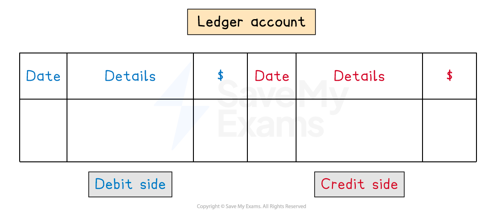
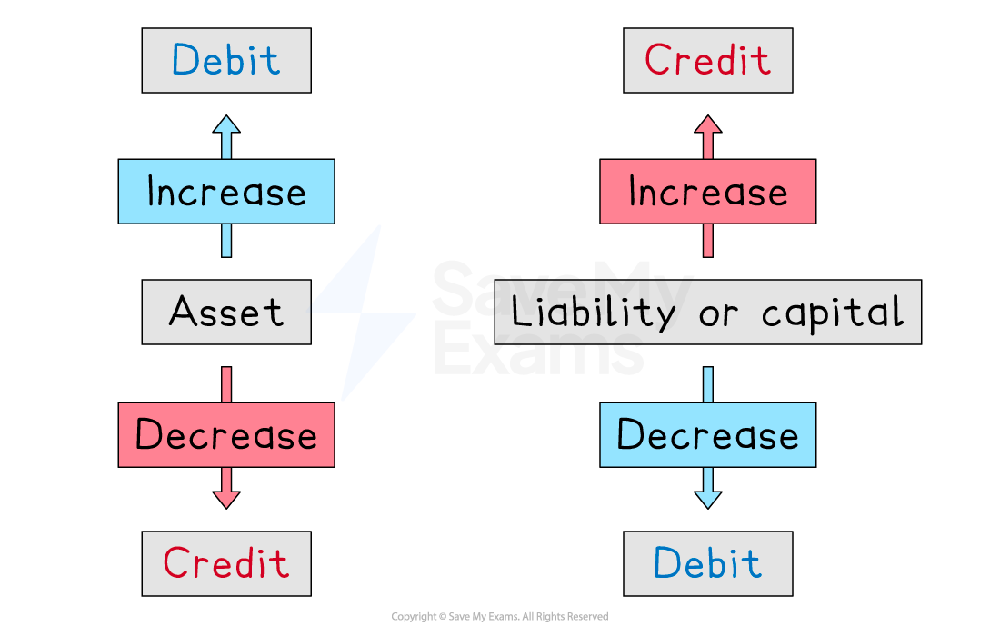
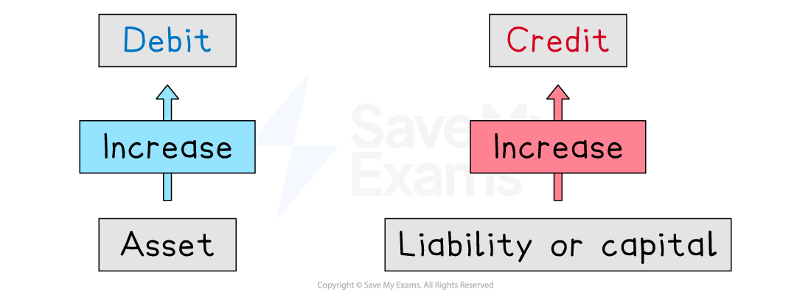
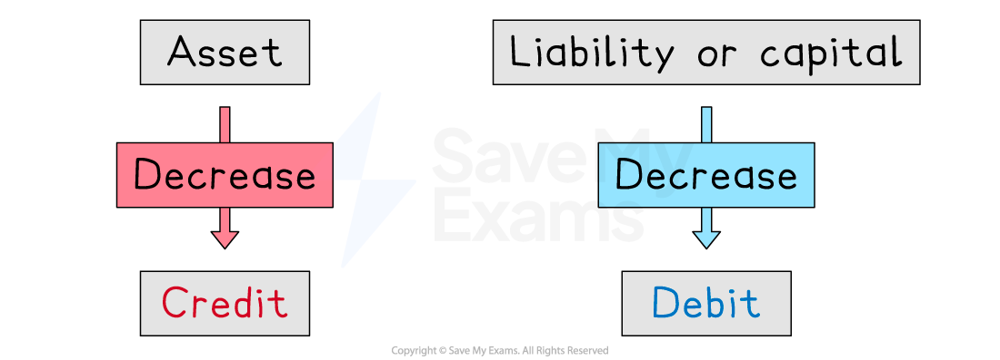
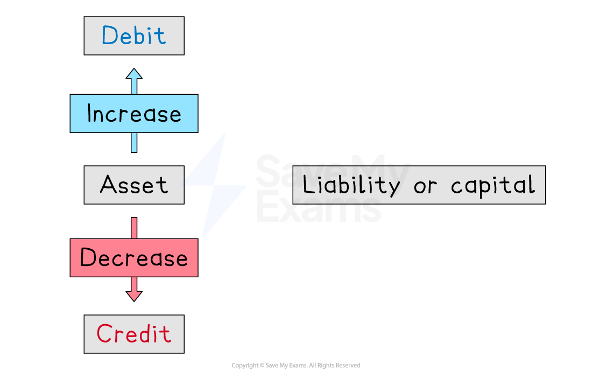
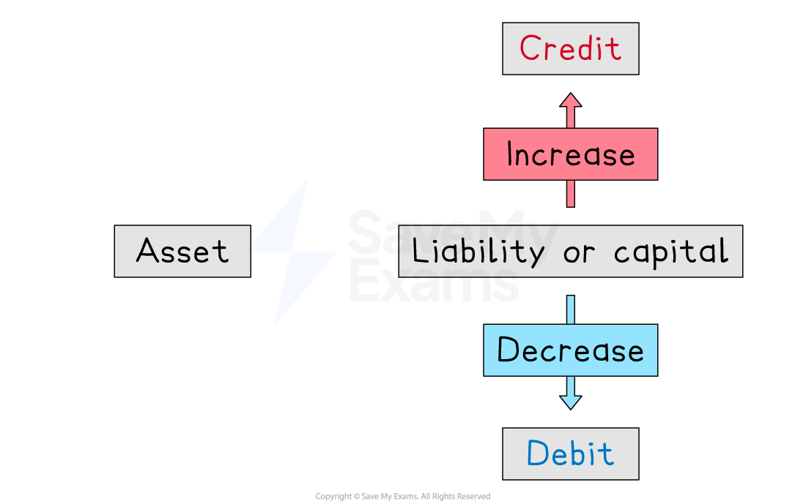

# The Double Entry System

## The double entry system

> **Spec point** — `spcpt_2mwdybdPxKGqK68k` · the principles of the double entry system to record business transactions

## The double entry system

### What is the double entry system?

- The **double entry system** is used by book-keepers

  - The double entry system is used to **improve the accuracy** of **financial statements**
- The double entry system is closely linked to the **accounting equation**

  - **Assets = Liabilities + Capital**
- The equation is **always balanced**
- Each **transaction** causes **both sides** of the equation to:

  - **increase**
  - or** decrease**
  - or** remain the same**
- Each **transaction** is entered into **two accounts**

  - One is called a **debit entry**
  - One is called a **credit entry**

### What is the layout of a ledger account?

- Each account will be split into** two sides**

  - The** debit** entries appear on the** left**
  
    - This side is sometimes labelled as **Dr**
  - The** credit** entries appear on the **right**
  
    - This side is sometimes labelled as **Cr**
- When you make an entry you need to **include**:

  - The **date** of the transaction
  - The **details** of the transaction
  
    - This is normally the name of the other account involved
  - The **value** of the transaction
- These accounts are sometimes referred to as **T accounts**

*Example of a ledger account*

## Debits & credits

> **Spec point** — `spcpt_CDQBWX2rX5p9mcrR` · the principles of the double entry system to record business transactions

## Debits & credits

### What is a debit entry?

- A **debit** entry is used to:

  - **increase** the value of an** asset**
  
    - The **left-hand side** of the accounting equation **increases**
  - **decrease** the value of a** liability **or the** capital**
  
    - The **right-hand side** of the accounting equation **decreases**

### What is a credit entry?

- A **credit **entry is used to:

  - **increase** the value of a **liability **or the** capital**
  
    - The **right-hand side** of the accounting equation **increases**
  - **decrease** the value of an **asset**
  
    - The **left-hand side** of the accounting equation **decreases**

*Debit and credit entries achieve specific purposes depending on the type of account*

### Which accounts should I debit?

- Debit** **an** asset account** when its value is **increasing**

  - You receive cash
  
    - Debit the cash account
  - A customer buys goods on credit
  
    - Debit their trade receivables account
- Debit a** liability account** when its value is **decreasing**

  - You make a repayment on a bank loan
  
    - Debit the bank loan account
  - You pay an invoice to a credit supplier
  
    - Debit their trade payables account
- Debit other accounts when the transaction **decreases **the **capital**

  - You take assets from the business for personal use
  
    - Debit the drawings account
  - You pay an expense which decreases the profit
  
    - Debit the relevant expense account
    - Such as purchases, rent paid, discount allowed, etc

### Which accounts should I credit?

- Credit a **liability** **account** when its value is **increasing**

  - You take out a bank loan
  
    - Credit the bank loan account
  - You buy goods on credit from a supplier
  
    - Credit their trade payables account
- Credit an **asset account** when its value is **decreasing**

  - You pay rent by bank transfer
  
    - Credit the bank account
  - A credit customer pays their invoice
  
    - Credit their trade receivables account
- Credit other accounts when the transaction **increases **the **capital**

  - You put more personal assets (such as money) into the business
  
    - Credit the capital account
  - You receive income which increases the profit
  
    - Credit the relevant income account
    - Such as sales, rent received, discount received, etc

### How do I enter the transactions into the accounts using the double-entry system?

- **STEP 1**
Identify the **accounts **involved in the transaction

  - One is usually cash, bank, trade receivables or trade payables
- **STEP 2**
Identify whether each account affects the **assets**, **liabilities **or** capital**

  - Usually this is cash, trade receivables or trade payables
- **STEP 3**
Determine whether the value of each account is** increasing** or **decreasing**
- **STEP 4**
**Debit **or **credit **the account

  - **Debit **the account if:
  
    - It is an **asset** account and its value is **increasing**
    - It is a **liability** or the **capital **account and its value is **decreasing**
  - **Credit** the account if:
  
    - It is an **asset** account and its value is **decreasing**
    - It is a **liability** or the **capital **account and its value is **increasing**

#### Examples where assets increase and liabilities or capital increase

| Transaction | Debit Asset that is increasing | Credit Liability or capital that is increasing |
|---|---|---|
| Credit sale to a customer | **Trade receivables**  - The business is owed more money by the customer | **Sales**  - Sales increase profit - Increasing profit increases capital |
| The business takes out a bank loan | **Bank**  - The business owns more money in the bank | **Bank loan**  - The business owes more money due to the bank loan |
| The business receives money for rent from a tenant | **Bank**  - The business owns more money in the bank | **Rent received**  - Income increases profit - Increasing profit increases capital |
| The owner deposits some of their personal money into the business bank account | **Bank**  - The business owns more money in the bank | **Capital**  - The business has more capital |

#### Examples where assets decrease and liabilities or capital decrease

| Transaction | Debit Capital or liability that is decreasing | Credit Asset that is increasing |
|---|---|---|
| The owner takes money out of the business bank account for personal use | **Drawings**  - The owner takes money from the bank as drawings - Taking drawings reduces the capital | **Bank**  - The business owns less money in the bank |
| The business pays cash for an electricity bill | **Electricity**  - Expenses decrease profit - Decreasing profit decreases capital | **Cash**  - The business owns less cash in hand |
| The business makes a cash payment to a credit supplier | **Trade payables**  - The business owes less money to the supplier | **Cash**  - The business owns less cash in hand |

#### Examples where assets increase and decrease

| Transaction | Debit Asset that is increasing | Credit Asset that is decreasing |
|---|---|---|
| The business receives a cash payment from a credit customer | **Cash**  - The business owns more cash in hand | **Trade receivables**  - The business is owed less money by the customer |
| The business withdraws cash from the business bank account | **Cash**  - The business owns more cash in hand | **Bank**  - The business owns less money in the bank |
| The business deposits cash into the business bank account | **Bank**  - The business owns more money in the bank | **Cash**  - The business owns less cash in hand |

#### Examples where liabilities or capital increase and decrease

| Transaction | Debit Capital or liability that is decreasing | Credit Liability or capital that is increasing |
|---|---|---|
| The business purchases goods on credit from a supplier | **Purchases**  - Purchases decrease profit - Decreasing profit decreases capital | **Trade payables**  - The business owes more money to the supplier |

> **Worked Example**
> Hina is a sole trader.
> 
> Complete the table below to show the accounts that Hina should debit and credit for each of the following transactions.
> 
> | **Transaction** | **Account to be debited** | **Account to be credited** |
> |---|---|---|
> | Hina sells goods on credit to Priya |   |   |
> | Hina receives a cash payment from Priya |   |   |
> | Hina pays an electricity bill by cheque |   |   |
> | Hina buys goods on credit from Dida |   |   |
> | Hina repays some of a bank loan by bank transfer |   |   |
> | Hina takes ownership of a company vehicle for her own use |   |   |
> | Hina puts some of her own money into the business bank account |   |   |
> 
> **Answer**:
> 
> | **Transaction** | **Account to be debited** | **Account to be credited** |
> |---|---|---|
> | Hina sells goods on credit to Priya | **Final answer:** **Priya**  - Priya is a trade receivable (she owes money to Hina) - A trade receivable is an asset - Priya owes more money - The **assets **are **increasing** | **Final answer:** **Sales**  - Sales increasing profit - Increasing profit increases the capital - The **capital **is **increasing** |
> | Hina receives a cash payment from Priya | **Final answer:** **Cash**  - Hina receives cash - Cash is an asset - The **assets **are **increasing** | **Final answer:** **Priya**  - Priya is a trade receivable (she owes money to Hina) - A trade receivable is an asset - Priya owes less money - The **assets **are **decreasing** |
> | Hina pays an electricity bill by bank transfer | **Final answer:** **Electricity**  - Electricity is an expense - Expenses reduce the profit - Decreasing profit decreases capital - The **capital** is **decreasing** | **Final answer:** **Bank**  - The cheque pays money from the bank - The money is the bank is an asset - The **assets **are **decreasing** |
> | Hina buys goods on credit from Dida | **Final answer:** **Purchases**  - Purchases are an expense - Expenses reduce the profit - Decreasing profit decreases capital - The **capital** is **decreasing** | **Final answer:** **Dida**  - Dida is a trade payable (Hina owes money to her) - A trade payable is a liability - Dida is owed more money - The **liabilities **are **increasing** |
> | Hina repays some of a bank loan by bank transfer | **Final answer:** **Bank loan**  - The bank loan is a liability (Hina owes money) - The amount Hina owes is reduced - The **liabilities **are **decreasing** | **Final answer:** **Bank**  - Hina pays using money from the bank - The money is the bank is an asset - The **assets **are **decreasing** |
> | Hina takes ownership of a company vehicle for her own use | **Final answer:** **Drawings**  - Hina takes an asset from the business for personal use - This is a form of taking drawings - Drawings reduces the capital - The **capital **is **decreasing** | **Final answer:** **Vehicles**  - Hina's business owns fewer vehicles - Vehicles are assets - The **assets **are **decreasing** |
> | Hina puts some of her own money into the business bank account | **Final answer:** **Bank**  - Hina's business receives money in the bank - The money is the bank is an asset - The **assets **are **increasing** | **Final answer:** **Capital**  - Hina is introducing extra capital to the business - The **capital **is **increasing** |

> **Exam Hint**
> To remember which side of an account to record a transaction, you can use the acronym DEAD CLIC.
> 
> - The transaction is on the **d**ebit side for** e**xpense, **a**sset, and **d**rawings accounts if the account is increasing.
> - The transaction is on the **c**redit side for** l**iability,** i**ncome, and **c**apital accounts if the account is increasing.
> - If the account is decreasing then the transaction is recorded on the opposite side!
> 
> 
> 
> Another set of acronyms is:
> 
> - **DIADL**: **D**ebits **I**ncrease** A**ssets or **D**ecrease **L**iabilities
> - **CILDA**: **C**redits** I**ncrease **L**iabilities or **D**ecrease **A**ssets
> 
> However, try to remember the connection to the accounting equation.
